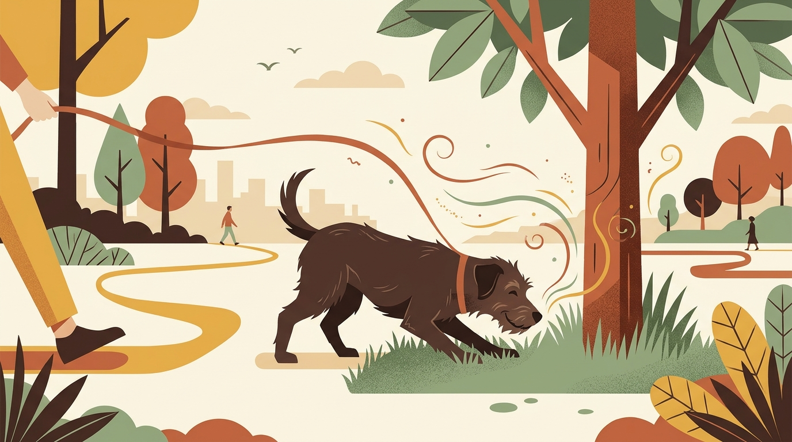

# **01\. Τι είναι το Sniffari και πώς η όσφρηση εμπλουτίζει τη βόλτα του σκύλου**

**Κατηγορία:** 01 - Η Φιλοσοφία Let It Sniff & Αστική Βόλτα  
**Προτεινόμενο URL:** /blog/ti-einai-to-sniffari-volta-skylou  
**Χρόνος ανάγνωσης:** 3 λεπτά

**Με μια ματιά (TL;DR)**

> * Το **Sniffari** (Sniff \+ Safari) είναι μια βόλτα αποσυμπίεσης όπου ο σκύλος επιλέγει τον ρυθμό και τα σημεία που θα μυρίσει.  
> * Η όσφρηση προσφέρει πληροφορίες και ευκαιρίες εξερεύνησης. Για πολλούς σκύλους είναι ευχάριστη νοητική απασχόληση.

&nbsp;

## **Γιατί συμβαίνει αυτό; (Η λογική πίσω από τη συμπεριφορά)**

Οι σκύλοι έχουν ιδιαίτερα ανεπτυγμένη όσφρηση. Με τη μύτη τους διερευνούν το περιβάλλον, εντοπίζουν τροφή και συλλέγουν πληροφορίες για άλλα ζώα. Δεν χρειάζεται να μετρήσουμε υποδοχείς ή ορμόνες για να σεβαστούμε αυτή την ανάγκη. Όταν βγαίνουμε βόλτα στα στενά της Αθήνας με μοναδικό στόχο να «γράψουμε χιλιόμετρα» περπατώντας γρήγορα, στερούμε από τον σκύλο τη βασική του ανάγκη: να συλλέξει πληροφορίες για το περιβάλλον του. Κάθε κολώνα, γωνία ή τοίχος είναι για εκείνον τα «νέα της γειτονιάς» — ποιος πέρασε, τι ώρα, αν ήταν ήρεμος ή αγχωμένος.  
Η εξερεύνηση με τη μύτη μπορεί να κάνει τη βόλτα πιο ενδιαφέρουσα και να προσφέρει επιλογές. Η ανταπόκριση διαφέρει: ορισμένες μυρωδιές αυξάνουν τη διέγερση. Παρατηρούμε τον σκύλο αντί να υποσχόμαστε συγκεκριμένη πτώση κορτιζόλης ή παλμών.

## **Πώς να το εφαρμόσετε στην πράξη (Βήμα-Βήμα)**

> 1. **Επιλέξτε τον κατάλληλο εξοπλισμό:** Χρησιμοποιήστε ένα άνετο σαμαράκι τύπου Υ και ένα λουρί τουλάχιστον 2 έως 3 μέτρων (ή 5 μέτρων σε πάρκο), ώστε ο σκύλος να έχει χώρο να κινηθεί χωρίς να νιώθει συνεχή τάση.  
> 2. **Αφήστε τον σκύλο να διαλέξει κατεύθυνση:** Εφόσον είναι ασφαλές (π.χ. σε έναν ήσυχο πεζόδρομο ή σε έναν λόφο όπως του Στρέφη ή του Φιλοπάππου), αφήστε τον να αποφασίσει αν θα στρίψει δεξιά ή αριστερά.  
> 3. **Δώστε χρόνο στην εξερεύνηση:** Περιμένετε όσο μυρίζει με άνετο σώμα και μπορεί να απομακρυνθεί. Αν κοκαλώσει, φοβηθεί ή πλησιάζει κίνδυνος, καθοδηγήστε τον ήρεμα σε ασφαλές σημείο.  
> 4. **Κρατήστε αργό ρυθμό:** Το Sniffari δεν έχει στόχο τη δική μας γυμναστική. Περπατήστε αργά και παρατηρήστε τη γλώσσα του σώματός του καθώς χαλαρώνει.

## **Τι να κάνετε & Τι να αποφύγετε**

> * **Ναι:** Δώστε στον σκύλο χρόνο να ολοκληρώσει το μύρισμα πριν του ζητήσετε να προχωρήσει.  
> * **Ναι:** Παρατηρήστε πώς πέφτει η ένταση στο σώμα του (χαλαρή ουρά, βαθιές εκπνοές) μετά από μερικά λεπτά.  
> * **Όχι:** Μην κάνετε απότομα τραβήγματα στο λουρί για να τον ξεκολλήσετε από μια μυρωδιά (εκτός αν υπάρχει κίνδυνος, π.χ. φαγώσιμο σκουπίδι).  
> * **Όχι:** Μην έχετε το κινητό στο χέρι σε όλη τη διαδρομή — η προσοχή σας χρειάζεται ώστε να προλαβαίνετε ερεθίσματα ή σκουπίδια στον δρόμο.

## **Μικρή Συμβουλή (Pro Tip)**

Αν έχετε λίγο χρόνο πριν τη δουλειά, δώστε μέρος της βόλτας σε ήρεμη όσφρηση. Αξιολογήστε αν ο σκύλος επιστρέφει πιο άνετος και προσαρμόστε τη διάρκεια στην ηλικία, την υγεία και τον καιρό.