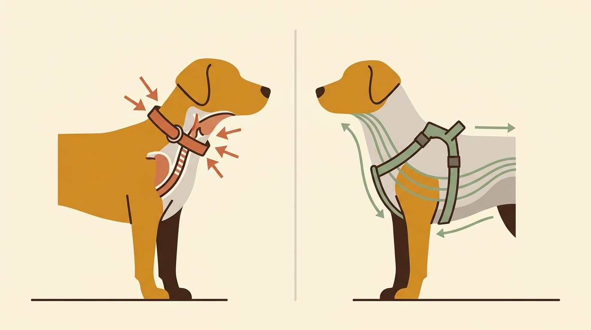

# **03\. Σαμαράκι (Επιστήθιο) ή Κολάρο; Τι είναι πραγματικά ασφαλές για τον λαιμό του σκύλου**

**Κατηγορία:** 01 - Η Φιλοσοφία Let It Sniff & Αστική Βόλτα  
**Προτεινόμενο URL:** /blog/samaraki-i-kolaro-ti-na-dialekso  
**Χρόνος ανάγνωσης:** 3 λεπτά

**Με μια ματιά (TL;DR)**

> * Ο λαιμός του σκύλου είναι εξαιρετικά ευαίσθητος: περιέχει την τραχεία, τον οισοφάγο, τον θυρεοειδή αδένα και βασικά αιμοφόρα αγγεία.  
> * Ακόμα και ο πιο εκπαιδευμένος σκύλος μπορεί να τρομάξει από ένα μηχανάκι ή μια γάτα και να τραβήξει απότομα, τραυματίζοντας τον λαιμό του αν φοράει κολάρο.  
> * Ένα καλά εφαρμοσμένο **σαμαράκι τύπου Υ** μπορεί να μειώσει την πίεση στον λαιμό. Το σχήμα μόνο του δεν εγγυάται ελεύθερη κίνηση ή προστασία από απόδραση.

## **Γιατί συμβαίνει αυτό; (Η λογική πίσω από τη συμπεριφορά)**

Υπάρχει ένας παλιός μύθος που λέει ότι «το σαμαράκι μαθαίνει τον σκύλο να τραβάει σαν έλκηθρο, ενώ με το κολάρο ελέγχεις το κεφάλι του». Στην πραγματικότητα, ένας σκύλος τραβάει επειδή δεν έχει μάθει ακόμα πώς να περπατάει με χαλαρό λουρί ή επειδή βρίσκεται σε υπερένταση — όχι εξαιτίας του σαμαρακιού.  
Η πίεση στον λαιμό μπορεί να προκαλέσει δυσφορία, ιδιαίτερα σε σκύλο που τραβάει ή έχει σχετική πάθηση. Ένα σωστά εφαρμοσμένο σαμαράκι απομακρύνει την έλξη από αυτή την περιοχή:

> * Ασκείται άμεση πίεση στην **τραχεία** (προκαλώντας βήχα ή δυσφορία).  
> * Δεν τεκμηριώνεται εδώ ότι η συνήθης χρήση κολάρου προκαλεί ορμονικές διαταραχές. Αποφεύγουμε τέτοιες γενικεύσεις και ζητάμε κτηνιατρική εκτίμηση για επίμονο βήχα ή πόνο.
> * Η πίεση από το κολάρο μπορεί να επηρεάσει την ενδοφθάλμια πίεση. Αν υπάρχει οφθαλμολογική ή αυχενική πάθηση, ο κτηνίατρος καθοδηγεί την επιλογή εξοπλισμού.

Όταν ο σκύλος νιώθει πόνο ή πνιγμό στον λαιμό κάθε φορά που βλέπει ένα άλλο σκυλί ή ένα ερέθισμα, συνδέει το ερέθισμα αυτό με δυσφορία — κάτι που συχνά γεννά ή επιδεινώνει την αντιδραστικότητα.

## **Πώς να επιλέξετε το σωστό σαμαράκι (Βήμα-Βήμα)**

> 1. **Αναζητήστε το σχήμα «Υ» στο στήθος:** Όταν κοιτάτε τον σκύλο από μπροστά, οι ιμάντες πρέπει να σχηματίζουν το γράμμα Υ, περνώντας ανάμεσα στα μπροστινά πόδια και κάτω από τον λαιμό (στο οστό του στέρνου).  
> 2. **Ελέγξτε την κίνηση, όχι μόνο την ετικέτα:** Παρατηρήστε το βάδισμα, τις τριβές και τη μετατόπιση των ιμάντων. Και ένα μοντέλο τύπου Υ μπορεί να μην ταιριάζει στον συγκεκριμένο σκύλο.
> 3. **Ελέγξτε την απόσταση από τις μασχάλες:** Ο πίσω ιμάντας που αγκαλιάζει τον θώρακα πρέπει να κάθεται τουλάχιστον 2–3 δάχτυλα πίσω από τις μασχάλες του σκύλου, ώστε να μην προκαλεί τριβή και ερεθισμούς.  
> 4. **Ελέγξτε τα σημεία σύνδεσης:** Ο μπροστινός κρίκος δεν είναι αυτόματη λύση για το τράβηγμα. Αποφύγετε συνεχή πλάγια έλξη και ζητήστε βοήθεια για τη ρύθμιση.

## **Τι να κάνετε & Τι να αποφύγετε**

> * **Ναι:** Χρησιμοποιήστε το κολάρο αποκλειστικά ως «βραχιόλι» για να κρεμάσετε την ταυτότητα με το τηλέφωνό σας.  
> * **Ναι:** Ρυθμίστε τους ιμάντες ώστε να χωράνε άνετα δύο δάχτυλα ανάμεσα στο σαμαράκι και το σώμα του σκύλου.  
> * **Όχι:** Μην χρησιμοποιείτε ποτέ πνίχτες, ημι-πνίχτες ή κολάρα με καρφιά — βασίζονται στον πόνο και τον φόβο.  
> * **Όχι:** Μην αγοράζετε σαμαράκι χωρίς να μετρήσετε πρώτα την περίμετρο του θώρακα και της βάσης του λαιμού του σκύλου σας.

## **Μικρή Συμβουλή (Pro Tip)**

Αν ο σκύλος σας δυσανασχετεί όταν του περνάτε το σαμαράκι από το κεφάλι, επιλέξτε ένα μοντέλο που διαθέτει κλιπ (κούμπωμα) και στον λαιμό, ώστε να φοριέται σαν γιλέκο χωρίς να περνάει πάνω από τα αυτιά του.
