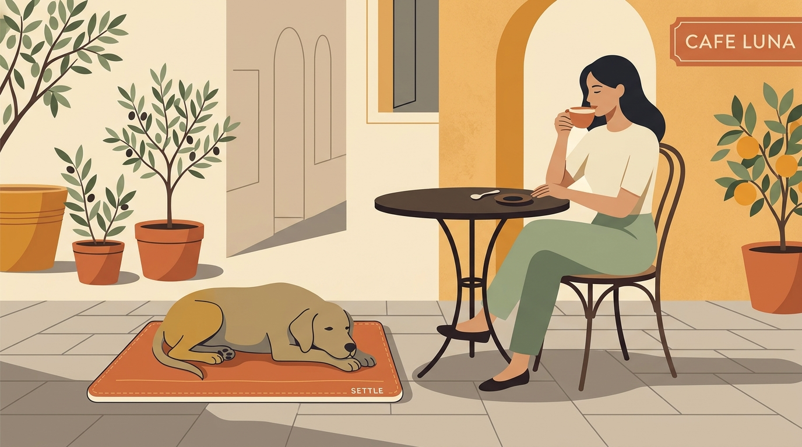

# **04\. Πώς να μάθετε στον σκύλο σας να κάθεται ήρεμος σε καφετέριες και εστιατόρια**

**Κατηγορία:** 01 - Η Φιλοσοφία Let It Sniff & Αστική Βόλτα  
**Προτεινόμενο URL:** /blog/skylos-se-kafeteria-estiatorio-iremia  
**Χρόνος ανάγνωσης:** 3 λεπτά

**Με μια ματιά (TL;DR)**

> * Για έναν σκύλο, το να κάθεται ακίνητος σε μια πολυσύχναστη καφετέρια ενώ γύρω του περνούν σερβιτόροι, φαγητά και άλλα σκυλιά είναι μια απαιτητική δεξιότητα.  
> * Η επιτυχία ξεκινάει **πριν** φτάσουμε στην καφετέρια: ένας σκύλος που έχει εκτονωθεί με μια ήρεμη βόλτα όσφρησης χαλαρώνει πολύ πιο εύκολα.  
> * Το **χαλάκι ηρεμίας (settle mat)** και ένα φυσικό μάσημα είναι τα δύο πιο δυνατά εργαλεία σας.

## **Γιατί συμβαίνει αυτό; (Η λογική πίσω από τη συμπεριφορά)**

Συχνά παίρνουμε τον σκύλο μας από το σπίτι, περπατάμε 5 λεπτά μέχρι το αγαπημένο μας καφέ στα Εξάρχεια, στο Παγκράτι ή στην Κυψέλη, καθόμαστε και περιμένουμε να ξαπλώσει ήσυχος για δύο ώρες. Για τον σκύλο, όμως, αυτό μεταφράζεται σε **βαρεμάρα και ματαίωση**.  
Έχει ενέργεια, βρίσκεται σε ένα περιβάλλον γεμάτο μυρωδιές και κίνηση, αλλά είναι δεμένος σε μια καρέκλα χωρίς να έχει τίποτα να κάνει. Έτσι αρχίζει να κλαψουρίζει, να γαβγίζει στους περαστικούς ή να τραβάει το τραπέζι. Η ηρεμία σε δημόσιο χώρο δεν είναι αυτονόητη· είναι μια συμπεριφορά που διδάσκεται σταδιακά.

## **Πώς να το εφαρμόσετε στην πράξη (Βήμα-Βήμα)**

> 1. **Εξασκηθείτε πρώτα στο σπίτι με ένα «χαλάκι ηρεμίας»:** Πάρτε μια μικρή, ελαφριά πετσέτα ή ένα ειδικό travel mat. Κάθε φορά που ο σκύλος πατάει ή ξαπλώνει πάνω του στο σαλόνι, αφήστε ήρεμα μια λιχουδιά ανάμεσα στα μπροστινά του πόδια. Σύντομα θα συνδέσει το χαλάκι με τη χαλάρωση.  
> 2. **Κάντε μια βόλτα αποσυμπίεσης πριν καθίσετε:** Πριν πάτε στην καφετέρια, αφιερώστε 20–30 λεπτά σε μια ήρεμη βόλτα με μύρισμα, ώστε ο σκύλος να έχει καλύψει τις ανάγκες του.  
> 3. **Διαλέξτε το σωστό τραπέζι:** Προτιμήστε ένα τραπέζι στη γωνία ή στην άκρη του εξωτερικού χώρου, και όχι δίπλα στην είσοδο ή στον διάδρομο όπου περνούν συνεχώς σερβιτόροι και περαστικοί.  
> 4. **Προσφέρετε γνώριμη απασχόληση μόνο αν ταιριάζει:** Ένα κατάλληλο γεμιστό παιχνίδι μπορεί να βοηθήσει υπό επίβλεψη. Αν ο σκύλος φυλάει φαγητό, μην προσφέρετε μασήματα ανάμεσα σε περαστικούς ή άλλα ζώα.

## **Τι να κάνετε & Τι να αποφύγετε**

> * **Ναι:** Επιβραβεύετε διακριτικά τον σκύλο (αφήνοντας μια λιχουδιά στο χαλάκι του) όταν είναι ξαπλωμένος και ήσυχος — μην περιμένετε να σηκωθεί για να του δώσετε σημασία.  
> * **Ναι:** Κρατήστε τις πρώτες επισκέψεις σύντομες (15–20 λεπτά, π.χ. όσο παίρνετε έναν καφέ) και αυξήστε τον χρόνο σταδιακά.  
> * **Όχι:** Μην δένετε το λουρί σε καρέκλα και μην βασίζεστε στο πάτημά του με το πόδι. Κρατήστε το με ασφάλεια, χωρίς να το τυλίγετε στο σώμα σας.
> * **Όχι:** Μην τον μαλώνετε αν σηκωθεί ή αν δυσκολεύεται να χαλαρώσει — είναι σημάδι ότι το περιβάλλον είναι ακόμα πολύ δύσκολο για εκείνον.

## **Μικρή Συμβουλή (Pro Tip)**

Τοποθετήστε το χαλάκι του σκύλου ανάμεσα σε εσάς και τον τοίχο (ή κάτω από το τραπέζι), ώστε το δικό σας σώμα να λειτουργεί ως «ασπίδα» απέναντι στα περαστικά σκυλιά και τους ανθρώπους.

## **Πότε φεύγουμε**

Αν λαχανιάζει χωρίς ζέστη, παγώνει ή προσπαθεί να απομακρυνθεί, η επίσκεψη τελειώνει. Δεν χρειάζεται κάθε σκύλος να απολαμβάνει την καφετέρια.
