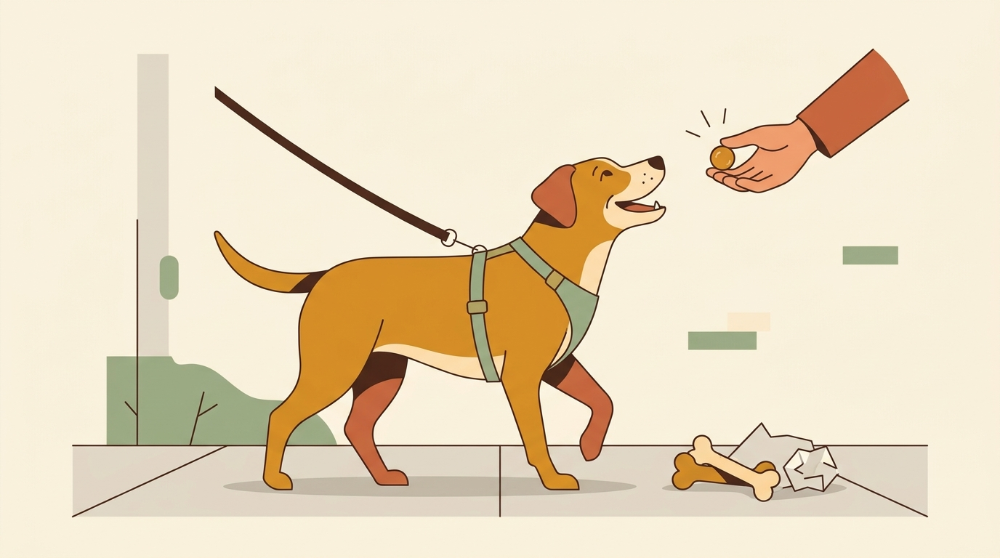

# **05\. Ο σκύλος μου τρώει σκουπίδια από τον δρόμο: Πώς να τον σταματήσετε χωρίς φωνές**

**Κατηγορία:** 01 - Η Φιλοσοφία Let It Sniff & Αστική Βόλτα  
**Προτεινόμενο URL:** /blog/skylos-troei-skoupidia-apo-ton-dromo  
**Χρόνος ανάγνωσης:** 3 λεπτά

**Με μια ματιά (TL;DR)**

> * Η αναζήτηση τροφής (scavenging) είναι ένα βαθιά ριζωμένο βιολογικό ένστικτο επιβίωσης σε όλους τους σκύλους.  
> * Όταν φωνάζουμε ή ανοίγουμε με το ζόρι το στόμα του σκύλου, εκείνος μαθαίνει να **καταπίνει τα ευρήματά του αμέσως** για να μην του τα πάρουμε.  
> * Η λύση βασίζεται στην πρόληψη στη βόλτα και στο παιχνίδι της **ανταλλαγής («Άστο»)** με κάτι πολύ πιο νόστιμο.

## **Γιατί συμβαίνει αυτό; (Η λογική πίσω από τη συμπεριφορά)**

Τα πεζοδρόμια της Αθήνας είναι συχνά γεμάτα «θησαυρούς» για τη μύτη ενός σκύλου: κόκαλα από σουβλάκια, ψωμιά, αποφάγια γύρω από κάδους ή φαγητό για αδέσποτες γάτες. Για τον σκύλο, αυτό δεν είναι «αταξία», αλλά μια απολύτως φυσιολογική συμπεριφορά.  
Το μεγαλύτερο λάθος που κάνουμε από τον (δικαιολογημένο) φόβο μας είναι να ορμάμε πάνω στον σκύλο φωνάζοντας «ΜΗ!» και να βάζουμε τα χέρια μας μέσα στο στόμα του. Τι καταλαβαίνει ο σκύλος; *«Ο άνθρωπός μου έρχεται να μου κλέψει τον θησαυρό! Την επόμενη φορά πρέπει να το καταπιώ αμάσητο πριν με προλάβει ή να γρυλίσω για να το προστατέψω»*.

## **Πώς να το εφαρμόσετε στην πράξη (Βήμα-Βήμα)**

> 1. **Μάθετε την «Ανταλλαγή» στο σπίτι:** Δώστε στον σκύλο ένα βαρετό παιχνίδι. Πλησιάστε, πείτε χαρούμενα «Άστο!» και παρουσιάστε μπροστά στη μύτη του μια κορυφαία λιχουδιά. Μόλις αφήσει το παιχνίδι για να φάει τη λιχουδιά, επιβραβεύστε τον και δώστε του ξανά το παιχνίδι.  
> 2. **Εξασκηθείτε στο «Προσπερνάω» στον δρόμο:** Όταν είστε στη βόλτα και δείτε από μακριά ένα σκουπίδι στο πεζοδρόμιο, πριν φτάσει ο σκύλος, καλέστε τον χαρούμενα κοντά σας και ρίξτε 2–3 νόστιμες λιχουδιές στο έδαφος από την αντίθετη πλευρά.  
> 3. **Αν πάρει κάτι στο στόμα:** Προσφέρετε ήρεμα μια γνωστή ανταλλαγή από ασφαλή απόσταση, χωρίς να σκύβετε πάνω του. Δεν είναι βέβαιο ότι θα αφήσει το αντικείμενο. Μην καθυστερήσετε κτηνιατρική επικοινωνία αν μπορεί να έχει καταπιεί κάτι επικίνδυνο.

## **Τι να κάνετε & Τι να αποφύγετε**

> * **Ναι:** Σκανάρετε το πεζοδρόμιο λίγα μέτρα μπροστά από τον σκύλο σας (ειδικά κοντά σε κάδους, παγκάκια και ψητοπωλεία).  
> * **Ναι:** Συζητήστε θετική εξοικείωση με κατάλληλο φίμωτρο για πρόληψη κατάποσης. Πολλά φίμωτρα καλαθιού επιτρέπουν να μαζεύει τροφή· χρειάζεται σωστό μοντέλο και άνετο λαχάνιασμα.
> * **Όχι:** Μην κυνηγάτε τον σκύλο αν έχει πάρει κάτι στο στόμα — για εκείνον το κυνήγι είναι παιχνίδι και θα τρέξει μακριά σας.  
> * **Όχι:** Μην βάζετε τυφλά τα δάχτυλα στο στόμα και μην προκαλείτε εμετό. Σε πιθανή δηλητηρίαση, αιχμηρό αντικείμενο ή πνιγμό επικοινωνήστε αμέσως με κτηνίατρο και ακολουθήστε τις οδηγίες του.

## **Μικρή Συμβουλή (Pro Tip)**

Στις βραδινές βόλτες σε σκοτεινούς δρόμους, ένας μικρός φακός που κουμπώνει πάνω στο λουρί ή στο σαμαράκι του σκύλου θα σας γλιτώσει από δεκάδες «αόρατα» κόκαλα στο πεζοδρόμιο!
