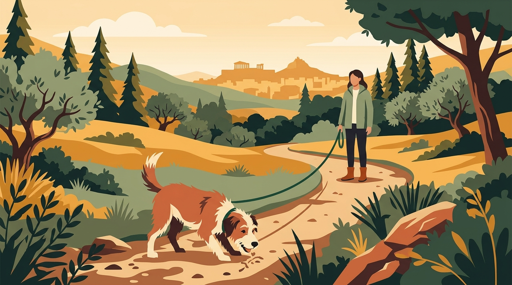

# **06\. Πάρκα και λόφοι στο κέντρο της Αθήνας για βόλτες αποσυμπίεσης**

**Κατηγορία:** 01 - Η Φιλοσοφία Let It Sniff & Αστική Βόλτα  
**Προτεινόμενο URL:** /blog/volta-me-skylo-kentro-athinas-parka  
**Χρόνος ανάγνωσης:** 3 λεπτά

**Με μια ματιά (TL;DR)**

> * Οι βόλτες στο τσιμέντο και στα στενά πεζοδρόμια κουράζουν αισθητηριακά τον σκύλο λόγω της έλλειψης χώρου και των συνεχών θορύβων.  
> * Ένας ήσυχος χώρος πρασίνου μπορεί να δώσει περισσότερες επιλογές και απόσταση. Δεν είναι αυτόματα ασφαλής ή χαλαρωτικός για κάθε σκύλο.
> * Κάθε πράσινο σημείο του κέντρου έχει τις δικές του ιδιαιτερότητες — η σωστή επιλογή ώρας και διαδρομής κάνει τη διαφορά.

## **Γιατί συμβαίνει αυτό; (Η λογική πίσω από τη συμπεριφορά)**

Σε ένα πυκνοκατοικημένο περιβάλλον όπως τα Εξάρχεια, η Κυψέλη, το Κουκάκι ή το Παγκράτι, ο σκύλος βρίσκεται διαρκώς σε «κατάσταση επαγρύπνησης». Σε ένα πεζοδρόμιο πλάτους ενός μέτρου, δεν έχει περιθώριο να πάρει απόσταση (να κάνει μια καμπύλη) αν δει έναν άλλον σκύλο ή έναν άνθρωπο που τον αγχώνει.  
Αντίθετα, σε έναν ανοιχτό χώρο πρασίνου, οι μυρωδιές της φύσης ενθαρρύνουν το **Sniffari**, το μαλακό έδαφος ξεκουράζει τις αρθρώσεις και η δυνατότητα απόστασης επιτρέπει στον σκύλο να παρατηρεί τον κόσμο με ασφάλεια, χωρίς να νιώθει εγκλωβισμένος.

## **Οδηγός Διαδρομών στο Κέντρο της Αθήνας**

1. **Πεδίον του Άρεως (Κυψέλη / Εξάρχεια / Γκύζη):**
   - Οι πιο ανοιχτές διαδρομές μπορούν να διευκολύνουν την τήρηση αποστάσεων.
   - Η κίνηση αλλάζει ανά ημέρα και εκδηλώσεις. Ελέγξτε την είσοδο και επιλέξτε διαδρομή με δυνατότητα αποχώρησης.
2. **Λόφος Στρέφη (Εξάρχεια):**
   - Το φυσικό ανάγλυφο προσφέρει ευκαιρίες εξερεύνησης, εφόσον ταιριάζει στην υγεία και την αντοχή του σκύλου.
   - Προσέξτε ανηφόρες, τυφλές στροφές, αδέσποτες γάτες και λυτούς σκύλους. Μαζέψτε έγκαιρα το διαθέσιμο μήκος του λουριού.
3. **Λόφος Φιλοπάππου / Πνύκα (Κουκάκι / Θησείο / Πετράλωνα):**
   - Υπάρχουν διαφορετικές διαδρομές, αλλά πρόσβαση, έδαφος και κίνηση χρειάζονται έλεγχο κάθε φορά.
   - Σεβαστείτε τη σήμανση και τυχόν περιορισμούς αρχαιολογικών χώρων. Δεν θεωρούμε κάθε παράπλευρο μονοπάτι προσβάσιμο.
4. **Λόφος Λυκαβηττού και Άλσος Παγκρατίου:**
   - Εξετάστε αν η συγκεκριμένη διαδρομή προσφέρει αρκετή σκιά, ορατότητα και χώρο.
   - Αποφύγετε απότομα ή συνωστισμένα τμήματα αν ο σκύλος δυσκολεύεται στην κίνηση ή στις κοντινές συναντήσεις.

## **Τι να κάνετε & Τι να αποφύγετε**

> * **Ναι:** Χρησιμοποιήστε μακρύ λουρί μόνο όπου επιτρέπεται και υπάρχει αρκετός ελεύθερος χώρος. Μαζέψτε το πριν από στροφές, περαστικούς και σκύλους.
> * **Ναι:** Έχετε πάντα μαζί σας νερό (ειδικά από την άνοιξη έως το φθινόπωρο) και σακούλες περισυλλογής.  
> * **Όχι:** Μην θεωρείτε την επαναφορά εγγύηση ασφάλειας ή εξαίρεση από τους τοπικούς κανόνες. Κρατήστε τον σκύλο δεμένο όπου απαιτείται και ελέγξτε τη σήμανση πρόσβασης.
> * **Όχι:** Μην επιτρέπετε στον σκύλο σας να τρέχει προς άλλα σκυλιά που είναι δεμένα με λουρί — πολλοί κηδεμόνες επιλέγουν τα πάρκα ακριβώς για να δουλέψουν τις φοβίες του σκύλου τους με ηρεμία.

## **Μικρή Συμβουλή (Pro Tip)**

Ελέγχετε πριν ξεκινήσετε τη σήμανση, τυχόν έργα, περιορισμούς πρόσβασης ή πυροπροστασίας και τις καιρικές συνθήκες. Καμία ώρα ή διαδρομή δεν εγγυάται ησυχία.
