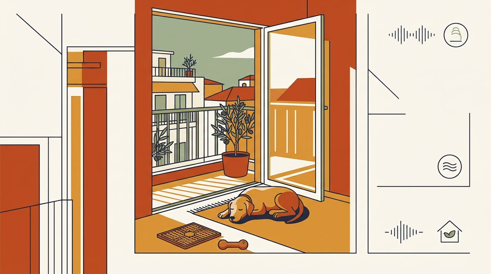

# **Πυλώνας 02: Ζωή στην Πολυκατοικία & Διαχείριση Άγχους**

**Εισαγωγή:** Ο πυλώνας αυτός απαντά στις μεγαλύτερες προκλήσεις της συμβίωσης σε αθηναϊκά διαμερίσματα. Εστιάζει στη συναισθηματική ασφάλεια του σκύλου μέσα στο σπίτι, την ηρεμία όταν μένει μόνος και την αρμονική συνύπαρξη με τους γείτονες.  
**Συνδεδεμένη Υπηρεσία:** /ypiresies/antimetopisi-provlimaton-symperiforas

## **Πίνακας Περιεχομένων (Άρθρα & Οδηγοί)**

> * **1\. Ο σκύλος μου γαβγίζει όταν μένει μόνος στην πολυκατοικία: Οδηγός για το Άγχος Αποχωρισμού**  
>   *URL:* /blog/agxos-apoxorismou-skylos-polykatoikia  
>   *Περιγραφή:* Πώς ξεχωρίζουμε τη βαρεμάρα από τον πανικό αποχωρισμού και πώς χτίζουμε σταδιακή απευαισθητοποίηση στις απουσίες μας.  
> * **2\. Γαβγίσματα σε κάθε ήχο στο κλιμακοστάσιο και στο κουδούνι: Πώς του μαθαίνουμε να ηρεμεί**  
>   *URL:* /blog/skylos-gavgizei-sto-koudouni-polykatoikia  
>   *Περιγραφή:* Τεχνικές ηχομόνωσης/διαχείρισης χώρου και θετικής σύνδεσης των θορύβων της πολυκατοικίας με την ηρεμία.  
> * **3\. Παιχνίδια μυαλού & Κονγκ (Enrichment): Πώς να απασχολήσετε τον σκύλο μέσα στο διαμέρισμα**  
>   *URL:* /blog/paixnidia-myalou-gia-skylous-sto-spiti  
>   *Περιγραφή:* Ιδέες δημιουργικής απασχόλησης, γλειψίματος και όσφρησης μέσα στο σπίτι που εκτονώνουν τον σκύλο και καλλιεργούν την αυτονομία του.  
> * **4\. Crate Training (Περιορισμός) χωρίς ενοχές: Πώς γίνεται η φωλιά ασφαλείας του και όχι «φυλακή»**  
>   *URL:* /blog/crate-training-skylos-sto-spiti  
>   *Περιγραφή:* Η σωστή, σταδιακή εξοικείωση με το crate ή το πάρκο περιορισμού ως ασφαλές καταφύγιο ξεκούρασης, χωρίς κλάματα ή καταναγκασμό.  
> * **5\. Φόβος για το ασανσέρ και τις σκάλες της πολυκατοικίας: Βήμα-βήμα απευαισθητοποίηση**  
>   *URL:* /blog/skylos-fovatai-to-asanser-skales  
>   *Περιγραφή:* Πώς βοηθάμε σκυλιά που «παγώνουν» μπροστά σε στενά ασανσέρ ή γλιστερές μαρμάρινες σκάλες πολυκατοικιών.  
> * **6\. Μετακόμιση σε νέο διαμέρισμα με σκύλο: Πώς διευκολύνουμε την προσαρμογή**  
>   *URL:* /blog/metakomisi-me-skylo-se-neo-spiti  
>   *Περιγραφή:* Γνώριμες μυρωδιές, ασφαλής μεταφορά και σταδιακές απουσίες, χωρίς την υπόσχεση ότι η αλλαγή θα είναι ανώδυνη για κάθε σκύλο.
