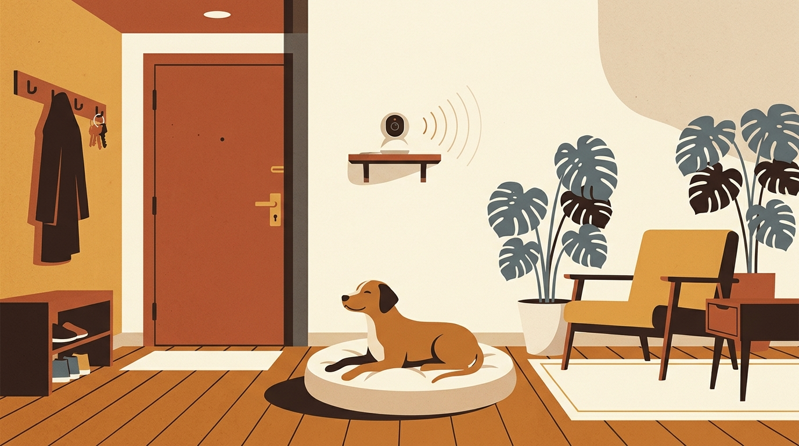

# **01\. Ο σκύλος μου γαβγίζει όταν μένει μόνος στην πολυκατοικία: Οδηγός για το Άγχος Αποχωρισμού**

**Κατηγορία:** 02 - Ζωή στην Πολυκατοικία & Διαχείριση Άγχους  
**Προτεινόμενο URL:** /blog/agxos-apoxorismou-skylos-polykatoikia  
**Χρόνος ανάγνωσης:** 3 λεπτά

**Με μια ματιά (TL;DR)**

> * Γάβγισμα ή ζημιές κατά την απουσία δεν σημαίνουν εκδίκηση. Μπορεί να σχετίζονται με άγχος αποχωρισμού, θορύβους, περιορισμό ή άλλες ανάγκες.
> * Είναι σημαντικό να ξεχωρίσουμε την απλή **βαρεμάρα** (έλλειψη εκτόνωσης) από το πραγματικό **άγχος αποχωρισμού**.  
> * Η λύση δεν είναι να τον αφήσουμε «να κλάψει μέχρι να συνηθίσει», αλλά η σταδιακή απευαισθητοποίηση σε μικρά βήματα που νιώθει ασφαλής.

## **Γιατί συμβαίνει αυτό; (Η λογική πίσω από τη συμπεριφορά)**

Οι σκύλοι είναι βαθιά κοινωνικά ζώα. Για έναν σκύλο που ζει σε διαμέρισμα στην Αθήνα, οι κηδεμόνες του είναι ολόκληρος ο κόσμος του και η πηγή της ασφάλειάς του. Όταν κλείνει η εξώπορτα, ορισμένοι σκύλοι νιώθουν τον ίδιο τρόμο που θα νιώθαμε εμείς αν ξυπνούσαμε ξαφνικά μόνοι σε ένα άγνωστο μέρος χωρίς τρόπο διαφυγής.  
**Πώς ξεχωρίζουμε τη βαρεμάρα από το άγχος αποχωρισμού;**  
Η καταγραφή με κάμερα βοηθά να δούμε πότε αρχίζει η δυσφορία και τι προηγείται. Λαχάνιασμα, βηματισμός, απόπειρες διαφυγής και φωνές χρειάζονται αξιολόγηση. Η κατανάλωση τροφής ή η ώρα εμφάνισης δεν αρκούν από μόνες τους για διάγνωση.

## **Πώς να το εφαρμόσετε στην πράξη (Βήμα-Βήμα)**

> 1. **Βάλτε μια κάμερα στο σαλόνι:** Μια απλή κάμερα Wi-Fi (ή ένα παλιό κινητό/λάπτοπ σε βιντεοκλήση) θα σας δείξει ακριβώς τι κάνει ο σκύλος όταν κλείνει η πόρτα και σε ποιο λεπτό ξεκινάει το άγχος.  
> 2. **Δουλέψτε τα σήματα αναχώρησης μόνο αν χρειάζεται:** Δοκιμάστε ένα μικρό, ήπιο βήμα, όπως να αγγίξετε τα κλειδιά. Αν αυξάνει την επαγρύπνηση, σταματήστε και προσαρμόστε το πλάνο με επαγγελματία.
> 3. **Μείνετε κάτω από το όριο δυσφορίας:** Η πρώτη άσκηση μπορεί να είναι ένα βήμα προς την πόρτα, όχι έξοδος. Επιστρέψτε πριν εμφανιστεί ανησυχία και αυξήστε μόνο μετά από επανειλημμένη άνεση, χωρίς άλματα χρόνου.
> 4. **Κάντε τις αφίξεις και τις αναχωρήσεις «βαρετές»:** Αποφύγετε τους δραματικούς αποχαιρετισμούς. Φύγετε και επιστρέψτε ήρεμα, σαν να πήγατε απλώς στο διπλανό δωμάτιο.

## **Τι να κάνετε & Τι να αποφύγετε**

> * **Ναι:** Εξασφαλίστε ότι πριν φύγετε ο σκύλος έχει κάνει μια ήρεμη βόλτα με μύρισμα (Sniffari) και έχει πάει τουαλέτα.  
> * **Ναι:** Αφήστε χαμηλή μουσική ή λευκό θόρυβο (π.χ. ανεμιστήρα ή ραδιόφωνο) για να καλύψετε τους ήχους της πολυκατοικίας.  
> * **Όχι:** Μην μαλώνετε ποτέ τον σκύλο όταν επιστρέφετε και βρίσκετε ζημιές — θα συνδέσει την επιστροφή σας με φόβο, αυξάνοντας κι άλλο το άγχος του.  
> * **Όχι:** Μην χρησιμοποιείτε κολάρα ενάντια στο γάβγισμα (σόκ, δόνηση ή σπρέι) — τιμωρούν το σύμπτωμα ενώ πολλαπλασιάζουν τον πανικό.

## **Μικρή Συμβουλή (Pro Tip)**

Ενημερώστε τους γείτονές σας στην πολυκατοικία με ένα ευγενικό σημείωμα ή μια κουβέντα («Δουλεύουμε με εκπαιδευτή πάνω στο άγχος του σκύλου μας, σας ευχαριστούμε για την υπομονή»). Όταν εσείς νιώθετε λιγότερη πίεση από τη γειτονιά, είστε πιο ήρεμοι και βοηθάτε καλύτερα τον σκύλο σας.

## **Η υποστήριξη είναι μέρος της λύσης**

Οργανώστε προσωρινά παρουσία έμπιστου ανθρώπου ώστε να αποφεύγονται απουσίες που προκαλούν πανικό. Σε αυτοτραυματισμό, απόπειρες διαφυγής ή αδυναμία ανάπαυσης ζητήστε κτηνιατρική αξιολόγηση και εξατομικευμένη υποστήριξη. Η βόλτα και ένα Kong δεν θεραπεύουν από μόνα τους το άγχος αποχωρισμού.
