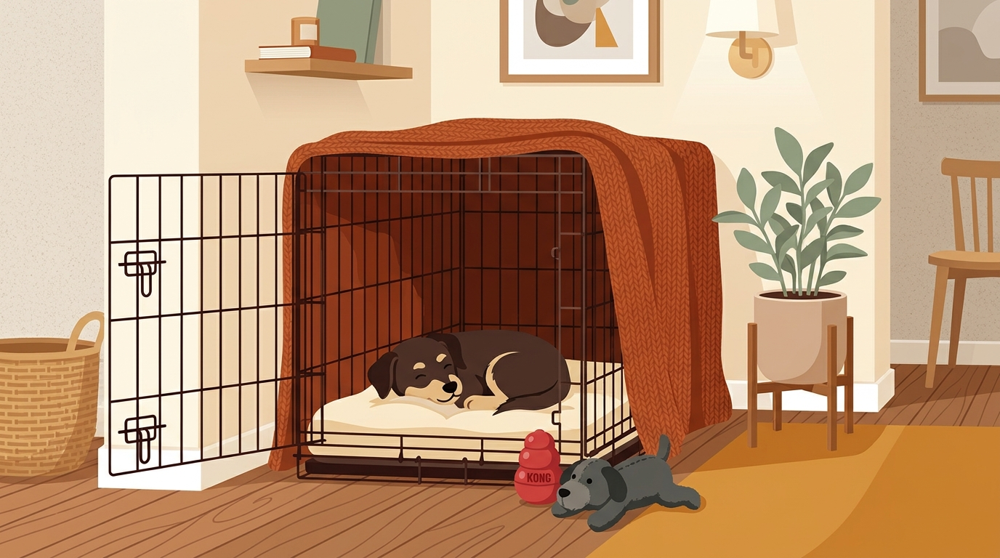

# **04\. Crate Training (Περιορισμός) χωρίς ενοχές: Πώς γίνεται η φωλιά ασφαλείας του και όχι «φυλακή»**

**Κατηγορία:** 02 - Ζωή στην Πολυκατοικία & Διαχείριση Άγχους  
**Προτεινόμενο URL:** /blog/crate-training-skylos-sto-spiti  
**Χρόνος ανάγνωσης:** 3 λεπτά

**Με μια ματιά (TL;DR)**

> * Για εμάς το μεταλλικό crate μπορεί να μοιάζει με «κλουβί», αλλά για τους σκύλους —όταν γίνει σωστή εξοικείωση— λειτουργεί ως μια ήσυχη, προστατευμένη **φωλιά ασφαλείας**.  
> * Στη θετική εκπαίδευση, το crate **δεν χρησιμοποιείται ποτέ ως τιμωρία** και δεν κλείνουμε ποτέ μέσα έναν σκύλο που κλαίει.  
> * Είναι πολύτιμο εργαλείο για την τουαλέτα του κουταβιού, την ασφάλεια στο αυτοκίνητο και την ηρεμία σε έκτακτες καταστάσεις (π.χ. νοσηλεία στον κτηνίατρο).

## **Γιατί συμβαίνει αυτό; (Η λογική πίσω από τη συμπεριφορά)**

Κάποιοι σκύλοι επιλέγουν προστατευμένα σημεία, ενώ άλλοι δυσφορούν στον περιορισμό. Το crate δεν είναι υποχρεωτικό ούτε θεραπεία για άγχος αποχωρισμού. Η άνεση αξιολογείται από τη συμπεριφορά, όχι από μια γενική θεωρία περί «φωλιάς».
Το μυστικό στο **Crate Training** είναι η επιλογή: ο σκύλος πρέπει να μπαίνει μέσα επειδή εκεί συμβαίνουν τα πιο ωραία πράγματα (ύπνος, μάσημα, ησυχία) και όχι επειδή τον σπρώξαμε εμείς.

## **Πώς να το εφαρμόσετε στην πράξη (Βήμα-Βήμα)**

> 1. **Επιλέξτε άνετο χώρο:** Ο σκύλος πρέπει να στέκεται, να γυρίζει και να ξαπλώνει φυσικά. Διατηρήστε καλό αερισμό και δροσιά. Κάλυμμα χρησιμοποιείται μόνο αν δεν προκαλεί ζέστη ή κίνδυνο κατάποσης.
> 2. **Αφήστε την πόρτα ανοιχτή και ρίξτε «θησαυρούς»:** Τις πρώτες μέρες, στερεώστε την πόρτα ώστε να μένει μόνιμα ανοιχτή. Ρίχνετε κρυφά μέσα μερικές νόστιμες λιχουδιές κατά τη διάρκεια της ημέρας, ώστε ο σκύλος να μπαίνει μόνος του, να τις βρίσκει και να βγαίνει ελεύθερα.  
> 3. **Προσφέρετε προαιρετικά κάτι ευχάριστο κοντά ή μέσα:** Μην στερείτε γεύματα για να αναγκαστεί να μπει. Αφήστε ελεύθερη έξοδο και πρόσβαση σε νερό.
> 4. **Εξασκηθείτε στο κλείσιμο χωριστά:** Όταν είναι άνετος, κινήστε λίγο την πόρτα και ανοίξτε την ξανά. Το πρώτο κλείσιμο μπορεί να κρατήσει ελάχιστα. Αν ανησυχήσει, ανοίξτε ήρεμα, χωρίς να περιμένετε σιωπή, και επιστρέψτε σε ευκολότερο βήμα.

## **Τι να κάνετε & Τι να αποφύγετε**

> * **Ναι:** Σεβαστείτε τον κανόνα του ασύλου: όταν ο σκύλος είναι μέσα στο crate του, **κανείς δεν τον ενοχλεί** (ούτε εμείς, ούτε τα παιδιά, ούτε οι επισκέπτες).  
> * **Ναι:** Αν έχετε κουτάβι ή σκύλο που δυσκολεύεται με το κλειστό crate, χρησιμοποιήστε ένα ευρύχωρο **πάρκο περιορισμού (playpen)** γύρω από το κρεβάτι του.  
> * **Όχι:** Μην στέλνετε ποτέ τον σκύλο στο crate όταν είστε εκνευρισμένοι μαζί του.  
> * **Όχι:** Μην αφήνετε τον σκύλο κλεισμένο στο crate για πολλές ώρες ενώ λείπετε στη δουλειά — ο σκύλος χρειάζεται χώρο για να τεντώνεται, να αλλάζει επιφάνειες ύπνου και να πίνει νερό.

## **Μικρή Συμβουλή (Pro Tip)**

Βγάζετε πάντα το κολάρο ή το σαμαράκι από τον σκύλο πριν μείνει μέσα στο crate, ώστε να μειωθεί ο κίνδυνος να πιαστεί κάποιο κλιπ ή ταυτότητα στα κάγκελα.
