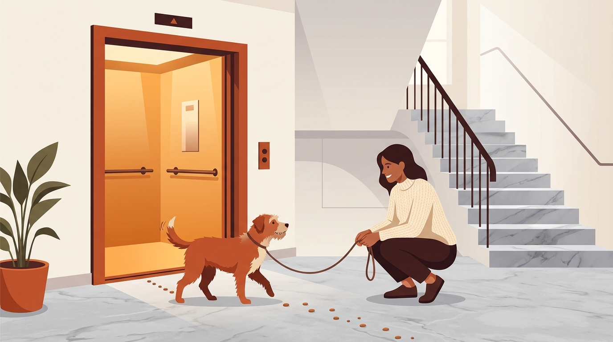

# **05\. Φόβος για το ασανσέρ και τις σκάλες της πολυκατοικίας: Βήμα-βήμα απευαισθητοποίηση**

**Κατηγορία:** 02 - Ζωή στην Πολυκατοικία & Διαχείριση Άγχους  
**Προτεινόμενο URL:** /blog/skylos-fovatai-to-asanser-skales  
**Χρόνος ανάγνωσης:** 3 λεπτά

**Με μια ματιά (TL;DR)**

> * Το ασανσέρ (ένα μικρό, κλειστό κουτί που τρίζει και κινείται) και οι γλιστερές μαρμάρινες σκάλες είναι εντελώς αφύσικα περιβάλλοντα για έναν σκύλο.  
> * Το αναγκαστικό τράβηγμα μπορεί να επιδεινώσει τον φόβο και να αυξήσει τον κίνδυνο γλιστρήματος ή τραυματισμού.
> * Η λύση είναι η **σταδιακή προσέγγιση** σε ώρες ησυχίας, με υψηλής αξίας επιβραβεύσεις.

## **Γιατί συμβαίνει αυτό; (Η λογική πίσω από τη συμπεριφορά)**

Για ένα κουτάβι ή έναν πρώην αδέσποτο σκύλο που δεν έχει μπει ποτέ σε πολυκατοικία, το κλιμακοστάσιο είναι γεμάτο «παγίδες»:

> * **Οι μαρμάρινες σκάλες:** Γλιστράνε, γυαλίζουν και συχνά έχουν απότομη κλίση. Οι σκύλοι φοβούνται δικαιολογημένα μήπως χάσουν την ισορροπία τους.  
> * **Το ασανσέρ:** Είναι ένας στενός χώρος χωρίς έξοδο διαφυγής, με μεταλλικούς ήχους, καθρέφτη (όπου ο σκύλος βλέπει ξαφνικά ένα «άλλο σκυλί» απέναντί του) και ένα πάτωμα που αρχίζει να κουνιέται κάτω από τα πόδια του.

## **Πώς να το εφαρμόσετε στην πράξη (Βήμα-Βήμα)**

### **Α. Για το Ασανσέρ:**

> 1. **Επιλέξτε μια ήσυχη ώρα:** Κάντε τις ασκήσεις αργά το βράδυ ή νωρίς το μεσημέρι, όταν δεν χρησιμοποιούν το ασανσέρ οι γείτονες.  
> 2. **Ξεκινήστε από άνετη απόσταση:** Επιβραβεύστε την ήρεμη παρατήρηση του ασανσέρ χωρίς να δελεάζετε τον σκύλο να πλησιάσει περισσότερο απ’ όσο αντέχει. Χρησιμοποιήστε μόνο τα προβλεπόμενα χειριστήρια της πόρτας, όχι σφήνες ή το σώμα σας.
> 3. **Μικρές εθελοντικές προσεγγίσεις:** Προχωρήστε σε είσοδο και έξοδο μόνο όταν υπάρχει χρόνος και ασφαλής λειτουργία της πόρτας. Σκύλος και συνοδός περνούν μαζί, με ολόκληρο το λουρί μέσα, ποτέ σε αντίθετες πλευρές.
> 4. **Ένας όροφος τη φορά:** Όταν μπαίνει πλέον χαρούμενος, κλείστε την πόρτα για 2 δευτερόλεπτα χωρίς να πατήσετε κουμπί, δώστε λιχουδιές και ανοίξτε. Στο επόμενο βήμα, ανεβείτε μόνο 1 όροφο ενώ του δίνετε συνεχώς να γλείφει λίγο πατέ ή τυρί κρέμα.

### **Β. Για τις Σκάλες:**

> 1. **Ξεκινήστε στο έδαφος:** Επιλέξτε ένα χαμηλό, αντιολισθητικό σκαλοπάτι και επιβραβεύστε την εθελοντική προσέγγιση. Μην τοποθετείτε τον σκύλο στη μέση μιας σκάλας για να αναγκαστεί να κινηθεί.
> 2. **Κοντέψτε τις τρίχες στις πατούσες:** Οι μακριές τρίχες ανάμεσα στα μαξιλαράκια των ποδιών κάνουν τον σκύλο να γλιστράει σαν να φοράει κάλτσες στο μάρμαρο.

## **Τι να κάνετε & Τι να αποφύγετε**

> * **Ναι:** Αν ο σκύλος είναι μικρόσωμος ή κουτάβι, πάρτε τον αγκαλιά στο ασανσέρ ή στις σκάλες τις πρώτες μέρες, ώστε να μην βιώνει πανικό σε κάθε βόλτα μέχρι να ολοκληρωθεί η εκπαίδευση.  
> * **Ναι:** Σταθείτε μπροστά από τον καθρέφτη του ασανσέρ αν παρατηρήσετε ότι το είδωλό του τον τρομάζει.  
> * **Όχι:** Μην τραβάτε ποτέ το λουρί για να τον σύρετε μέσα στο ασανσέρ — επιβεβαιώνετε τον φόβο του ότι το ασανσέρ είναι παγίδα.  
> * **Όχι:** Μην ανεβαίνετε στο ασανσέρ μαζί με αγνώστους τις πρώτες εβδομάδες προσαρμογής.

## **Μικρή Συμβουλή (Pro Tip)**

Ξαφνική άρνηση σκάλας μπορεί να συνδέεται με πόνο ή δυσκολία όρασης. Ζητήστε κτηνιατρικό έλεγχο πριν αυξήσετε την εξάσκηση. Η ευκολότερη κατεύθυνση διαφέρει ανά σκύλο.
