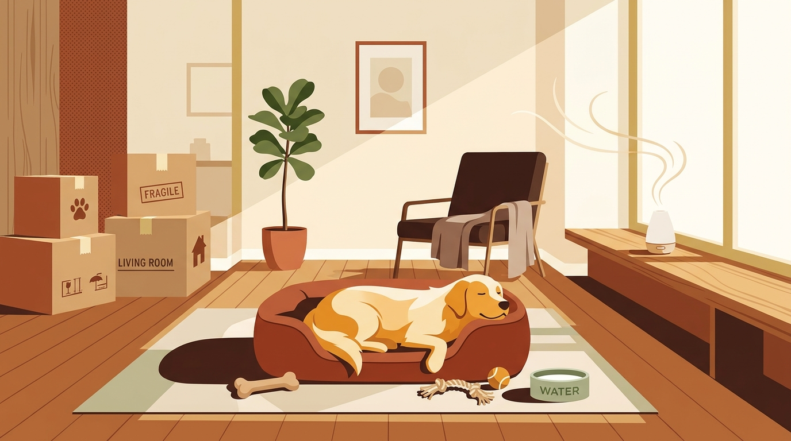

# **06\. Μετακόμιση σε νέο διαμέρισμα με σκύλο: Πώς διευκολύνουμε την προσαρμογή**

**Κατηγορία:** 02 - Ζωή στην Πολυκατοικία & Διαχείριση Άγχους  
**Προτεινόμενο URL:** /blog/metakomisi-me-skylo-se-neo-spiti  
**Χρόνος ανάγνωσης:** 3 λεπτά

**Με μια ματιά (TL;DR)**

> * Οι σκύλοι είναι πλάσματα της ρουτίνας και της μυρωδιάς: μια μετακόμιση ανατρέπει απότομα και τα δύο.  
> * Είναι απόλυτα φυσιολογικό τις πρώτες μέρες στο νέο σπίτι ο σκύλος να είναι πιο ανήσυχος, να σας ακολουθεί παντού ή να γαβγίζει στους νέους ήχους.  
> * Η διατήρηση των **γνώριμων μυρωδιών** και του σταθερού ωραρίου είναι το κλειδί για ομαλή μετάβαση.

## **Γιατί συμβαίνει αυτό; (Η λογική πίσω από τη συμπεριφορά)**

Για εμάς, η μετακόμιση σε ένα νέο, καλύτερο διαμέρισμα είναι λόγος χαράς. Ο σκύλος μας, όμως, δεν ξέρει τι θα πει «νέο συμβόλαιο ενοικίασης». Βλέπει απλώς τα έπιπλα να εξαφανίζονται μέσα σε κούτες, τους ανθρώπους του να τρέχουν αγχωμένοι και ξαφνικά βρίσκεται σε έναν χώρο με άγνωστες μυρωδιές, διαφορετική ακουστική και μια άγνωστη γειτονιά.  
Αυτή η προσωρινή ανασφάλεια μπορεί να εκδηλωθεί με γάβγισμα στους νέους γείτονες, δυσκολία να μείνει μόνος στο νέο σπίτι ή ακόμα και με κάποιο «ατύχημα» τουαλέτας.

## **Πώς να το εφαρμόσετε στην πράξη (Βήμα-Βήμα)**

> 1. **Μην πλύνετε το κρεβάτι του πριν τη μετακόμιση!** Όσο δελεαστικό κι αν είναι να μπουν όλα πεντακάθαρα στο νέο σπίτι, κρατήστε το κρεβατάκι, την κουβέρτα και τα παιχνίδια του άπλυτα για την πρώτη εβδομάδα. Η οικεία μυρωδιά του παλιού σπιτιού τον καθησυχάζει.  
> 2. **Γνωρίστε τη νέα γειτονιά εκ των προτέρων:** Αν το νέο διαμέρισμα είναι κοντά, κάντε 2–3 χαλαρές βόλτες (Sniffari) στους δρόμους γύρω από το νέο σπίτι λίγες μέρες πριν τη μετακόμιση.  
> 3. **Προστατέψτε τον την ημέρα της μεταφορικής:** Την ημέρα που μπαινοβγαίνουν μεταφορείς, ανοιγοκλείνουν πόρτες και μετακινούνται έπιπλα, είναι προτιμότερο ο σκύλος να μείνει με έναν φίλο/συγγενή ή σε ένα ήσυχο δωμάτιο με εσάς.  
> 4. **Στήστε πρώτα τη «γωνιά» του:** Πριν ανοίξετε τις δικές σας κούτες στο νέο σπίτι, στρώστε το κρεβάτι του, βάλτε τα μπολ του με νερό και δώστε του ένα νόστιμο μάσημα για να συνδέσει τον νέο χώρο με κάτι θετικό.

## **Τι να κάνετε & Τι να αποφύγετε**

> * **Ναι:** Κρατήστε ακριβώς τις ίδιες ώρες φαγητού και βόλτας όπως στο παλιό σπίτι — η προβλεψιμότητα μειώνει το άγχος.  
> * **Ναι:** Αξιολογήστε ξανά την άνεση όταν απομακρύνεστε. Ξεκινήστε με δευτερόλεπτα ή ακόμη και με κίνηση προς την πόρτα, παρακολουθώντας τον σκύλο, όχι με προκαθορισμένη απουσία.
> * **Όχι:** Μην φύγετε για 8 ώρες στη δουλειά την αμέσως επόμενη μέρα της μετακόμισης. Προγραμματίστε τη μετακόμιση Παρασκευή ή Σαββατοκύριακο ώστε να είστε μαζί του τις πρώτες 2–3 μέρες.  
> * **Όχι:** Μην τον αφήνετε μόνο στο νέο μπαλκόνι — δεν γνωρίζει ακόμα τους ήχους της νέας γειτονιάς και πρέπει πρώτα να ελέγξετε την ασφάλεια στα κάγκελα.

## **Μικρή Συμβουλή (Pro Tip)**

Οι φερομόνες μπορεί να συζητηθούν με τον κτηνίατρο ως συμπληρωματικό μέτρο, αλλά τα αποτελέσματα ποικίλλουν. Δεν αντικαθιστούν ήρεμη ρουτίνα, ασφαλή χώρο και προσαρμοσμένο πλάνο απουσιών.
