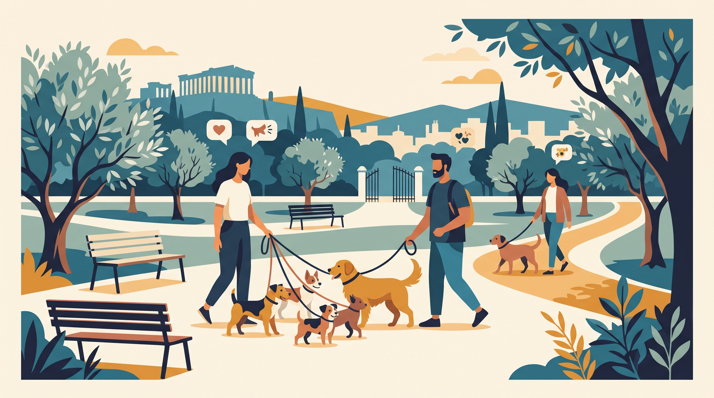

# **Πυλώνας 04: Πάρκα Σκύλων, Dog Walkers & Κοινωνική Ζωή στην Πόλη**

**Προτεινόμενο URL:** /blog/enotita/parka-skylon-dog-walkers-koinoniki-zoi
**Χρώμα:** #2E7A9B
**Εισαγωγή:** Η κοινωνική ζωή ενός σκύλου στην Αθήνα κρύβει παγίδες όταν βασίζεται στην άναρχη επαφή. Αυτός ο πυλώνας ξεκαθαρίζει τι πραγματικά σημαίνει «κοινωνικός σκύλος», πότε τα πάρκα σκύλων βοηθούν ή βλάπτουν και πώς διαχειριζόμαστε απρόβλεπτες συναντήσεις.  
**Συνδεδεμένη Υπηρεσία:** /ypiresies/astiki-symviosi-ypakoi

## **Πίνακας Περιεχομένων (Άρθρα & Οδηγοί)**

> * **1\. Πάρκα Σκύλων στην Αθήνα: Πότε κάνουν καλό και πότε δημιουργούν φοβίες και επιθετικότητα**  
>   *URL:* /blog/parka-skylon-athina-kindynoi-kanones  
>   *Περιγραφή:* Γιατί ο περιορισμένος χώρος με άγνωστα, υπερδιεγερμένα σκυλιά δεν ταιριάζει σε όλους και πώς αξιολογούμε αν ο σκύλος μας περνάει καλά.  
> * **2\. «Μη φοβάσαι, είναι καλός!» Τι κάνουμε όταν πλησιάζει ξένος λυτός σκύλος**  
>   *URL:* /blog/ksenos-lytos-skylos-sti-volta-ti-kano  
>   *Περιγραφή:* Απόσταση, οπτικά εμπόδια και ασφαλής αποχώρηση, χωρίς να βάζουμε χέρια ανάμεσα σε σκύλους ή να υποσχόμαστε τεχνική που αποτρέπει κάθε επίθεση.  
> * **3\. Είναι φυσιολογικό ο σκύλος μου να μη θέλει να παίζει με άλλα σκυλιά; (Dog Selectivity)**  
>   *URL:* /blog/skylos-den-thelei-na-paizei-me-alla-skylia  
>   *Περιγραφή:* Η κλίμακα κοινωνικότητας στους ενήλικους σκύλους και γιατί η ουδετερότητα στη βόλτα είναι πιο ρεαλιστικός στόχος από το παιχνίδι με όλους.  
> * **4\. Πώς να επιλέξετε Dog Walker στην Αθήνα: Οι ερωτήσεις που εξασφαλίζουν ότι η βόλτα γίνεται με θετικό τρόπο**  
>   *URL:* /blog/pos-na-epileksete-dog-walker-athina  
>   *Περιγραφή:* Ερωτήσεις για μεθόδους, μέγεθος και συμβατότητα ομάδας, ασφαλή μεταφορά και σχέδιο έκτακτης ανάγκης.
