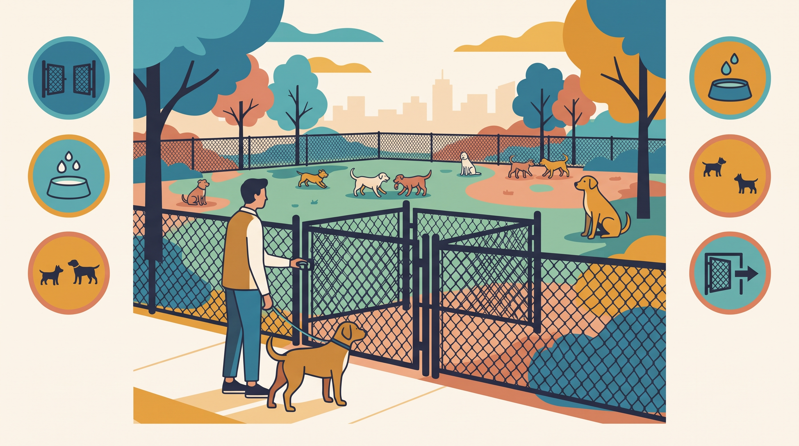

# **01\. Πάρκα Σκύλων στην Αθήνα: Πότε κάνουν καλό και πότε δημιουργούν φοβίες και επιθετικότητα**

**Κατηγορία:** 04 - Πάρκα Σκύλων, Dog Walkers & Κοινωνική Ζωή στην Πόλη  
**Προτεινόμενο URL:** /blog/parka-skylon-athina-kindynoi-kanones  
**Χρόνος ανάγνωσης:** 2 λεπτά

**Με μια ματιά (TL;DR)**

> * Το πάρκο σκύλων δεν είναι υποχρεωτικό για κοινωνική ζωή.
> * Αξιολογούμε τον χώρο και την παρέα πριν μπούμε.
> * Η αποχώρηση νωρίς είναι καλή διαχείριση, όχι αποτυχία.

## **Τι προσφέρει και πότε δυσκολεύει**

Ένας ασφαλής χώρος με συμβατή παρέα μπορεί να προσφέρει παιχνίδι. Όμως περιορισμένη έκταση, συνωστισμός στην είσοδο και διαφορετικοί τρόποι παιχνιδιού μπορούν να αυξήσουν την ένταση.

Δεν χρησιμοποιούμε το πάρκο για να συνηθίσει αναγκαστικά ένας φοβισμένος σκύλος. Ελέγξτε επίσης κανόνες πρόσβασης και κτηνιατρική προστασία, ιδιαίτερα για κουτάβια ή ευάλωτα ζώα.

## **Πριν ανοίξετε την πόρτα**

1. **Δείτε την περίφραξη:** Κενά, χαλασμένες πόρτες και δυνατότητα ασφαλούς εξόδου.
2. **Παρατηρήστε τα ζώα:** Υπάρχει συνεχές κυνηγητό ενός σκύλου ή άνετες παύσεις;
3. **Δείτε τους συνοδούς:** Παρακολουθούν ενεργά και μπορούν να παρέμβουν εγκαίρως;
4. **Ελέγξτε τον δικό σας σκύλο:** Θέλει να μπει ή απομακρύνεται και παγώνει;

## **Μέσα στον χώρο**

Κρατήστε μικρή πρώτη επίσκεψη. Αποφύγετε μασήματα, τροφή και πολύτιμα παιχνίδια ανάμεσα σε άγνωστους σκύλους. Μην σχηματίζετε συνωστισμό στην είσοδο και μην αφήνετε τον σκύλο να παρενοχλεί όποιον ζητά απόσταση.

Σε συνεχές μπλοκάρισμα, υπερβολική καταδίωξη ή μεγάλη διαφορά μεγέθους, αποχωρήστε προληπτικά. Μην περιμένετε να γίνει καβγάς για να κρίνετε ότι η παρέα δεν ταιριάζει.

Εναλλακτικές είναι παράλληλη βόλτα με γνώριμο σκύλο ή ήρεμη εξερεύνηση χωρίς άμεση επαφή. Η ποιότητα της εμπειρίας έχει μεγαλύτερη σημασία από τον αριθμό γνωριμιών.

**Διαβάστε επίσης:** [Παιχνίδι ή αρχή καβγά](/blog/paixnidi-skylon-i-kavgas-pos-ksexorizoume).
