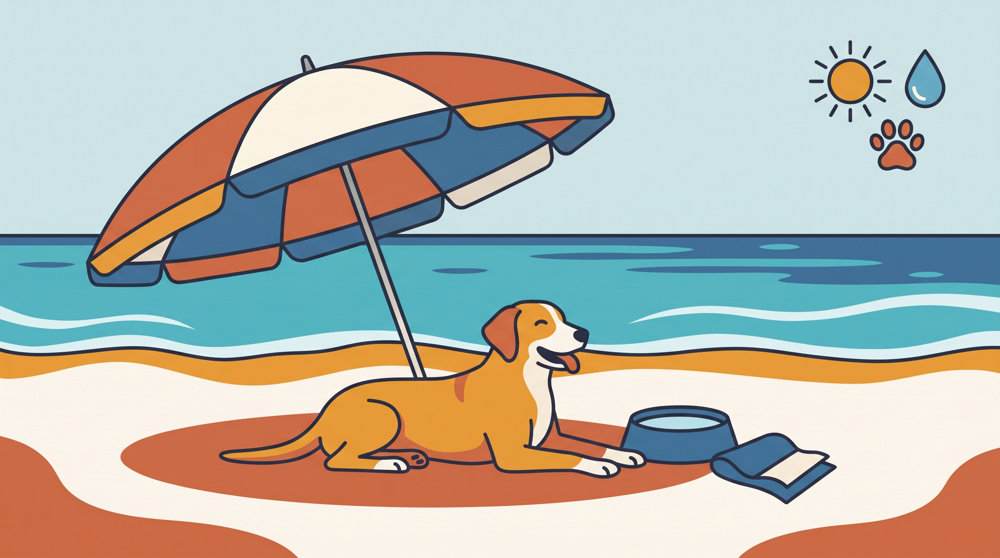

# **04\. Πρώτη φορά με τον σκύλο στην παραλία: Φόβος για τα κύματα, κατάποση θαλασσινού νερού και σκιά**

**Κατηγορία:** 08 - Ταξίδια, Μετακινήσεις στην Αθήνα & Διακοπές  
**Προτεινόμενο URL:** /blog/skylos-stin-paralia-thalassa-odigos  
**Χρόνος ανάγνωσης:** 2 λεπτά

**Με μια ματιά (TL;DR)**

> * Ο σκύλος επιλέγει αν θα πλησιάσει το νερό.
> * Σκιά, γλυκό νερό και κατάλληλες συνθήκες είναι απαραίτητα.
> * Το κολύμπι δεν αποκλείει υπερθέρμανση ή εξάντληση.

## **Δεν ταιριάζει κάθε παραλία σε κάθε σκύλο**

Κύματα, παιδιά και ζεστή άμμος μπορεί να είναι έντονα ερεθίσματα. Ελέγξτε πρόσβαση και ισχύοντες κανόνες της συγκεκριμένης παραλίας. Η παρουσία άλλων σκύλων δεν σημαίνει ελεύθερη πρόσβαση παντού.

Προτιμήστε ήσυχη, δροσερή ώρα και εύκολη αποχώρηση. Σε καύσωνα, το δροσερό σπίτι μπορεί να είναι ασφαλέστερο.

## **Μια ήρεμη πρώτη εμπειρία**

1. **Ξεκινήστε μακριά από τα κύματα:** Αφήστε τον να παρατηρήσει με ασφαλή έλεγχο.
2. **Πλησιάστε μόνο εθελοντικά:** Μην τον τραβάτε ή πετάτε στο νερό και μην απομακρύνεστε κολυμπώντας για να σας ακολουθήσει αναγκαστικά.
3. **Κρατήστε μικρή διάρκεια:** Ρηχό νερό και συχνά διαλείμματα. Κατάλληλο σωσίβιο μπορεί να βοηθήσει, αλλά δεν αντικαθιστά επίβλεψη.
4. **Προσφέρετε νερό και ανάπαυση:** Αποτρέψτε κατανάλωση θαλασσινού νερού και ασταμάτητο κυνήγι μπάλας στα κύματα.

## **Πότε φεύγουμε αμέσως**

Έντονο λαχάνιασμα, αδυναμία, εμετός ή αστάθεια χρειάζονται άμεση κτηνιατρική επικοινωνία. Η κατάποση μεγάλης ποσότητας θαλασσινού νερού μπορεί να γίνει επικίνδυνη· δεν περιμένουμε απλώς να «του περάσει».

Προσέξτε ρεύματα, αγκίστρια, σκουπίδια και καυτές επιφάνειες. Μετά, ξεπλύνετε απαλά αλάτι και άμμο και ελέγξτε πατούσες. Η επιτυχία μπορεί να είναι λίγα ήρεμα λεπτά στην ακτή, χωρίς κολύμπι. Αν επιμένει να απομακρύνεται, σεβαστείτε την επιλογή του.

**Διαβάστε επίσης:** [Σκύλος στον καύσωνα](/blog/volta-skylou-ston-kafsona-kalokairi).
