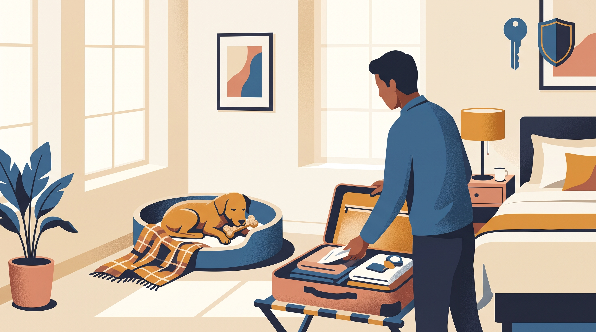

# **05\. Ξενοδοχείο και Airbnb με σκύλο: Πώς να μην γαβγίζει σε ένα άγνωστο δωμάτιο διακοπών**

**Κατηγορία:** 08 - Ταξίδια, Μετακινήσεις στην Αθήνα & Διακοπές  
**Προτεινόμενο URL:** /blog/diakopes-me-skylo-se-ksenodoxeio  
**Χρόνος ανάγνωσης:** 2 λεπτά

**Με μια ματιά (TL;DR)**

> * Το «pet-friendly» δεν σημαίνει ότι επιτρέπεται κάθε μορφή διαμονής.
> * Ο νέος χώρος χρειάζεται εξοικείωση.
> * Δεν υποθέτουμε ότι αντέχει μόνος όπως στο σπίτι.

## **Ρωτήστε πριν την κράτηση**

Επιβεβαιώστε όρια μεγέθους, χρεώσεις, επιτρεπόμενους χώρους και πολιτική απουσίας κηδεμόνα. Ρωτήστε για ασφαλές μπαλκόνι, θόρυβο διαδρόμου και κοντινές διαδρομές.

Η γνώριμη κουβέρτα μπορεί να βοηθήσει, αλλά δεν εγγυάται ηρεμία. Ήχοι καθαριότητας, ασανσέρ και γειτονικών δωματίων μπορεί να απαιτούν πρόσθετη διαχείριση.

## **Την ημέρα άφιξης**

1. **Ελέγξτε το δωμάτιο:** Ασφαλίστε παράθυρα, καλώδια και τρόφιμα. Μην επιτρέπετε πρόσβαση σε αβέβαιη περίφραξη.
2. **Προσφέρετε τουαλέτα και νερό:** Μετά το ταξίδι προηγούνται οι βασικές ανάγκες, όχι αμέσως άλλη εκδρομή.
3. **Φτιάξτε ήσυχο σημείο:** Κρεβάτι μακριά από την πόρτα και, αν βοηθά, ήπιος γνώριμος ήχος.
4. **Μείνετε μαζί αρχικά:** Παρατηρήστε αν μπορεί να ξεκουραστεί πριν προσθέσετε νέες απαιτήσεις.

## **Απουσία μόνο με προϋποθέσεις**

Αν επιτρέπεται από το κατάλυμα, δοκιμάστε πολύ μικρά βήματα απομάκρυνσης με παρακολούθηση. Επιστρέψτε πριν εμφανιστεί δυσφορία. Αν δεν αντέχει, χρειάζεται εναλλακτική φροντίδα ή αλλαγή προγράμματος, όχι παρατεταμένο κλάμα.

Συνεννοηθείτε για την καθαριότητα ώστε να μη βρεθεί προσωπικό ξαφνικά μαζί του. Μην χρησιμοποιείτε άγνωστο crate για πολύωρη έξοδο. Κρατήστε στοιχεία κοντινού κτηνιάτρου και σχέδιο ασφαλούς μεταφοράς.

Οι διακοπές μπορούν να περιλαμβάνουν περισσότερη ανάπαυση και λιγότερες δραστηριότητες, χωρίς αυτό να θεωρείται αποτυχία προσαρμογής.

**Διαβάστε επίσης:** [Άγχος αποχωρισμού](/blog/agxos-apoxorismou-skylos-polykatoikia).
