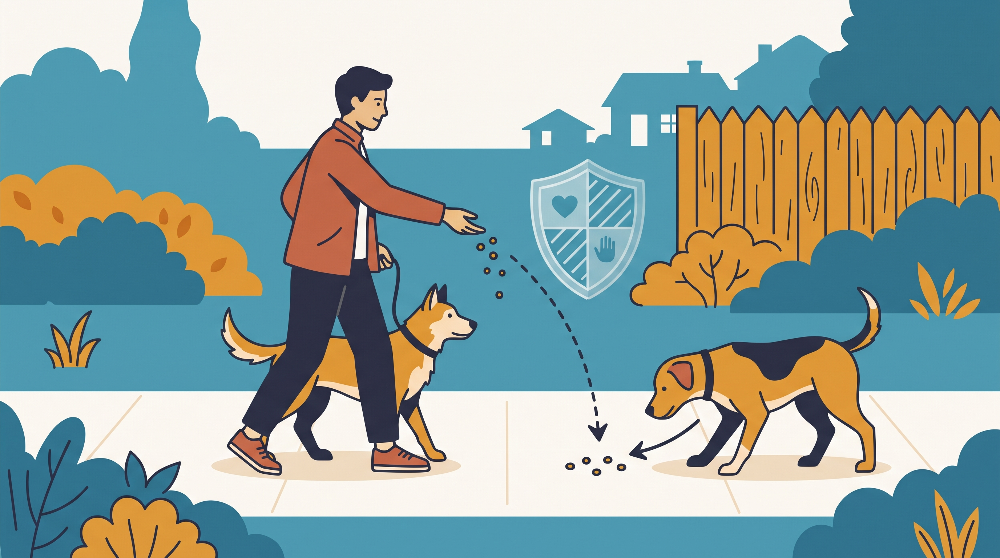

# **02\. «Μη φοβάσαι, είναι καλός!» Τι κάνουμε όταν πλησιάζει ξένος λυτός σκύλος**

**Κατηγορία:** 17 - Πάρκα Σκύλων, Dog Walkers & Κοινωνική Ζωή στην Πόλη  
**Προτεινόμενο URL:** /blog/ksenos-lytos-skylos-sti-volta-ti-kano  
**Χρόνος ανάγνωσης:** 2 λεπτά

**Με μια ματιά (TL;DR)**

> * Προτεραιότητα είναι χώρος και ασφαλής αποχώρηση.
> * Το «είναι καλός» δεν αρκεί για να θεωρηθεί ασφαλής η συνάντηση.
> * Δεν υπάρχει τεχνική που εγγυάται αποτροπή κάθε επίθεσης.

## **Πριν φτάσει κοντά**

Αν δείτε λυτό σκύλο από απόσταση, κινηθείτε ήρεμα προς ασφαλές σημείο. Ζητήστε καθαρά από τον συνοδό να τον καλέσει και να τον δέσει. Δεν χρειάζεται να απολογηθείτε επειδή ο δικός σας δεν θέλει επαφή.

Μην τρέχετε προς τον δρόμο ή σε σημείο χωρίς έξοδο. Η προσπάθεια αποφυγής δεν πρέπει να δημιουργεί νέο κίνδυνο.

## **Πρακτικές επιλογές**

1. **Χρησιμοποιήστε απόσταση:** Κάντε αναστροφή όσο υπάρχει χώρος, με ασφαλές μήκος λουριού.
2. **Βρείτε οπτικό εμπόδιο:** Σταθμευμένο όχημα από την πλευρά του πεζοδρομίου, τοίχος ή ασφαλής είσοδος μπορεί να βοηθήσει.
3. **Κρατήστε ήρεμη κίνηση:** Αποφύγετε φωνές, πρόκληση και απότομα τινάγματα στον δικό σας σκύλο.
4. **Μην επιβάλλετε γνωριμία:** Αν ο ξένος πλησιάζει πιεστικά, συνεχίστε να αναζητάτε χώρο αντί να ζητάτε από τον δικό σας να καθίσει ακίνητος.

## **Τι αποφεύγουμε**

Μην βάζετε χέρια ανάμεσα σε σκύλους και μην πιάνετε κολάρα σε σύγκρουση. Το σωματικό μπλοκάρισμα δεν είναι ασφαλές ως γενική οδηγία απέναντι σε σκύλο που απειλεί. Μην σκορπίζετε τροφή ανάμεσα στα ζώα, όπου μπορεί να αυξηθεί ο ανταγωνισμός.

Μετά από τραυματισμό χρειάζεται κτηνιατρική ή ανθρώπινη ιατρική φροντίδα αντίστοιχα, ακόμη και αν οι πληγές φαίνονται μικρές. Για επαναλαμβανόμενο πρόβλημα στη γειτονιά, καταγράψτε με ασφάλεια και απευθυνθείτε στις αρμόδιες τοπικές υπηρεσίες.

**Διαβάστε επίσης:** [Ασφαλείς χαιρετισμοί](/blog/pos-xairetiountai-ta-skylia-sti-volta).
