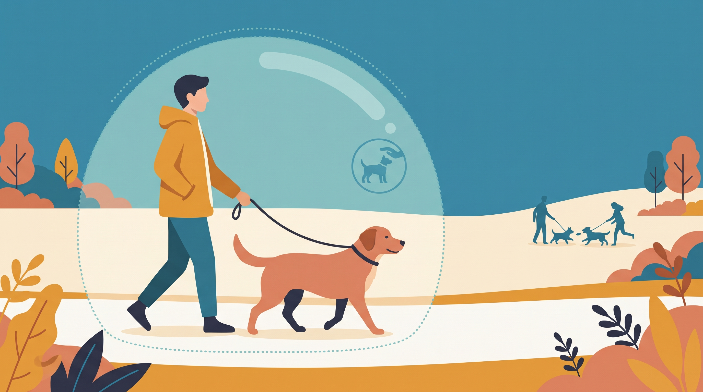

# **03\. Είναι φυσιολογικό ο σκύλος μου να μη θέλει να παίζει με άλλα σκυλιά; (Dog Selectivity)**

**Κατηγορία:** 17 - Πάρκα Σκύλων, Dog Walkers & Κοινωνική Ζωή στην Πόλη  
**Προτεινόμενο URL:** /blog/skylos-den-thelei-na-paizei-me-alla-skylia  
**Χρόνος ανάγνωσης:** 2 λεπτά

**Με μια ματιά (TL;DR)**

> * Η επιλεκτικότητα στις παρέες μπορεί να είναι απολύτως συμβατή με καλή ευημερία.
> * Κοινωνικότητα δεν σημαίνει παιχνίδι με όλους.
> * Ξαφνική αλλαγή προτιμήσεων χρειάζεται προσοχή.

## **Η ουδετερότητα είναι θεμιτός στόχος**

Ορισμένοι σκύλοι απολαμβάνουν λίγους γνώριμους συντρόφους. Άλλοι προτιμούν κοινή βόλτα χωρίς σωματικό παιχνίδι. Η ηλικία, οι εμπειρίες και η σωματική άνεση μπορεί να επηρεάζουν τις επιλογές.

Δεν χρειάζεται να τον στέλνουμε σε πάρκο μέχρι να «γίνει κοινωνικός». Επαναλαμβανόμενη πίεση μπορεί να κάνει την παρουσία άλλων σκύλων δυσκολότερη.

## **Πώς προσφέρουμε κατάλληλη κοινωνική ζωή**

1. **Σεβαστείτε την απομάκρυνση:** Μην τον επιστρέφετε σε επαφή που αποφεύγει.
2. **Δοκιμάστε παράλληλη βόλτα:** Με γνώριμο συμβατό σκύλο, απόσταση και ξεχωριστούς συνοδούς.
3. **Επιλέξτε μικρές συναντήσεις:** Ένας κατάλληλος σύντροφος μπορεί να ταιριάζει καλύτερα από μεγάλη ομάδα.
4. **Καλύψτε άλλες ανάγκες:** Όσφρηση, παιχνίδι με άνθρωπο, εκπαίδευση και ανάπαυση παραμένουν πολύτιμα.

## **Πότε χρειάζεται αξιολόγηση**

Αν ένας σκύλος που έπαιζε άνετα αρχίσει ξαφνικά να αποφεύγει ή να γρυλίζει, εξετάστε πόνο, ασθένεια ή πρόσφατη δυσάρεστη εμπειρία. Σε κίνδυνο δαγκώματος χρειάζεται εξατομικευμένο πλάνο.

Η επιλογή απόστασης δεν ισοδυναμεί με μόνιμη απομόνωση. Μπορούμε να χτίσουμε άνετη παρουσία άλλων ζώων χωρίς υποχρέωση επαφής.

Μετρήστε την ποιότητα της καθημερινότητας από το αν χαλαρώνει, εξερευνά και έχει επιλογές, όχι από το πόσους «φίλους» έκανε στη βόλτα.

**Διαβάστε επίσης:** [Πάρκα σκύλων](/blog/parka-skylon-athina-kindynoi-kanones).
