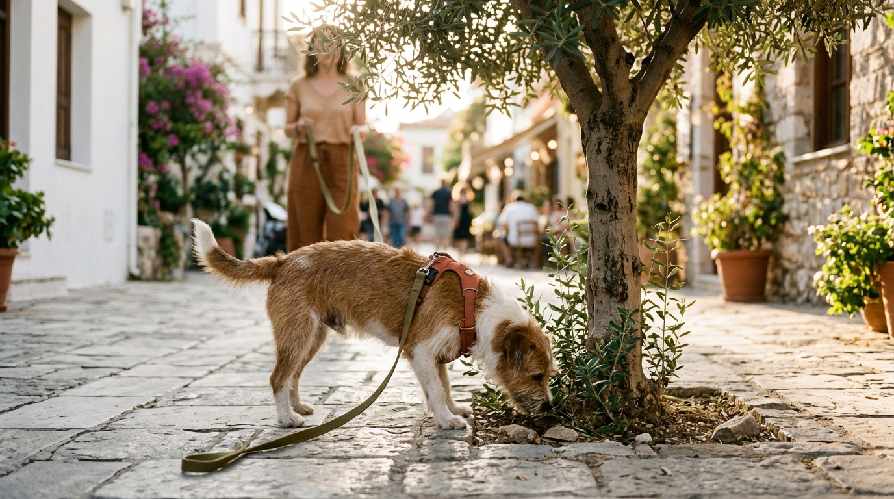

# **Πυλώνας 01: Η Φιλοσοφία "Let It Sniff" & Αστική Βόλτα**

**Εισαγωγή:** Αυτός ο πυλώνας αποτελεί τον πυρήνα της ταυτότητας του *letitsniff.gr*. Εστιάζει στη μετατροπή της καθημερινής βόλτας στα στενά της Αθήνας από πηγή έντασης σε εμπειρία αποσυμπίεσης και σύνδεσης, αναδεικνύοντας τον ρόλο της όσφρησης στην ψυχολογία του σκύλου.  
**Συνδεδεμένη Υπηρεσία:** /ypiresies/astiki-symviosi-ypakoi

## **Πίνακας Περιεχομένων (Άρθρα & Οδηγοί)**

> * **1\. Τι είναι το "Sniffari" και γιατί 20 λεπτά μυρίσματος κουράζουν τον σκύλο περισσότερο από 1 ώρα τρέξιμο**  
>   *URL:* /blog/ti-einai-to-sniffari-volta-skylou  
>   *Περιγραφή:* Εξηγεί πώς λειτουργεί η πνευματική εκτόνωση μέσω της όσφρησης, πώς μειώνει τους καρδιακούς παλμούς και την κορτιζόλη, και πώς εφαρμόζεται στην πράξη.  
> * **2\. Βόλτα στην Αθήνα χωρίς τράβηγμα στο λουρί: 4 λάθη που κάνουμε χωρίς να το ξέρουμε**  
>   *URL:* /blog/volta-xoris-travigma-sto-louri-athina  
>   *Περιγραφή:* Αναλύει γιατί τραβάνε τα σκυλιά στα αστικά πεζοδρόμια και πώς η τεχνική του χαλαρού λουριού χτίζεται με συνεργασία αντί για διορθώσεις.  
> * **3\. Σαμαράκι (Επιστήθιο) ή Κολάρο; Τι είναι πραγματικά ασφαλές για τον λαιμό του σκύλου**  
>   *URL:* /blog/samaraki-i-kolaro-ti-na-dialekso  
>   *Περιγραφή:* Ανατομική και συμπεριφορική σύγκριση εξοπλισμού, οι κίνδυνοι στον θυρεοειδή και την τραχεία από την πίεση στον λαιμό, και πώς επιλέγουμε σωστό σαμαράκι τύπου Υ.  
> * **4\. Πώς να μάθετε στον σκύλο σας να κάθεται ήρεμος σε καφετέριες και εστιατόρια**  
>   *URL:* /blog/skylos-se-kafeteria-estiatorio-iremia  
>   *Περιγραφή:* Πρακτικός οδηγός (πρωτόκολλο χαλάρωσης σε χαλάκι/κουβερτάκι) για ήρεμη παρουσία του σκύλου σε πολυσύχναστα στέκια της πόλης.  
> * **5\. Ο σκύλος μου τρώει σκουπίδια από τον δρόμο: Πώς να τον σταματήσετε χωρίς φωνές**  
>   *URL:* /blog/skylos-troei-skoupidia-apo-ton-dromo  
>   *Περιγραφή:* Γιατί η βίαιη αφαίρεση αντικειμένων από το στόμα κάνει τον σκύλο να καταπίνει πιο γρήγορα, και πώς μαθαίνουμε την ασφαλή εναλλαγή («άστο»).  
> * **6\. Ασφαλή πάρκα και λόφοι στο κέντρο της Αθήνας για αποσυμπίεση (Στρέφη, Πεδίον του Άρεως, Φιλοπάππου)**  
>   *URL:* /blog/volta-me-skylo-kentro-athinas-parka  
>   *Περιγραφή:* Τοπικός οδηγός για τις καλύτερες διαδρομές και ώρες βόλτας στο κέντρο της Αθήνας, ανάλογα με τις ανάγκες και την κοινωνικότητα του σκύλου.