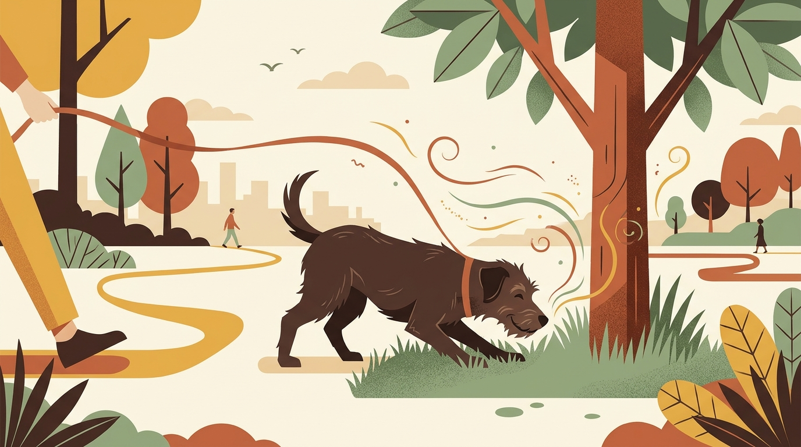

# **01\. Τι είναι το "Sniffari" και γιατί 20 λεπτά μυρίσματος κουράζουν τον σκύλο περισσότερο από 1 ώρα τρέξιμο**

**Κατηγορία:** 01 \- Η Φιλοσοφία Let It Sniff & Αστική Βόλτα  
**Προτεινόμενο URL:** /blog/ti-einai-to-sniffari-volta-skylou  
**Χρόνος ανάγνωσης:** 3 λεπτά

## \---

**Με μια ματιά (TL;DR)**

> * Το **Sniffari** (Sniff \+ Safari) είναι μια βόλτα αποσυμπίεσης όπου ο σκύλος επιλέγει τον ρυθμό και τα σημεία που θα μυρίσει.  
> * Η όσφρηση ενεργοποιεί τεράστιο μέρος του εγκεφάλου του σκύλου, προσφέροντας βαθιά **πνευματική εκτόνωση**.  
> * Το παρατεταμένο μύρισμα μειώνει τους καρδιακούς παλμούς και την κορτιζόλη (ορμόνη του στρες), σε αντίθεση με το έντονο τρέξιμο που συχνά ανεβάζει την αδρεναλίνη.

## **Γιατί συμβαίνει αυτό; (Η λογική πίσω από τη συμπεριφορά)**

Οι άνθρωποι αντιλαμβανόμαστε τον κόσμο κυρίως με την όραση. Οι σκύλοι, όμως, «βλέπουν» με τη μύτη τους. Ένας σκύλος διαθέτει έως και 300 εκατομμύρια οσφρητικούς υποδοχείς (όταν εμείς έχουμε περίπου 6 εκατομμύρια), ενώ το τμήμα του εγκεφάλου του που αναλύει τις μυρωδιές είναι αναλογικά 40 φορές μεγαλύτερο από το δικό μας.  
Όταν βγαίνουμε βόλτα στα στενά της Αθήνας με μοναδικό στόχο να «γράψουμε χιλιόμετρα» περπατώντας γρήγορα, στερούμε από τον σκύλο τη βασική του ανάγκη: να συλλέξει πληροφορίες για το περιβάλλον του. Κάθε κολώνα, γωνία ή τοίχος είναι για εκείνον τα «νέα της γειτονιάς» — ποιος πέρασε, τι ώρα, αν ήταν ήρεμος ή αγχωμένος.  
Η επεξεργασία αυτών των οσφρητικών πληροφοριών απαιτεί έντονη εγκεφαλική εργασία. Γι' αυτό 20 λεπτά ελεύθερης εξερεύνησης με τη μύτη κουράζουν τον σκύλο ουσιαστικά και ήρεμα, ενώ 1 ώρα μηχανικού τρεξίματος απλώς χτίζει μεγαλύτερη σωματική αντοχή (και συχνά υπερένταση).

## **Πώς να το εφαρμόσετε στην πράξη (Βήμα-Βήμα)**

> 1. **Επιλέξτε τον κατάλληλο εξοπλισμό:** Χρησιμοποιήστε ένα άνετο σαμαράκι τύπου Υ και ένα λουρί τουλάχιστον 2 έως 3 μέτρων (ή 5 μέτρων σε πάρκο), ώστε ο σκύλος να έχει χώρο να κινηθεί χωρίς να νιώθει συνεχή τάση.  
> 2. **Αφήστε τον σκύλο να διαλέξει κατεύθυνση:** Εφόσον είναι ασφαλές (π.χ. σε έναν ήσυχο πεζόδρομο ή σε έναν λόφο όπως του Στρέφη ή του Φιλοπάππου), αφήστε τον να αποφασίσει αν θα στρίψει δεξιά ή αριστερά.  
> 3. **Μην τον τραβάτε όταν «κολλάει» σε ένα σημείο:** Αν σταματήσει να μυρίσει ένα σημείο για 30–40 δευτερόλεπτα, περιμένετε υπομονετικά. Εκείνη τη στιγμή ο εγκέφαλός του δουλεύει στο μέγιστο.  
> 4. **Κρατήστε αργό ρυθμό:** Το Sniffari δεν έχει στόχο τη δική μας γυμναστική. Περπατήστε αργά και παρατηρήστε τη γλώσσα του σώματός του καθώς χαλαρώνει.

## **Τι να κάνετε & Τι να αποφύγετε**

> * **Ναι:** Δώστε στον σκύλο χρόνο να ολοκληρώσει το μύρισμα πριν του ζητήσετε να προχωρήσει.  
> * **Ναι:** Παρατηρήστε πώς πέφτει η ένταση στο σώμα του (χαλαρή ουρά, βαθιές εκπνοές) μετά από μερικά λεπτά.  
> * **Όχι:** Μην κάνετε απότομα τραβήγματα στο λουρί για να τον ξεκολλήσετε από μια μυρωδιά (εκτός αν υπάρχει κίνδυνος, π.χ. φαγώσιμο σκουπίδι).  
> * **Όχι:** Μην έχετε το κινητό στο χέρι σε όλη τη διαδρομή — η προσοχή σας χρειάζεται ώστε να προλαβαίνετε ερεθίσματα ή σκουπίδια στον δρόμο.

## **Μικρή Συμβουλή (Pro Tip)**

Αν έχετε περιορισμένο χρόνο το πρωί πριν τη δουλειά, προτιμήστε 15 λεπτά ποιοτικού Sniffari γύρω από το τετράγωνο παρά 15 λεπτά βιαστικού περπατήματος. Ο σκύλος σας θα επιστρέψει στο διαμέρισμα πολύ πιο ήρεμος και έτοιμος να ξεκουραστεί.