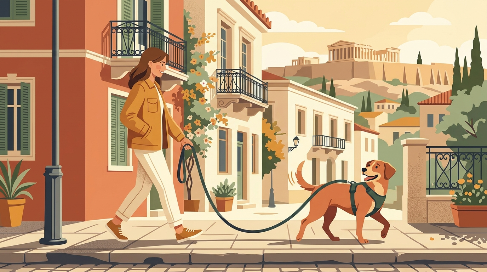

# **02\. Βόλτα στην Αθήνα χωρίς τράβηγμα στο λουρί: 4 λάθη που κάνουμε χωρίς να το ξέρουμε**

**Κατηγορία:** 01 - Η Φιλοσοφία Let It Sniff & Αστική Βόλτα  
**Προτεινόμενο URL:** /blog/volta-xoris-travigma-sto-louri-athina  
**Χρόνος ανάγνωσης:** 3 λεπτά

**Με μια ματιά (TL;DR)**

> * Οι σκύλοι δεν τραβάνε στο λουρί επειδή θέλουν να «επιβληθούν», αλλά επειδή το φυσικό τους βάδισμα είναι πιο γρήγορο από το δικό μας και το αστικό περιβάλλον είναι γεμάτο ερεθίσματα.  
> * Το τράβηγμα μπορεί να ενισχυθεί όταν οδηγεί σε κάτι επιθυμητό. Αν όμως ο σκύλος απομακρύνεται από φόβο ή κίνδυνο, προηγείται η ασφάλεια, όχι η απαίτηση για χαλαρό λουρί.
> * Το χαλαρό λουρί χτίζεται με επικοινωνία, σωστό μήκος λουριού και επιβράβευση της σύνδεσης μαζί μας.

## **Γιατί συμβαίνει αυτό; (Η λογική πίσω από τη συμπεριφορά)**

Η βόλτα στα στενά πεζοδρόμια της Αθήνας —ανάμεσα σε παρκαρισμένα αυτοκίνητα, δέντρα, γάτες και θορύβους— είναι μια τεράστια πρόκληση για κάθε σκύλο. Για τον σκύλο, ο έξω κόσμος είναι το πιο συναρπαστικό μέρος της ημέρας του.  
Το τράβηγμα μπορεί να συνδέεται με προσμονή, φόβο, διαφορετικό ρυθμό κίνησης ή προηγούμενη μάθηση. Η συνεχής πίεση συχνά δυσκολεύει τη συνεργασία, αλλά δεν εξηγούμε κάθε περίπτωση με ένα υποτιθέμενο ενιαίο αντανακλαστικό.

## **Τα 4 λάθη που κάνουμε χωρίς να το ξέρουμε**

> 1. **Χρησιμοποιούμε πολύ κοντό λουρί (ή πτυσσόμενο flexi):** Το πολύ κοντό λουρί (1–1,20μ.) κρατάει τον σκύλο σε μόνιμη τάση, ενώ το πτυσσόμενο λουρί (flexi) τον μαθαίνει ότι «για να πάω μπροστά, πρέπει να τραβάω κόντρα στο ελατήριο».  
> 2. **Ακολουθούμε τον σκύλο ενώ το λουρί είναι τεντωμένο:** Κάθε φορά που ο σκύλος τραβάει για να φτάσει σε ένα δέντρο και εμείς τον ακολουθούμε, του μαθαίνουμε ότι το τράβηγμα λειτουργεί.  
> 3. **Βγαίνουμε βόλτα ενώ ο σκύλος είναι ήδη σε υπερένταση:** Αν η ένταση ξεκινάει από τη στιγμή που πιάνουμε το λουρί στο χολ, η βόλτα είναι σχεδόν βέβαιο ότι θα ξεκινήσει με τράβηγμα.  
> 4. **Του μιλάμε μόνο όταν κάνει κάτι «λάθος»:** Αν αγνοούμε τον σκύλο όταν περπατάει ήρεμα δίπλα μας και του δίνουμε σημασία μόνο όταν τεντώνει το λουρί, χάνουμε την ευκαιρία να ενισχύσουμε τη σωστή συμπεριφορά.

## **Πώς να το εφαρμόσετε στην πράξη (Βήμα-Βήμα)**

> 1. **Ξεκινήστε ήρεμα από το σπίτι:** Βάλτε το σαμαράκι και περιμένετε λίγα δευτερόλεπτα μέχρι ο σκύλος να ηρεμήσει πριν ανοίξετε την εξώπορτα.  
> 2. **Επιβραβεύστε το «τσεκάρισμα» (Check-in):** Κάθε φορά που ο σκύλος γυρίζει αυθόρμητα να σας κοιτάξει ή περπατάει με χαλαρό λουρί, πείτε μια ήρεμη λέξη επιβράβευσης (π.χ. «μπράβο») και δώστε του μια λιχουδιά κοντά στο πόδι σας.  
> 3. **Εξασκηθείτε σε ήσυχο, ασφαλές σημείο:** Αν τραβάει προς μια μυρωδιά, σταματήστε απαλά και συνεχίστε όταν χαλαρώσει η τάση. Μην τον κρατάτε ακίνητο δίπλα σε κάτι που τον φοβίζει· απομακρυνθείτε και κάντε την άσκηση ευκολότερη.

## **Τι να κάνετε & Τι να αποφύγετε**

> * **Ναι:** Προσαρμόστε το διαθέσιμο μήκος του σταθερού λουριού στον χώρο. Κοντά σε δρόμο δεν πρέπει να μπορεί να φτάσει στο οδόστρωμα.
> * **Ναι:** Να έχετε πάντα μαζί σας νόστιμες, μαλακές λιχουδιές σε ένα τσαντάκι μέσης για άμεση επιβράβευση.  
> * **Όχι:** Μην κάνετε απότομα τινάγματα (leash pops) στο λουρί — προκαλούν πόνο, φόβο και αυξάνουν το στρες της βόλτας.  
> * **Όχι:** Μην περιμένετε τέλειο περπάτημα στα πρώτα 5 λεπτά της βόλτας· αφήστε τον πρώτα να κάνει την ανάγκη του και να αποσυμπιεστεί.

## **Μικρή Συμβουλή (Pro Tip)**

Φανταστείτε ότι το λουρί είναι ένα «χαμόγελο» (σχήμα J) ανάμεσα σε εσάς και τον σκύλο σας. Στόχος μας δεν είναι ο σκύλος να περπατάει σαν στρατιωτάκι κολλημένος στο γόνατό μας, αλλά να κινούμαστε μαζί χωρίς ένταση στο λουρί.
