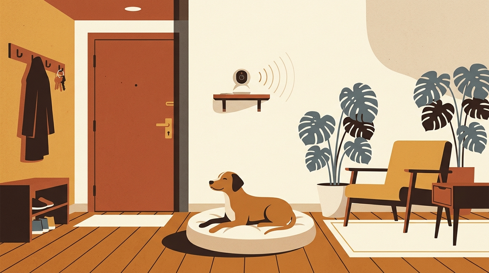

# **01\. Ο σκύλος μου γαβγίζει όταν μένει μόνος στην πολυκατοικία: Οδηγός για το Άγχος Αποχωρισμού**

**Κατηγορία:** 02 \- Ζωή στην Πολυκατοικία & Διαχείριση Άγχους  
**Προτεινόμενο URL:** /blog/agxos-apoxorismou-skylos-polykatoikia  
**Χρόνος ανάγνωσης:** 3 λεπτά

## \---

**Με μια ματιά (TL;DR)**

> * Ο σκύλος που γαβγίζει, ουρλιάζει ή καταστρέφει την πόρτα όταν μένει μόνος **δεν μας «εκδικείται»** — βιώνει κρίση πανικού.  
> * Είναι σημαντικό να ξεχωρίσουμε την απλή **βαρεμάρα** (έλλειψη εκτόνωσης) από το πραγματικό **άγχος αποχωρισμού**.  
> * Η λύση δεν είναι να τον αφήσουμε «να κλάψει μέχρι να συνηθίσει», αλλά η σταδιακή απευαισθητοποίηση σε μικρά βήματα που νιώθει ασφαλής.

## **Γιατί συμβαίνει αυτό; (Η λογική πίσω από τη συμπεριφορά)**

Οι σκύλοι είναι βαθιά κοινωνικά ζώα. Για έναν σκύλο που ζει σε διαμέρισμα στην Αθήνα, οι κηδεμόνες του είναι ολόκληρος ο κόσμος του και η πηγή της ασφάλειάς του. Όταν κλείνει η εξώπορτα, ορισμένοι σκύλοι νιώθουν τον ίδιο τρόμο που θα νιώθαμε εμείς αν ξυπνούσαμε ξαφνικά μόνοι σε ένα άγνωστο μέρος χωρίς τρόπο διαφυγής.  
**Πώς ξεχωρίζουμε τη βαρεμάρα από το άγχος αποχωρισμού;**  
Ένας σκύλος που *βαριέται* συνήθως θα φάει το Kong του, θα κοιμηθεί λίγο και μετά από 2 ώρες θα μασήσει ένα μαξιλάρι επειδή ψάχνει κάτι να κάνει. Αντίθετα, ένας σκύλος με *άγχος αποχωρισμού* ξεκινά να αγχώνεται από τη στιγμή που πιάνετε τα κλειδιά σας, δεν αγγίζει το φαγητό του όταν φύγετε, λαχανιάζει, βηματίζει αδιάκοπα και γαβγίζει ή ουρλιάζει στα πρώτα κιόλας λεπτά.

## **Πώς να το εφαρμόσετε στην πράξη (Βήμα-Βήμα)**

> 1. **Βάλτε μια κάμερα στο σαλόνι:** Μια απλή κάμερα Wi-Fi (ή ένα παλιό κινητό/λάπτοπ σε βιντεοκλήση) θα σας δείξει ακριβώς τι κάνει ο σκύλος όταν κλείνει η πόρτα και σε ποιο λεπτό ξεκινάει το άγχος.  
> 2. **Αποφορτίστε τα «σήματα αναχώρησης»:** Πιάστε τα κλειδιά σας, φορέστε το μπουφάν σας ή τα παπούτσια σας και μετά... καθίστε στον καναπέ. Κάντε το 4–5 φορές τη μέρα ώστε αυτά τα αντικείμενα να πάψουν να σημαίνουν «τώρα θα μείνω μόνος».  
> 3. **Δουλέψτε κάτω από το όριο πανικού (Threshold):** Αν ο σκύλος αντέχει μόνος 30 δευτερόλεπτα, βγείτε από την πόρτα για 15 δευτερόλεπτα και επιστρέψτε *πριν* προλάβει να αγχωθεί. Αυξήστε τον χρόνο σταδιακά (1 λεπτό, 3 λεπτά, 10 λεπτά).  
> 4. **Κάντε τις αφίξεις και τις αναχωρήσεις «βαρετές»:** Αποφύγετε τους δραματικούς αποχαιρετισμούς. Φύγετε και επιστρέψτε ήρεμα, σαν να πήγατε απλώς στο διπλανό δωμάτιο.

## **Τι να κάνετε & Τι να αποφύγετε**

> * **Ναι:** Εξασφαλίστε ότι πριν φύγετε ο σκύλος έχει κάνει μια ήρεμη βόλτα με μύρισμα (Sniffari) και έχει πάει τουαλέτα.  
> * **Ναι:** Αφήστε χαμηλή μουσική ή λευκό θόρυβο (π.χ. ανεμιστήρα ή ραδιόφωνο) για να καλύψετε τους ήχους της πολυκατοικίας.  
> * **Όχι:** Μην μαλώνετε ποτέ τον σκύλο όταν επιστρέφετε και βρίσκετε ζημιές — θα συνδέσει την επιστροφή σας με φόβο, αυξάνοντας κι άλλο το άγχος του.  
> * **Όχι:** Μην χρησιμοποιείτε κολάρα ενάντια στο γάβγισμα (σόκ, δόνηση ή σπρέι) — τιμωρούν το σύμπτωμα ενώ πολλαπλασιάζουν τον πανικό.

## **Μικρή Συμβουλή (Pro Tip)**

Ενημερώστε τους γείτονές σας στην πολυκατοικία με ένα ευγενικό σημείωμα ή μια κουβέντα («Δουλεύουμε με εκπαιδευτή πάνω στο άγχος του σκύλου μας, σας ευχαριστούμε για την υπομονή»). Όταν εσείς νιώθετε λιγότερη πίεση από τη γειτονιά, είστε πιο ήρεμοι και βοηθάτε καλύτερα τον σκύλο σας.