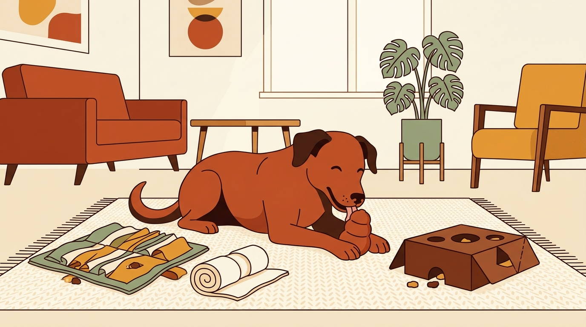

# **03\. Παιχνίδια μυαλού & Κονγκ (Enrichment): Πώς να απασχολήσετε τον σκύλο μέσα στο διαμέρισμα**

**Κατηγορία:** 02 \- Ζωή στην Πολυκατοικία & Διαχείριση Άγχους  
**Προτεινόμενο URL:** /blog/paixnidia-myalou-gia-skylous-sto-spiti  
**Χρόνος ανάγνωσης:** 3 λεπτά

## \---

**Με μια ματιά (TL;DR)**

> * Το μπολ φαγητού αδειάζει σε 30 δευτερόλεπτα, αφήνοντας τον σκύλο με ανεκπλήρωτο το φυσικό ένστικτο αναζήτησης τροφής.  
> * Ο **περιβαλλοντικός εμπλουτισμός (Enrichment)** μετατρέπει το γεύμα σε ήρεμη πνευματική εργασία μέσα στο σπίτι.  
> * Το γλείψιμο (π.χ. σε Kong ή LickiMat) και η όσφρηση εκκρίνουν ενδορφίνες που χαλαρώνουν το νευρικό σύστημα του σκύλου.

## **Γιατί συμβαίνει αυτό; (Η λογική πίσω από τη συμπεριφορά)**

Στη φύση, οι σκύλοι περνούν μεγάλο μέρος της ημέρας τους ψάχνοντας τροφή με τη μύτη, σκάβοντας, γλείφοντας και μασώντας. Σε ένα διαμέρισμα, όμως, τους προσφέρουμε την τροφή έτοιμη σε ένα μπολ και μετά περιμένουμε να κάθονται ακίνητοι στον καναπέ για τις υπόλοιπες 22 ώρες της ημέρας.  
Όταν ένας σκύλος δεν έχει πού να διοχετεύσει την πνευματική του ενέργεια, θα βρει μόνος του «δουλειά»: θα μασήσει το χαλί, θα γαβγίζει στο μπαλκόνι ή θα σας φέρνει ασταμάτητα παιχνίδια για να του δώσετε σημασία. Τα παιχνίδια μυαλού καλύπτουν αυτή ακριβώς τη βιολογική ανάγκη.

## **Πώς να το εφαρμόσετε στην πράξη (4 Εύκολες Ιδέες)**

> 1. **Το κλασικό γεμιστό Kong:** Μουλιάστε λίγη από την ξηρά τροφή του σε ζεστό νερό (ή ζωμό χωρίς αλάτι/κρεμμύδι), ανακατέψτε την με λίγο γιαούρτι ή λιωμένη μπανάνα και γεμίστε το Kong. Αν ο σκύλος σας είναι έμπειρος, βάλτε το στην κατάψυξη για 2–3 ώρες ώστε να του πάρει 30 λεπτά ήρεμου γλειψίματος.  
> 2. **Παιχνίδια χωρίς έξοδα (DIY με μια πετσέτα):** Απλώστε μια παλιά πετσέτα στο πάτωμα, σκορπίστε πάνω της μερικές κροκέτες, τυλίξτε την σε ρολό (και αν θέλετε δέστε την έναν χαλαρό κόμπο). Ο σκύλος πρέπει να χρησιμοποιήσει τη μύτη και τα πόδια του για να την ξετυλίξει.  
> 3. **Κουτιά αναζήτησης (Χαρτόκουτα):** Πριν πετάξετε το χαρτόκουτο από ένα δέμα στην ανακύκλωση, ρίξτε μέσα μερικά τσαλακωμένα χαρτιά και λίγες λιχουδιές. Αφήστε τον σκύλο να «βουτήξει» τη μύτη του και να τις ξετρυπώσει.  
> 4. **Κρυφτό λιχουδιών στο σαλόνι:** Ζητήστε από τον σκύλο να περιμένει, κρύψτε 5–6 λιχουδιές σε εύκολα σημεία (π.χ. στη γωνία του καναπέ, πίσω από την καρέκλα) και πείτε του «Ψάξε\!».

## **Τι να κάνετε & Τι να αποφύγετε**

> * **Ναι:** Ξεκινήστε με εύκολο επίπεδο δυσκολίας\! Αν το παζλ είναι πολύ δύσκολο (π.χ. κατεψυγμένο Kong την πρώτη φορά), ο σκύλος θα απογοητευτεί και θα το παρατήσει.  
> * **Ναι:** Αφαιρείτε τις θερμίδες των λιχουδιών από το ημερήσιο γεύμα του ώστε να διατηρεί υγιές βάρος.  
> * **Όχι:** Μην ενοχλείτε τον σκύλο και μην του παίρνετε το παιχνίδι ενώ τρώει — αφήστε τον να απολαύσει την εργασία του με ηρεμία.  
> * **Όχι:** Μην αφήνετε τον σκύλο χωρίς επίβλεψη με αυτοσχέδια παιχνίδια (όπως πετσέτες ή χαρτόκουτα) αν έχει την τάση να καταπίνει κομμάτια υφάσματος ή χαρτιού.

## **Μικρή Συμβουλή (Pro Tip)**

Έχετε πάντα 2 γεμιστά Kong έτοιμα στην κατάψυξη\! Είναι το απόλυτο «σωσίβιο» για τις βροχερές μέρες, τις ώρες που έχετε τηλεδιάσκεψη από το σπίτι ή όταν έχετε καλεσμένους στο σαλόνι.