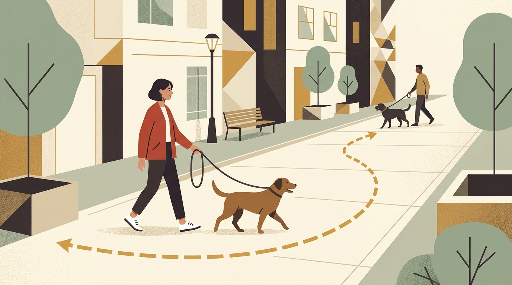

# **01\. Αντιδραστικός ή Επιθετικός Σκύλος; Γιατί ο σκύλος σας «τρελαίνεται» όταν βλέπει άλλα σκυλιά στο λουρί**

**Κατηγορία:** 01 - Αντιδραστικότητα, Φοβίες & Ερεθίσματα της Πόλης  
**Προτεινόμενο URL:** /blog/antidrastikos-skylos-sto-louri  
**Χρόνος ανάγνωσης:** 3 λεπτά

**Με μια ματιά (TL;DR)**

> * Η αντιδραστικότητα περιγράφει έντονη αντίδραση, όχι διάγνωση ή εγγύηση ότι ο σκύλος δεν θα δαγκώσει. Μπορεί να συνυπάρχει με επιθετική συμπεριφορά.
> * Οι δύο βασικές αιτίες της αντιδραστικότητας στο λουρί είναι ο **φόβος** («θέλω να φύγει μακριά μου») ή η **ματαίωση/ενθουσιασμός** («θέλω απεγνωσμένα να πάω να τον μυρίσω και το λουρί με εμποδίζει»).  
> * Το κλειδί είναι η απόσταση (κάτω από το όριο έκρηξης) και η αλλαγή του συναισθήματος με θετική σύνδεση.

## **Γιατί συμβαίνει αυτό; (Η λογική πίσω από τη συμπεριφορά)**

Στη φυσική τους επικοινωνία, οι σκύλοι πλησιάζουν ο ένας τον άλλον κάνοντας μια ανοιχτή καμπύλη και έχοντας την επιλογή να απομακρυνθούν αν νιώσουν άβολα. Στα στενά πεζοδρόμια της Αθήνας, όμως, αναγκάζουμε δύο σκύλους να περπατήσουν **μετωπικά** ο ένας προς τον άλλον, δεμένους με ένα λουρί 1,5 μέτρου.  
Όταν ο σκύλος νιώθει ότι δεν μπορεί να φύγει (λόγω του λουριού), ενεργοποιείται το ένστικτο επιβίωσης: επιλέγει το γάβγισμα και τις προβολές προς τα εμπρός για να κρατήσει τον άλλον σκύλο σε απόσταση. Σε άλλες περιπτώσεις, πρόκειται για έναν υπερ-κοινωνικό σκύλο που έχει μάθει να χαιρετάει κάθε σκυλί στον δρόμο και, όταν το λουρί τον σταματά, ξεσπάει από εκνευρισμό (leash frustration).

## **Πώς να το εφαρμόσετε στην πράξη (Βήμα-Βήμα)**

> 1. **Βρείτε την «Απόσταση Ασφαλείας» (Threshold):** Παρατηρήστε σε ποια απόσταση ο σκύλος σας βλέπει τον άλλον σκύλο αλλά μπορεί ακόμα να σας ακούσει και να φάει λιχουδιά (π.χ. στα 10 μέτρα ή στο απέναντι πεζοδρόμιο). Εκεί γίνεται όλη η εκπαίδευση.  
> 2. **Δημιουργήστε χώρο:** Επιλέξτε αναστροφή ή ασφαλή αλλαγή διαδρομής. Διασχίστε τον δρόμο μόνο από ασφαλές σημείο με ορατότητα, όχι ανάμεσα σε σταθμευμένα αυτοκίνητα.
> 3. **Παίξτε το παιχνίδι «Κοίτα το σκυλί = Λιχουδιά» (Engage-Disengage):** Μόλις ο σκύλος σας κοιτάξει ήρεμα το άλλο σκυλί από απόσταση (πριν γαβγίσει!), πείτε «Μπράβο!» και δώστε του μια κορυφαία λιχουδιά. Σταδιακά, η θέα άλλου σκύλου θα γίνει το σύνθημα για να γυρίζει να σας κοιτάζει χαρούμενος!

## **Τι να κάνετε & Τι να αποφύγετε**

> * **Ναι:** Κρατήστε ασφαλές μήκος χωρίς περιττή τάση. Το άγχος του κηδεμόνα δεν είναι η μοναδική αιτία της αντίδρασης και δεν χρειάζεται ενοχή.
> * **Ναι:** Αν πλησιάζει άλλος σκύλος, προτιμήστε απόσταση και οπτικό εμπόδιο. Μην σκορπίζετε φαγητό ανάμεσα στους δύο σκύλους ή κοντά στον δρόμο.
> * **Όχι:** Μην μαλώνετε τον σκύλο όταν γαβγίζει — αν τον τιμωρήσετε τη στιγμή που βλέπει άλλο σκυλί, θα συνδέσει τα άλλα σκυλιά με ακόμα μεγαλύτερο πόνο και φόβο.  
> * **Όχι:** Μην επιτρέπετε μετωπικές γνωριμίες «μύτη με μύτη» με τεντωμένο λουρί στη μέση του δρόμου.

## **Μικρή Συμβουλή (Pro Tip)**

Μετά από μια δύσκολη αντίδραση, προτιμήστε ήσυχη διαδρομή ή επιστροφή για ανάπαυση. Παρατηρήστε πότε επανέρχεται στην άνετη συμπεριφορά του, χωρίς να υπολογίζετε ορμόνες ή υποχρεωτικά λεπτά αποφόρτισης.

## **Πότε χρειάζεται εξατομικευμένη βοήθεια**

Αν υπάρχει ιστορικό δαγκώματος, ανακατεύθυνση προς τον συνοδό ή αδυναμία ασφαλούς ελέγχου, χρειάζεται επαγγελματική αξιολόγηση και κτηνιατρικός έλεγχος. Η αποδοχή μιας λιχουδιάς δεν αποδεικνύει από μόνη της ότι ο σκύλος είναι άνετος.
