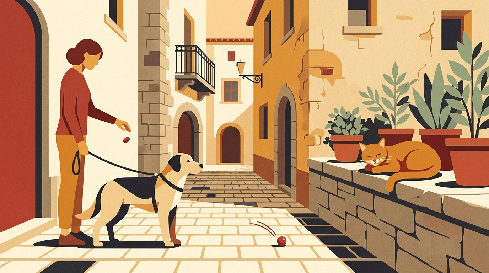

# **03\. Γάτες της γειτονιάς vs Σκύλος: Πώς να διαχειριστείτε το ένστικτο θήρευσης στα στενά της πόλης**

**Κατηγορία:** 01 - Αντιδραστικότητα, Φοβίες & Ερεθίσματα της Πόλης  
**Προτεινόμενο URL:** /blog/skylos-kynigaei-gates-sti-volta  
**Χρόνος ανάγνωσης:** 3 λεπτά

**Με μια ματιά (TL;DR)**

> * Στην Αθήνα, οι αδέσποτες γάτες βρίσκονται σε κάθε γωνία, κάτω από κάθε αυτοκίνητο και πάνω σε κάθε κάδο.  
> * Το κυνήγι της γάτας δεν είναι «κακία», αλλά η ενεργοποίηση της **αλυσίδας θήρευσης** (Εντοπισμός → Παρατήρηση → Καταδίωξη).  
> * Αντί να μαλώνουμε τον σκύλο επειδή είδε μια γάτα, του επιτρέπουμε να την παρατηρήσει ήρεμα από απόσταση και επιβραβεύουμε την αποδέσμευση της προσοχής του.

## **Γιατί συμβαίνει αυτό; (Η λογική πίσω από τη συμπεριφορά)**

Κάθε σκύλος, ανεξαρτήτως φυλής ή μεγέθους, κουβαλάει σε μικρότερο ή μεγαλύτερο βαθμό το ένστικτο του κυνηγού. Η αλυσίδα της θήρευσης ξεκινάει με τον **εντοπισμό (orient)** και το **βλέμμα/παρατήρηση (eye/stalk)**, και στη συνέχεια περνάει στην **εκτίναξη/καταδίωξη (chase)**.  
Η έγκαιρη απομάκρυνση είναι συνήθως ευκολότερη από τη διακοπή καταδίωξης. Όμως η ακινησία και το επίμονο βλέμμα μπορεί ήδη να δείχνουν έντονη προσήλωση, όχι ηρεμία. Δεν περιμένουμε να κλιμακωθεί η κατάσταση.

## **Πώς να το εφαρμόσετε στην πράξη (Βήμα-Βήμα)**

> 1. **Κρατήστε αρκετή απόσταση:** Επιβραβεύστε ένα σύντομο βλέμμα μόνο όταν το σώμα παραμένει χαλαρό και ο σκύλος μπορεί να στραφεί αλλού. Αν παγώσει, σκύψει ή καρφώσει το βλέμμα, απομακρυνθείτε· τα μέτρα διαφέρουν ανά περίπτωση.
> 2. **Διακόψτε ήρεμα πριν την έκρηξη:** Πείτε μια σταθερή λέξη επιβράβευσης (π.χ. «Ναι!») και κυλήστε μια νόστιμη λιχουδιά στο έδαφος, προς την αντίθετη κατεύθυνση από τη γάτα.  
> 3. **Προσφέρετε άλλη δραστηριότητα:** Σε ασφαλές σημείο μακριά από τη γάτα, δοκιμάστε εύκολη αναζήτηση τροφής. Δεν χρειάζεται να «ολοκληρωθεί» μια αλυσίδα για να είναι χρήσιμο το παιχνίδι.

## **Τι να κάνετε & Τι να αποφύγετε**

> * **Ναι:** Κοντύνετε ήρεμα το λουρί όταν περνάτε δίπλα από σημεία ταΐσματος γατών (αποικίες) ή πυκνούς θάμνους στις γωνίες των πολυκατοικιών.  
> * **Ναι:** Σεβαστείτε και την ασφάλεια των γατών (αλλά και των ματιών του σκύλου σας, καθώς μια εγκλωβισμένη γάτα θα αμυνθεί με τα νύχια της).  
> * **Όχι:** Μην λέτε στον σκύλο «Κοίτα τη γατούλα!» με ενθουσιώδη φωνή αν έχει έντονο κυνηγετικό ένστικτο — έτσι του ανεβάζετε τη διέγερση στα ύψη.  
> * **Όχι:** Μην κρατάτε τον σκύλο να κοιτάζει επίμονα τη γάτα. Ένα οπτικό εμπόδιο και η αποχώρηση είναι θεμιτά μέτρα πρόληψης.

## **Μικρή Συμβουλή (Pro Tip)**

Μην χρησιμοποιείτε τις γάτες της γειτονιάς ως αναγκαστικούς «βοηθούς» εκπαίδευσης. Αν αλλάζουν στάση, κρύβονται ή προσπαθούν να φύγουν, αυξήστε αμέσως την απόσταση. Σε ιστορικό τραυματισμού άλλου ζώου ζητήστε εξατομικευμένο πλάνο.
