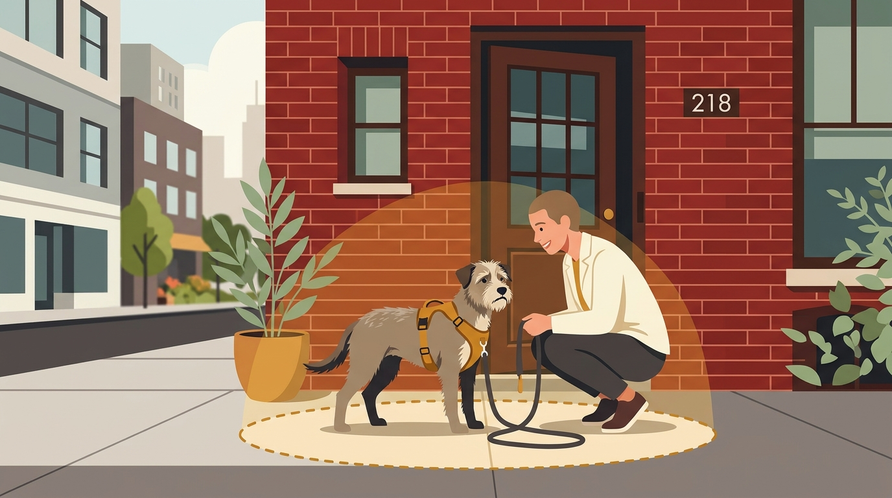

# **04\. Υιοθέτησα αδέσποτο σκύλο με φοβίες: Πώς χτίζουμε την ασφάλεια στον έξω κόσμο**

**Κατηγορία:** 01 - Αντιδραστικότητα, Φοβίες & Ερεθίσματα της Πόλης  
**Προτεινόμενο URL:** /blog/yiothesia-adespotou-skylou-fovies-volta  
**Χρόνος ανάγνωσης:** 3 λεπτά

**Με μια ματιά (TL;DR)**

> * Πολλά αδέσποτα σκυλιά που έρχονται από καταφύγια, χωράφια ή επαρχία παθαίνουν **αισθητηριακό σοκ** όταν βρίσκονται ξαφνικά στο κέντρο της Αθήνας.  
> * Αν ο σκύλος «παγώνει» στην είσοδο της πολυκατοικίας και αρνείται να περπατήσει, δεν είναι «πεισματάρης» — είναι τρομοκρατημένος.  
> * Στόχος μας τις πρώτες εβδομάδες δεν είναι οι μεγάλες βόλτες, αλλά το να νιώσει ότι **μαζί μας είναι πάντα ασφαλής**.

## **Γιατί συμβαίνει αυτό; (Η λογική πίσω από τη συμπεριφορά)**

Ένας σκύλος χωρίς σχετική εμπειρία μπορεί να δυσκολεύεται με ρολά καταστημάτων, κόρνες και πλήθη. Δεν γνωρίζουμε την ιστορία του μόνο από την προέλευσή του· παρατηρούμε τι τον δυσκολεύει τώρα.
Όταν ένας φοβικός σκύλος βγαίνει στον δρόμο, το συμπαθητικό νευρικό του σύστημα μπαίνει σε κατάσταση *Fight, Flight or Freeze* (Πάλη, Φυγή ή Πάγωμα). Συνήθως επιλέγει τη Φυγή (τραβάει πανικόβλητος προς το σπίτι με την ουρά στα σκέλια) ή το Πάγωμα (ριζώνει στο πεζοδρόμιο και τρέμει).

## **Πώς να το εφαρμόσετε στην πράξη (Βήμα-Βήμα)**

> 1. **Μειώστε τον κίνδυνο απόδρασης:** Ζητήστε σωστή εφαρμογή σαμαριού ασφαλείας και, όπου χρειάζεται, δεύτερη ασφαλή σύνδεση. Ελέγξτε κουμπώματα, ταυτότητα και στοιχεία μικροτσίπ. Κανένα σαμαράκι δεν είναι αδύνατο να βγει.
> 2. **Κρατήστε τον «Κύκλο Ασφαλείας» μικρό:** Τις πρώτες μέρες, η βόλτα μπορεί να είναι απλώς 5 μέτρα έξω από την εξώπορτα της πολυκατοικίας για τουαλέτα και αμέσως επιστροφή στο σπίτι. Μην τον πιέζετε να κάνει το γύρο του τετραγώνου.  
> 3. **Διαλέξτε τις πιο ήσυχες ώρες της ημέρας:** Βγείτε νωρίς το πρωί (πριν τις 07:30) ή αργά το βράδυ (μετά τις 22:30), όταν η κίνηση στους δρόμους είναι ελάχιστη.  
> 4. **Αφήστε τον να παρατηρεί (Watch the World Go By):** Σταθείτε στην είσοδο της πολυκατοικίας ή σε ένα ήσυχο σημείο και αφήστε τον απλώς να κοιτάζει και να μυρίζει τον αέρα, χωρίς να του ζητάτε να προχωρήσει.

## **Τι να κάνετε & Τι να αποφύγετε**

> * **Ναι:** Γίνετε προβλέψιμοι! Ακολουθείτε ακριβώς την ίδια, μικρή, «βαρετή» διαδρομή κάθε μέρα μέχρι ο σκύλος να τη μάθει απ' έξω και να χαλαρώσει.  
> * **Ναι:** Αν ο σκύλος ζητήσει να γυρίσετε σπίτι επειδή τρόμαξε, **ακούστε τον και επιστρέψτε**. Έτσι μαθαίνει ότι επικοινωνείτε μαζί του και δεν τον αναγκάζετε να εκτεθεί στον φόβο του.  
> * **Όχι:** Μην τον σέρνετε ποτέ από το λουρί όταν «παγώνει» και μην τον πηγαίνετε σε πολυσύχναστες πλατείες ή καφετέριες «για να κοινωνικοποιηθεί» (αυτό λέγεται flooding και τραυματίζει ψυχικά τον σκύλο).  
> * **Όχι:** Μην αφήνετε αγνώστους στον δρόμο να σκύβουν από πάνω του για να τον χαϊδέψουν «επειδή τον λυπούνται».

## **Μικρή Συμβουλή (Pro Tip)**

Η αποδοχή τροφής και η εξερεύνηση είναι χρήσιμες ενδείξεις μαζί με τη στάση του σώματος, όχι απόδειξη απουσίας φόβου. Αν δεν μπορεί να βγει για τις ανάγκες του, δεν τρώει ή παραμένει σε πανικό, επικοινωνήστε με κτηνίατρο και εκπαιδευτή.
