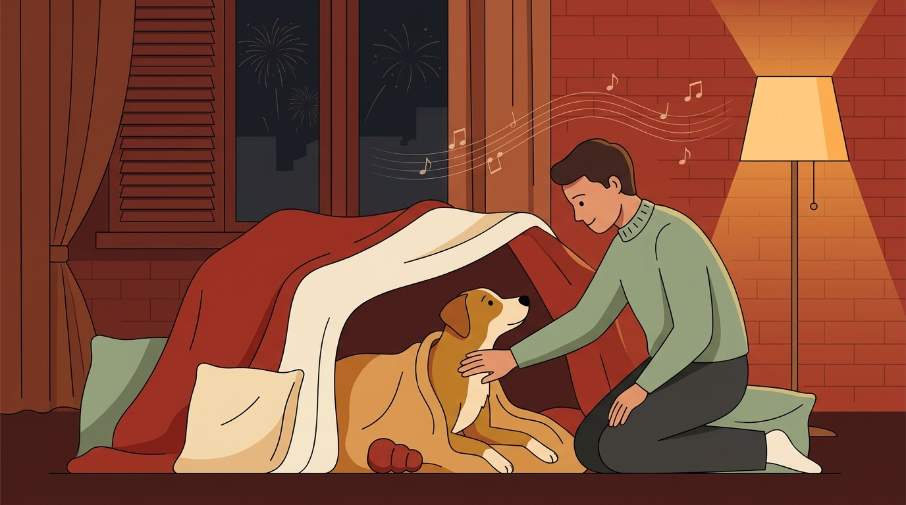

# **05\. Φόβος για κροτίδες, βεγγαλικά και κεραυνούς: Τι να κάνετε (και τι να ΜΗΝ κάνετε) την Ανάσταση και την Πρωτοχρονιά**

**Κατηγορία:** 01 - Αντιδραστικότητα, Φοβίες & Ερεθίσματα της Πόλης  
**Προτεινόμενο URL:** /blog/skylos-fovatai-krotides-veggalika  
**Χρόνος ανάγνωσης:** 3 λεπτά

**Με μια ματιά (TL;DR)**

> * Οι εκρήξεις και οι κεραυνοί μπορεί να προκαλέσουν έντονο φόβο, ενώ πολύ δυνατοί ήχοι μπορούν να βλάψουν την ακοή. Δεν υπάρχει μία ενιαία αναλογία ευαισθησίας με τον άνθρωπο.
> * **Παρηγοριά με επιλογή:** Μείνετε διαθέσιμοι και προσφέρετε ήρεμη επαφή αν τη ζητά. Μην τον αγκαλιάζετε σφιχτά και μην τον βγάζετε από την κρυψώνα του.
> * Τις μέρες του Πάσχα και της Πρωτοχρονιάς, η πρόληψη (πρωινή βόλτα, κλειστά παντζούρια, μουσική) σώζει ζωές.

## **Γιατί συμβαίνει αυτό; (Η λογική πίσω από τη συμπεριφορά)**

Γιατί ένας σκύλος τρέμει, λαχανιάζει και προσπαθεί να κρυφτεί κάτω από το κρεβάτι ή μέσα στο μπάνιο όταν ακούει κροτίδες ή κεραυνούς; Επειδή δεν γνωρίζει τι είναι τα πυροτεχνήματα. Για το δικό του ένστικτο επιβίωσης, οι εκρήξεις στον ουρανό, η δόνηση στα τζάμια και η μυρωδιά του μπαρουτιού σημαίνουν ότι ο κόσμος γύρω του καταρρέει.  
Για χρόνια κυκλοφορούσε η λανθασμένη συμβουλή: *«Μην χαϊδεύεις τον σκύλο όταν τρέμει στις κροτίδες, γιατί θα νομίζει ότι του λες μπράβο που φοβάται»*. Η σύγχρονη επιστήμη της συμπεριφοράς το έχει καταρρίψει πλήρως: δεν μπορείς να ενισχύσεις τον τρόμο με την τρυφερότητα, όπως ακριβώς δεν κάνεις ένα παιδί πιο φοβιτσιάρικο αν το πάρεις αγκαλιά όταν ακούσει έναν κεραυνό.

## **Πώς να προετοιμαστείτε στην πράξη (Βήμα-Βήμα)**

> 1. **Οργανώστε έξοδο πριν από την αναμενόμενη φασαρία:** Δεν υπάρχει εγγυημένα ασφαλής ώρα. Προτιμήστε σύντομη διαδρομή, ασφαλή εξοπλισμό και έγκαιρη επιστροφή.
> 2. **Φτιάξτε το «Καταφύγιο» μέσα στο σπίτι:** Αφήστε ανοιχτή την πόρτα του μπάνιου (που συχνά δεν έχει παράθυρα και έχει την καλύτερη ηχομόνωση) ή φτιάξτε μια φωλιά κάτω από ένα τραπέζι με κουβέρτες και τα αγαπημένα του παιχνίδια.  
> 3. **Περιορίστε ήχους και λάμψεις:** Κλείστε παράθυρα και παντζούρια διατηρώντας αερισμό και δροσιά. Χρησιμοποιήστε γνώριμη μουσική ή λευκό θόρυβο σε άνετη ένταση, όχι τόσο δυνατά ώστε να καλύπτει βίαια τις εκρήξεις.
> 4. **Προσφέρετε προαιρετικά απασχόληση πριν αρχίσει ο φόβος:** Ένα γνώριμο παιχνίδι μπορεί να βοηθήσει αν το επιλέγει. Μην τον πιέζετε να φάει και μην βασίζεστε σε αυτό για την αντιμετώπιση πανικού.

## **Τι να κάνετε & Τι να αποφύγετε**

> * **Ναι:** Αν ο σκύλος έρθει κοντά σας τρέμοντας, καθίστε δίπλα του ήρεμα, ακουμπήστε το χέρι σας στο στέρνο του με αργές, σταθερές κινήσεις και μιλήστε του γλυκά.  
> * **Ναι:** Αν ο σκύλος σας παθαίνει ακραίες κρίσεις πανικού, συμβουλευτείτε έγκαιρα (1–2 εβδομάδες πριν) τον κτηνίατρό σας για ασφαλή αγχολυτική υποστήριξη.  
> * **Όχι:** Μην αφήνετε ποτέ τον σκύλο μόνο στο σπίτι ή στο μπαλκόνι το βράδυ της Ανάστασης ή της Πρωτοχρονιάς!  
> * **Όχι:** Μην τον τραβάτε έξω από την κρυψώνα του (π.χ. κάτω από το κρεβάτι) — αφήστε τον στο σημείο που εκείνος νιώθει ασφαλής.

## **Μικρή Συμβουλή (Pro Tip)**

Τους χειμερινούς μήνες (όταν δεν υπάρχουν κροτίδες), μπορείτε να κάνετε σταδιακή απευαισθητοποίηση βάζοντας ηχογραφημένους ήχους πυροτεχνημάτων από το YouTube σε **ελάχιστη ένταση** (τόσο χαμηλά που ο σκύλος δεν αγχώνεται καθόλου) ενώ παίζετε ή του δίνετε το φαγητό του!

Οι ηχογραφήσεις δεν αναπαράγουν όλες τις δονήσεις, μυρωδιές και λάμψεις. Η εξοικείωση γίνεται σε ήρεμες περιόδους και σταματά αν προκαλεί δυσφορία. Φάρμακα δίνονται μόνο με κτηνιατρική καθοδήγηση, ποτέ ανθρώπινα ηρεμιστικά με δική μας πρωτοβουλία.
