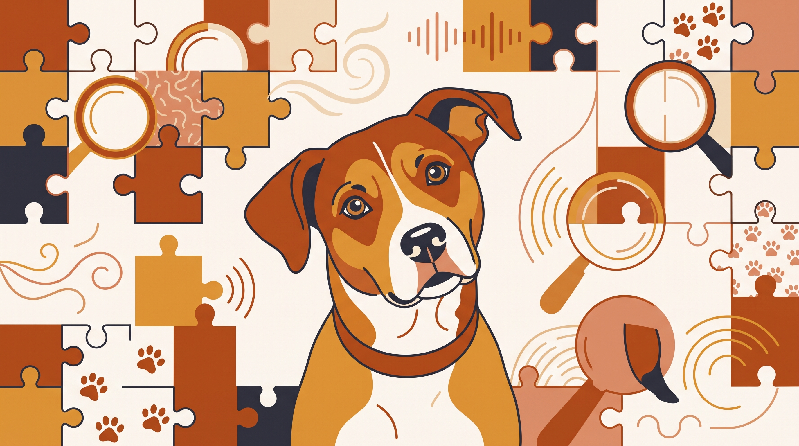

# **Πυλώνας 02: «Παράξενες» Συμπεριφορές & Καθημερινά Αινίγματα**

**Εισαγωγή:** Το γρασίδι, οι κλεμμένες κάλτσες και το επίμονο γλείψιμο συχνά μας μπερδεύουν. Εξετάζουμε πιθανές εξηγήσεις, πρακτική διαχείριση και τα σημάδια που χρειάζονται πρώτα κτηνιατρικό έλεγχο.  
**Συνδεδεμένη Υπηρεσία:** /ypiresies/antimetopisi-provlimaton-symperiforas

## **Πίνακας Περιεχομένων (Άρθρα & Οδηγοί)**

> * **1\. Γιατί ο σκύλος μου τρώει γρασίδι στη βόλτα; Πότε είναι φυσιολογικό και πότε πρέπει να ανησυχήσω**  
>   *URL:* /blog/giati-o-skylos-troei-grasidi  
>   *Περιγραφή:* Οι λόγοι (πεπτικοί, γευστικοί ή εκτόνωσης στρες) που τα σκυλιά βόσκουν χόρτα και τι να προσέχουμε με τα φυτοφάρμακα στα πάρκα της πόλης.  
> * **2\. Κοπροφαγία: Γιατί ο σκύλος μου τρώει ακαθαρσίες (δικές του ή γάτας) και πώς το κόβουμε**  
>   *URL:* /blog/skylos-troei-akatharsies-koprofagia  
>   *Περιγραφή:* Ιατρικά και συμπεριφορικά αίτια της κοπροφαγίας, γιατί οι φωνές χειροτερεύουν το πρόβλημα και πώς το διαχειριζόμαστε.  
> * **3\. Ο σκύλος μου σκάβει τον καναπέ, το κρεβάτι του ή τις γλάστρες στο μπαλκόνι: Τι προσπαθεί να κάνει;**  
>   *URL:* /blog/skylos-skavei-kanape-glastres  
>   *Περιγραφή:* Το ένστικτο φωλιάσματος, η θερμορύθμιση και η εκτόνωση ενέργειας, μαζί με εναλλακτικές λύσεις (όπως κουτιά σκαψίματος).  
> * **4\. Υπερβολικό γλείψιμο (σε πατούσες, πάτωμα ή πάνω μας): Είναι αγάπη, βαρεμάρα ή κρυφό στρες;**  
>   *URL:* /blog/skylos-gleifei-synexeia-patouses  
>   *Περιγραφή:* Το γλείψιμο μπορεί να έχει διαφορετικές αιτίες. Ελέγχουμε δέρμα, πόνο και πεπτική δυσφορία πριν το αποδώσουμε σε άγχος.  
> * **5\. Γιατί ο σκύλος μου «καβαλάει» (Humping) μαξιλάρια, άλλα σκυλιά ή τα πόδια των επισκεπτών;**  
>   *URL:* /blog/giati-o-skylos-kavalaei-podia-skylia  
>   *Περιγραφή:* Το καβάλημα μπορεί να συνδέεται με σεξουαλική συμπεριφορά, παιχνίδι, διέγερση ή δυσφορία. Το πλαίσιο καθοδηγεί τη διαχείριση.  
> * **6\. Ο σκύλος μου κλέβει κάλτσες, παπούτσια και χαρτομάντιλα και τρέχει να τον κυνηγήσω**  
>   *URL:* /blog/skylos-klevei-kaltses-papoutsia  
>   *Περιγραφή:* Πώς εμείς οι ίδιοι μετατρέπουμε την «κλοπή» στο πιο διασκεδαστικό παιχνίδι κυνηγητού, και πώς το σταματάμε αλλάζοντας την αντίδρασή μας.
