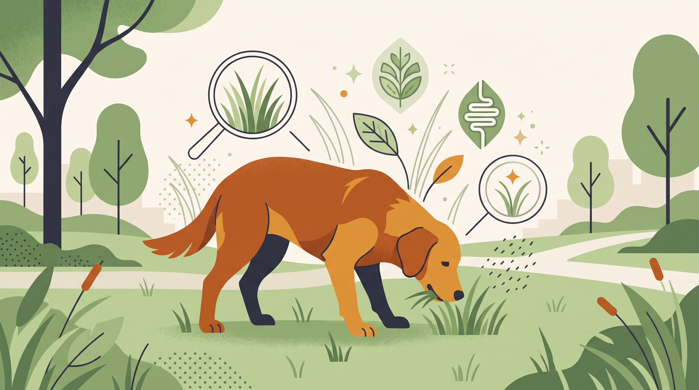

# **01\. Γιατί ο σκύλος μου τρώει γρασίδι στη βόλτα; Πότε είναι φυσιολογικό και πότε πρέπει να ανησυχήσω**

**Κατηγορία:** 02 - Παράξενες Συμπεριφορές & Καθημερινά Αινίγματα  
**Προτεινόμενο URL:** /blog/giati-o-skylos-troei-grasidi  
**Χρόνος ανάγνωσης:** 2 λεπτά

**Με μια ματιά (TL;DR)**

> * Η περιστασιακή κατανάλωση γρασιδιού δεν έχει μία αποδεδειγμένη εξήγηση.
> * Δεν σημαίνει αυτόματα έλλειψη βιταμινών ή προσπάθεια πρόκλησης εμετού.
> * Συμπτώματα και αλλαγές συχνότητας καθορίζουν την ανάγκη ελέγχου.

## **Παρατηρούμε χωρίς βιαστική διάγνωση**

Κάποιοι σκύλοι δοκιμάζουν χόρτα κατά την εξερεύνηση. Άλλοι το κάνουν μαζί με σημάδια πεπτικής δυσφορίας. Το ότι έφαγε γρασίδι δεν αρκεί για να αποφασίσουμε αν είναι άρρωστος ή αν χρειάζεται αλλαγή τροφής.

Στην πόλη υπάρχει επιπλέον κίνδυνος από φυτοφάρμακα, λιπάσματα, ακαθαρσίες και άγνωστα φυτά. Η πράσινη όψη ενός παρτεριού δεν εγγυάται ασφάλεια.

## **Πρακτική διαχείριση**

1. **Καταγράψτε το μοτίβο:** Πόσο συχνά, πόση ποσότητα και αν ακολουθούν εμετός, διάρροια ή μειωμένη όρεξη.
2. **Αποφύγετε αμφίβολα σημεία:** Μην επιτρέπετε βόσκηση σε ψεκασμένους χώρους ή ανάμεσα σε άγνωστα φυτά.
3. **Καλέστε ήρεμα μακριά:** Επιβραβεύστε την απομάκρυνση και συνεχίστε την εξερεύνηση αλλού, χωρίς τράβηγμα στο στόμα.
4. **Διατηρήστε κατάλληλη διατροφή:** Μην προσθέτετε συμπληρώματα ή αλλάζετε απότομα τροφή χωρίς κτηνιατρική συμβουλή.

## **Πότε επικοινωνούμε με κτηνίατρο**

Επαναλαμβανόμενος εμετός, αίμα, λήθαργος, πόνος ή επίμονη αλλαγή χρειάζονται αξιολόγηση. Φουσκωμένη κοιλιά με άκαρπες προσπάθειες εμετού είναι επείγον περιστατικό.

Σε πιθανή έκθεση σε φυτοφάρμακο ή τοξικό φυτό, επικοινωνήστε αμέσως. Μην προκαλείτε εμετό και μην δίνετε «αντίδοτα» του σπιτιού. Αν είναι ασφαλές, κρατήστε πληροφορίες για το προϊόν ή φωτογραφία του φυτού.

**Διαβάστε επίσης:** [Κατάποση σκουπιδιών στη βόλτα](/blog/skylos-troei-skoupidia-apo-ton-dromo).
