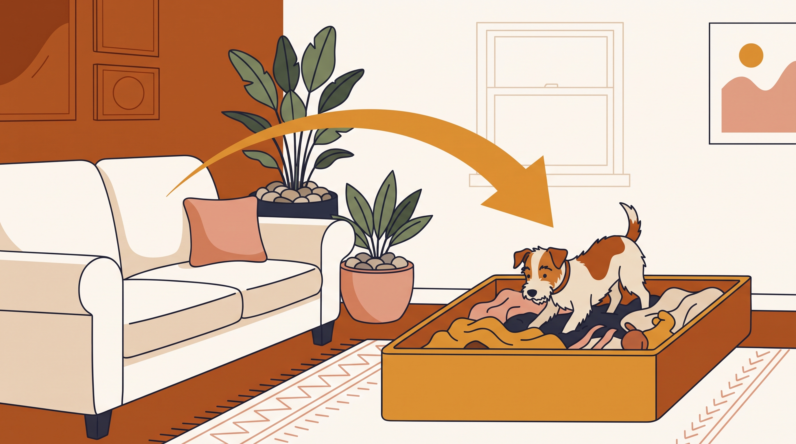

# **03\. Ο σκύλος μου σκάβει τον καναπέ, το κρεβάτι του ή τις γλάστρες στο μπαλκόνι: Τι προσπαθεί να κάνει;**

**Κατηγορία:** 02 - Παράξενες Συμπεριφορές & Καθημερινά Αινίγματα  
**Προτεινόμενο URL:** /blog/skylos-skavei-kanape-glastres  
**Χρόνος ανάγνωσης:** 2 λεπτά

**Με μια ματιά (TL;DR)**

> * Το σύντομο ξύσιμο πριν τον ύπνο μπορεί να είναι συνηθισμένη συμπεριφορά.
> * Το επίμονο σκάψιμο χρειάζεται παρατήρηση του πλαισίου.
> * Προστατεύουμε έπιπλα και φυτά, προσφέροντας ασφαλή εναλλακτική.

## **Τι προσπαθεί να πετύχει**

Ο σκύλος μπορεί να διαμορφώνει σημείο ανάπαυσης, να εξερευνά μυρωδιές ή να αναζητά δραστηριότητα. Αν όμως δεν μπορεί να βολευτεί, λαχανιάζει ή αλλάζει συνεχώς θέση, εξετάζουμε δυσφορία και πιθανό πόνο.

Στις γλάστρες υπάρχουν κίνδυνοι από τοξικά φυτά, λιπάσματα, μικρά χαλίκια και ανατροπή δοχείων. Το μπαλκόνι δεν γίνεται ασφαλές μόνο επειδή επιβλέπουμε το σκάψιμο.

## **Πώς το διαχειριζόμαστε**

1. **Περιορίστε την πρόσβαση:** Μετακινήστε επικίνδυνες γλάστρες και ασφαλίστε το μπαλκόνι. Μην χρησιμοποιείτε ερεθιστικά απωθητικά.
2. **Προσφέρετε κατάλληλο κρεβάτι:** Δοκιμάστε άνετη, ανθεκτική επιφάνεια και διαφορετική δροσερή θέση.
3. **Δώστε επιτρεπόμενη αναζήτηση:** Ένα ρηχό κουτί με ασφαλές υλικό ή απλωμένη πετσέτα μπορεί να προσφέρει δραστηριότητα, μόνο με επίβλεψη και χωρίς κατάποση κομματιών.
4. **Παρατηρήστε πότε εμφανίζεται:** Αν συμβαίνει μόνο στην απουσία σας, αξιολογήστε την πιθανότητα άγχους αντί να προσθέτετε απλώς παιχνίδια.

## **Πότε σταματάμε τις αυτοσχέδιες λύσεις**

Αν καταπίνει ύφασμα, χώμα ή πέτρες, αφαιρέστε την πρόσβαση και μιλήστε με κτηνίατρο. Ξαφνική έντονη ανησυχία, πόνος ή αλλαγή ύπνου χρειάζονται επίσης έλεγχο.

Δεν χρειάζεται να εξαφανιστεί κάθε φυσική κίνηση φωλιάσματος. Στόχος είναι ασφαλής έκφραση χωρίς ζημιά ή κίνδυνο.

**Διαβάστε επίσης:** [Παιχνίδια μυαλού στο σπίτι](/blog/paixnidia-myalou-gia-skylous-sto-spiti).
