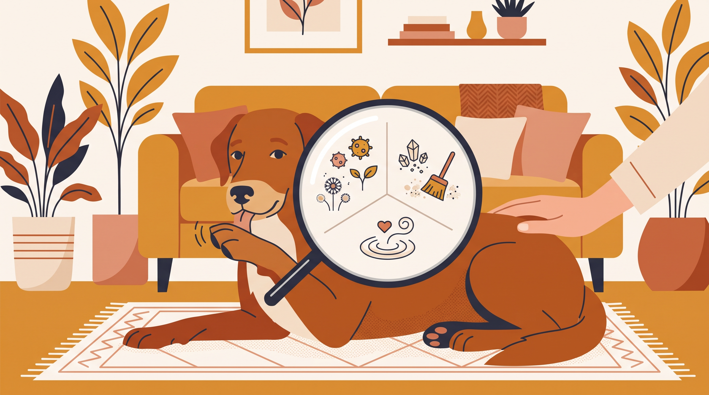

# **04\. Υπερβολικό γλείψιμο (σε πατούσες, πάτωμα ή πάνω μας): Είναι αγάπη, βαρεμάρα ή κρυφό στρες;**

**Κατηγορία:** 02 - Παράξενες Συμπεριφορές & Καθημερινά Αινίγματα  
**Προτεινόμενο URL:** /blog/skylos-gleifei-synexeia-patouses  
**Χρόνος ανάγνωσης:** 2 λεπτά

**Με μια ματιά (TL;DR)**

> * Το επίμονο γλείψιμο δεν είναι πάντα αγάπη ή βαρεμάρα.
> * Δέρμα, πόνος και πεπτική δυσφορία χρειάζονται αξιολόγηση.
> * Η διακοπή του γλειψίματος δεν θεραπεύει απαραίτητα την αιτία.

## **Το σημείο και η συχνότητα έχουν σημασία**

Γλείψιμο μιας πατούσας μπορεί να συνδέεται με τοπικό ερεθισμό ή ξένο σώμα. Γλείψιμο πολλών σημείων μπορεί να έχει άλλες αιτίες. Επίμονο γλείψιμο επιφανειών μπορεί επίσης να συνοδεύει ναυτία ή δυσφορία.

Δεν μπορούμε να ξεχωρίσουμε με βεβαιότητα σωματική και συμπεριφορική αιτία από ένα βίντεο. Μπορεί να συνυπάρχουν, ενώ το ίδιο το γλείψιμο ενδέχεται να επιδεινώνει το δέρμα.

## **Τι κάνουμε πρώτα**

1. **Παρατηρήστε χωρίς βίαιο χειρισμό:** Δείτε αν υπάρχει κοκκινίλα, πρήξιμο ή πληγή, μόνο αν ο σκύλος ανέχεται την επαφή.
2. **Καταγράψτε περιστάσεις:** Ώρα, διάρκεια, σημείο, σχέση με βόλτα ή φαγητό. Ένα αυθόρμητο βίντεο μπορεί να βοηθήσει τον κτηνίατρο.
3. **Περιορίστε κινδύνους:** Απομακρύνετε καθαριστικά και ακατάλληλες επιφάνειες. Μην εφαρμόζετε ανθρώπινες κρέμες ή αιθέρια έλαια.
4. **Ζητήστε αξιολόγηση:** Ιδιαίτερα αν επαναλαμβάνεται, τραυματίζει το δέρμα ή συνοδεύεται από χωλότητα και πεπτικά συμπτώματα.

## **Μετά τον έλεγχο**

Αν υπάρχει συνιστώσα άγχους, οργανώστε ήρεμη ρουτίνα και κατάλληλη απασχόληση μαζί με το θεραπευτικό πλάνο. Μην τιμωρείτε και μην χρησιμοποιείτε απλώς περισσότερα παιχνίδια γλειψίματος για να καλύψετε επίμονο σύμπτωμα.

Προστατευτικός εξοπλισμός χρησιμοποιείται σύμφωνα με κτηνιατρικές οδηγίες. Η πρόληψη τραυματισμού και η αντιμετώπιση της αιτίας προχωρούν μαζί.

**Διαβάστε επίσης:** [Πόνος και αλλαγή συμπεριφοράς](/blog/ponos-kai-epithetikotita-skylou).
