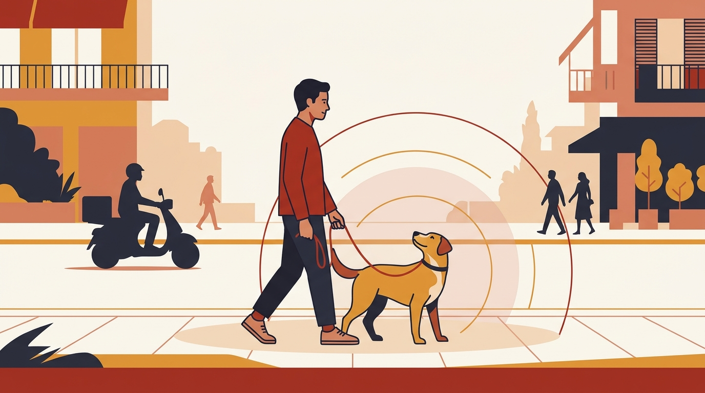

# **Πυλώνας 03: Αντιδραστικότητα, Φοβίες & Ερεθίσματα της Πόλης**

**Εισαγωγή:** Το κέντρο της Αθήνας είναι γεμάτο έντονα ερεθίσματα (μηχανάκια, θορύβους, γάτες, άλλα σκυλιά σε στενά πεζοδρόμια). Αυτός ο πυλώνας εξηγεί την επιστήμη πίσω από την αντιδραστικότητα και τον φόβο, προσφέροντας ασφαλείς μεθόδους αποκατάστασης.  
**Συνδεδεμένη Υπηρεσία:** /ypiresies/antimetopisi-provlimaton-symperiforas

## **Πίνακας Περιεχομένων (Άρθρα & Οδηγοί)**

> * **1\. Αντιδραστικός ή Επιθετικός Σκύλος; Γιατί ο σκύλος σας «τρελαίνεται» όταν βλέπει άλλα σκυλιά στο λουρί**  
>   *URL:* /blog/antidrastikos-skylos-sto-louri  
>   *Περιγραφή:* Η αντιδραστικότητα μπορεί να συνυπάρχει με επιθετική συμπεριφορά. Μαθαίνουμε να παρατηρούμε φόβο, ματαίωση και όρια ανοχής χωρίς να υποτιμούμε τον κίνδυνο.  
> * **2\. Ο σκύλος μου κυνηγάει μηχανάκια, πατίνια και ντελιβεράδες: Τι κρύβεται πίσω από αυτή τη συμπεριφορά**  
>   *URL:* /blog/skylos-kynigaei-mixanakia-patinia  
>   *Περιγραφή:* Πώς το ένστικτο καταδίωξης και το στρες από τον θόρυβο πυροδοτούν εκρήξεις στη βόλτα και πώς αλλάζουμε το συναισθηματικό πρόσημο.  
> * **3\. Γάτες της γειτονιάς vs Σκύλος: Πώς να διαχειριστείτε το ένστικτο θήρευσης στα στενά της πόλης**  
>   *URL:* /blog/skylos-kynigaei-gates-sti-volta  
>   *Περιγραφή:* Πρόληψη καταδίωξης, έγκαιρη απομάκρυνση και ασφαλής αποδέσμευση της προσοχής, με σεβασμό και στην ευημερία των γατών.  
> * **4\. Υιοθέτησα αδέσποτο σκύλο με φοβίες: Πώς χτίζουμε την ασφάλεια στον έξω κόσμο**  
>   *URL:* /blog/yiothesia-adespotou-skylou-fovies-volta  
>   *Περιγραφή:* Πρακτικά βήματα για σκυλιά που φοβούνται να βγουν από την είσοδο της πολυκατοικίας ή πανικοβάλλονται από τους ήχους του δρόμου.  
> * **5\. Φόβος για κροτίδες, βεγγαλικά και κεραυνούς: Τι να κάνετε (και τι να ΜΗΝ κάνετε) την Ανάσταση και την Πρωτοχρονιά**  
>   *URL:* /blog/skylos-fovatai-krotides-veggalika  
>   *Περιγραφή:* Προετοιμασία ήσυχου χώρου, παρηγοριά όταν ο σκύλος την επιλέγει και έγκαιρη κτηνιατρική υποστήριξη για έντονο φόβο.  
> * **6\. Φύλαξη Πόρων (Resource Guarding): Όταν ο σκύλος γρυλίζει πάνω από το φαγητό, το κόκαλο ή τον καναπέ**  
>   *URL:* /blog/skylos-grylizei-sto-fagito-kanape  
>   *Περιγραφή:* Γιατί η ανασφάλεια γύρω από πολύτιμους πόρους είναι φυσιολογική συμπεριφορά επιβίωσης και πώς αντιμετωπίζεται χωρίς ποτέ να βάζουμε χέρι στο μπολ.
