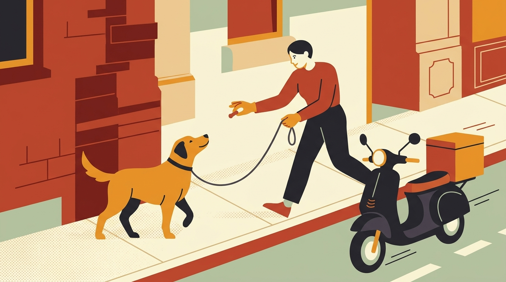

# **02\. Ο σκύλος μου κυνηγάει μηχανάκια, πατίνια και ντελιβεράδες: Τι κρύβεται πίσω από αυτή τη συμπεριφορά**

**Κατηγορία:** 03 - Αντιδραστικότητα, Φοβίες & Ερεθίσματα της Πόλης  
**Προτεινόμενο URL:** /blog/skylos-kynigaei-mixanakia-patinia  
**Χρόνος ανάγνωσης:** 3 λεπτά

**Με μια ματιά (TL;DR)**

> * Τα μηχανάκια, τα ηλεκτρικά πατίνια και τα ποδήλατα συνδυάζουν δύο ισχυρά ερεθίσματα: **γρήγορη κίνηση** και **απρόβλεπτο θόρυβο**.  
> * Συχνά η συμπεριφορά αυτή πηγάζει είτε από το ένστικτο καταδίωξης/βόσκησης είτε από φόβο (ο σκύλος προσπαθεί να «διώξει» το θορυβώδες αντικείμενο).  
> * Επειδή το μηχανάκι όντως απομακρύνεται γρήγορα, ο σκύλος πιστεύει ότι **το γάβγισμά του το έδιωξε με επιτυχία**!

## **Γιατί συμβαίνει αυτό; (Η λογική πίσω από τη συμπεριφορά)**

Η Αθήνα είναι γεμάτη δίκυκλα που περνούν ξυστά από τα πεζοδρόμια, φρενάρουν απότομα ή ανεβαίνουν σε πεζόδρομους. Για το νευρικό σύστημα του σκύλου, ένα αντικείμενο που εμφανίζεται ξαφνικά με εκκωφαντικό ήχο εξάτμισης ή περνάει αθόρυβα και γρήγορα (όπως τα ηλεκτρικά πατίνια) αποτελεί άμεση απειλή ή ισχυρό ερέθισμα καταδίωξης.  
Η κληρονομικότητα μπορεί να επηρεάζει την ευαισθησία στην κίνηση, αλλά δεν προβλέπουμε τη συμπεριφορά μόνο από φυλή ή εμφάνιση. Εμπειρίες, φόβος, υγεία και προηγούμενη μάθηση έχουν επίσης σημασία.

## **Πώς να το εφαρμόσετε στην πράξη (Βήμα-Βήμα)**

> 1. **Περπατήστε από την εσωτερική πλευρά του πεζοδρομίου:** Κρατήστε τον σκύλο από την πλευρά των κτιρίων και εσάς από την πλευρά του δρόμου, ώστε το σώμα σας να λειτουργεί ως φυσικό όριο ασφαλείας.  
> 2. **Ξεκινήστε με σταθμευμένα και μακρινά δίκυκλα:** Καθίστε σε ένα παγκάκι ή σε μια πλατεία με οπτική επαφή σε δρόμο (π.χ. στα 15–20 μέτρα). Κάθε φορά που περνάει ένα μηχανάκι ή πατίνι και ο σκύλος το κοιτάζει χωρίς να αντιδράσει, επιβραβεύστε με μια λιχουδιά υψηλής αξίας.  
> 3. **Συνδέστε τον ήχο της μηχανής με φαγητό:** Μόλις ακούσετε από μακριά τον χαρακτηριστικό ήχο ενός ντελιβερά που πλησιάζει στο στενό, *πριν* καν φανεί οπτικά, πείτε μια χαρούμενη λέξη (π.χ. «Μηχανάκι!») και αρχίστε να ταΐζετε τον σκύλο σας 2–3 λιχουδιές στη σειρά μέχρι να προσπεράσει.

## **Τι να κάνετε & Τι να αποφύγετε**

> * **Ναι:** Χρησιμοποιήστε ένα γερό, ανατομικό σαμαράκι (με κρίκο και στο στήθος αν ο σκύλος είναι μεγαλόσωμος) για να έχετε ασφαλή έλεγχο χωρίς να τραυματίζεται ο λαιμός του.  
> * **Ναι:** Δώστε στον σκύλο εναλλακτικούς, ασφαλείς τρόπους να εκτονώνει την ενέργειά του (π.χ. παιχνίδια όσφρησης και αναζήτησης).  
> * **Όχι:** Μην περπατάτε στην άκρη του πεζοδρομίου με χαλαρό λουρί 3 μέτρων σε δρόμους με κίνηση — η ασφάλεια προηγείται πάντα.  
> * **Όχι:** Μην απαιτείτε ακινησία δίπλα σε όχημα που τον τρομάζει. Κινηθείτε μαζί σε ασφαλή απόσταση, χωρίς άλματα για λιχουδιές κοντά στην κυκλοφορία.

## **Μικρή Συμβουλή (Pro Tip)**

Τα ηλεκτρικά πατίνια αιφνιδιάζουν τους σκύλους επειδή είναι αθόρυβα! Ρίχνετε συχνά μια ματιά πίσω σας όταν περπατάτε σε πεζόδρομους ή ποδηλατόδρομους, ώστε να μην περάσει κάποιο πατίνι ξυστά από την ουρά του σκύλου σας χωρίς να το έχετε δει.
