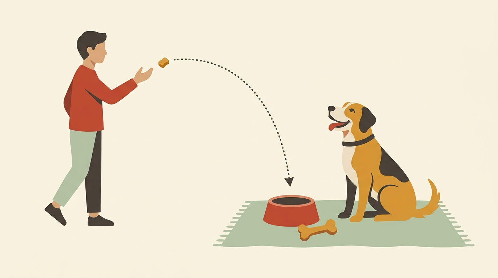

# **06\. Φύλαξη Πόρων (Resource Guarding): Όταν ο σκύλος γρυλίζει πάνω από το φαγητό, το κόκαλο ή τον καναπέ**

**Κατηγορία:** 03 - Αντιδραστικότητα, Φοβίες & Ερεθίσματα της Πόλης  
**Προτεινόμενο URL:** /blog/skylos-grylizei-sto-fagito-kanape  
**Χρόνος ανάγνωσης:** 3 λεπτά

**Με μια ματιά (TL;DR)**

> * Η **Φύλαξη Πόρων (Resource Guarding)** βασίζεται στον φόβο της απώλειας: ο σκύλος φοβάται ότι θα του πάρετε κάτι που θεωρεί εξαιρετικά πολύτιμο.  
> * Η αφαίρεση του μπολ και η ενόχληση κατά το φαγητό μπορούν να επιδεινώσουν τη φύλαξη. Δεν είναι η μοναδική αιτία· εμπειρίες, προδιάθεση και πόνος μπορεί επίσης να συμβάλλουν.
> * Η λύση είναι να πείσουμε τον σκύλο ότι η προσέγγισή μας σημαίνει **κέρδος (προσθήκη)** και ποτέ απώλεια.

## **Γιατί συμβαίνει αυτό; (Η λογική πίσω από τη συμπεριφορά)**

Η φύλαξη μπορεί να αφορά τροφή, παιχνίδια ή σημεία ανάπαυσης. Η προδιάθεση, οι εμπειρίες και η σωματική άνεση διαφέρουν, γι’ αυτό δεν αποδίδουμε κάθε περίπτωση σε μία αιτία. Το ότι μια συμπεριφορά έχει φυσικές βάσεις δεν σημαίνει ότι αγνοούμε τον κίνδυνο.
Δυστυχώς, πολλοί κηδεμόνες εφαρμόζουν την παλιά, επικίνδυνη συμβουλή να ενοχλούν το κουτάβι την ώρα που τρώει ή να του παίρνουν το μπολ από μπροστά του. Φανταστείτε να τρώτε σε ένα εστιατόριο και ο σερβιτόρος να σας αρπάζει το πιάτο κάθε δύο λεπτά. Την τρίτη φορά, θα βάλετε τα χέρια σας γύρω από το πιάτο και θα θυμώσετε! Αυτό ακριβώς κάνει και ο σκύλος: **δεν είναι «κυρίαρχος», είναι ανασφαλής**.

## **Πώς να το εφαρμόσετε στην πράξη (Βήμα-Βήμα)**

> 1. **Αφήστε τον σκύλο να τρώει με απόλυτη ησυχία:** Τοποθετήστε το μπολ του σε μια ήσυχη γωνία και απομακρυνθείτε. Κανείς (ειδικά μικρά παιδιά ή άλλα κατοικίδια) δεν πρέπει να τον πλησιάζει όταν τρώει ή ασχολείται με κατάλληλο μάσημα.
> 2. **Μάθετε τα προειδοποιητικά σημάδια (πριν το γρύλισμα):** Πριν γρυλίζει ένας σκύλος, συνήθως «παγώνει» πάνω από το αντικείμενο, αρχίζει να μασάει πιο γρήγορα, κατεβάζει το κεφάλι ή φαίνεται το ασπράδι του ματιού του (whale eye). Αν δείτε αυτά τα σημάδια, δώστε του αμέσως χώρο.  
> 3. **Μην δοκιμάζετε τα όριά του:** Η θετική σύνδεση της προσέγγισης με κάτι ευχάριστο χρειάζεται εξατομικευμένο πλάνο. Όταν υπάρχει ήδη γρύλισμα, μην κάνετε μόνοι σας επαναλαμβανόμενες προσεγγίσεις στο μπολ ούτε θεωρείτε τα δύο μέτρα ασφαλή για κάθε σκύλο.

## **Τι να κάνετε & Τι να αποφύγετε**

> * **Ναι:** Αν πρέπει οπωσδήποτε να πάρετε κάτι επικίνδυνο που έχει ο σκύλος, καλέστε τον στην κουζίνα (π.χ. ανοίγοντας το ψυγείο ή το σακουλάκι με τις λιχουδιές) και, αφού έρθει σε εσάς, ένας δεύτερος άνθρωπος (ή εσείς αφού κλείσετε την πόρτα) μαζεύει ήρεμα το αντικείμενο.  
> * **Ναι:** Μαζέψτε από το πάτωμα αντικείμενα που πυροδοτούν φύλαξη (παπούτσια, παιδικά παιχνίδια, χαρτομάντιλα) — η πρόληψη μειώνει τις συγκρούσεις.  
> * **Όχι:** **Μην τιμωρείτε το γρύλισμα.** Μπορεί να κατασταλεί η προειδοποίηση χωρίς να μειωθεί η δυσφορία, αυξάνοντας τον κίνδυνο δαγκώματος.
> * **Όχι:** Μην βάζετε ποτέ το χέρι σας μέσα στο μπολ του.

## **Μικρή Συμβουλή (Pro Tip)**

Μην τραβάτε τον σκύλο από τον καναπέ ή το κολάρο. Διδάξτε πρόσκληση μετακίνησης όταν είναι άνετος, όχι στη μέση σύγκρουσης. Σε φύλαξη χώρου, δάγκωμα ή παρουσία παιδιών χρησιμοποιήστε ασφαλή χωρισμό και ζητήστε επαγγελματική αξιολόγηση, μαζί με έλεγχο για πόνο.
