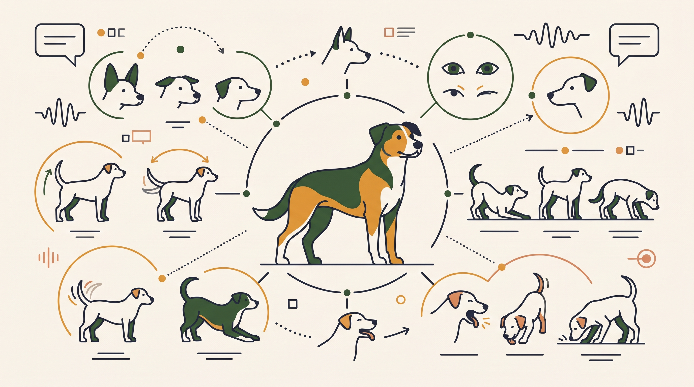

# **Πυλώνας 03: Πώς Εκφράζονται τα Σκυλιά (Γλώσσα Σώματος & Σήματα Ηρεμίας)**

**Προτεινόμενο URL:** /blog/enotita/pos-ekfrazontai-ta-skylia-glossa-somatos
**Χρώμα:** #3D5C38
**Εισαγωγή:** Η ουρά, το βλέμμα και η στάση του σώματος μας δίνουν χρήσιμες ενδείξεις, όχι αλάνθαστες μεταφράσεις συναισθημάτων. Μαθαίνουμε να παρατηρούμε ολόκληρο τον σκύλο και το πλαίσιο, σεβόμενοι την ανάγκη του για απόσταση.  
**Συνδεδεμένη Σελίδα:** /o-alexandros

## **Πίνακας Περιεχομένων (Άρθρα & Οδηγοί)**

> * **1\. Σήματα ηρεμίας: 10 ενδείξεις που αξίζει να παρατηρείτε στον σκύλο**  
>   *URL:* /blog/simata-iremias-skylou-calming-signals  
>   *Περιγραφή:* Γλείψιμο μύτης, χασμουρητό και αποστροφή βλέμματος μπορεί να συνδέονται με δυσφορία, αλλά ερμηνεύονται πάντα μέσα στο πλαίσιο.  
> * **2\. Κουνάει την ουρά του: Σημαίνει πάντα ότι είναι χαρούμενος; (Ο μεγαλύτερος μύθος)**  
>   *URL:* /blog/ti-simainei-otan-kounaei-tin-oura-o-skylos  
>   *Περιγραφή:* Πώς το ύψος, η ταχύτητα, η ακαμψία και η κατεύθυνση της ουράς φανερώνουν διέγερση, ανασφάλεια ή χαλαρή φιλικότητα.  
> * **3\. Η κλίμακα της επιθετικότητας: Πώς αναγνωρίζουμε την κλιμάκωση της δυσφορίας**  
>   *URL:* /blog/klimaka-epithetikotitas-skylou-simadia  
>   *Περιγραφή:* Χρήσιμο μοντέλο παρατήρησης, όχι υποχρεωτική σειρά σημάτων. Ένα δάγκωμα μπορεί να συμβεί χωρίς ορατή προειδοποίηση.  
> * **4\. Whale Eye (Ασπράδι ματιού), Αυτιά & Στόμα: Πώς να διαβάζετε το πρόσωπο του σκύλου σας**  
>   *URL:* /blog/pos-diavazoume-to-prosopo-tou-skylou  
>   *Περιγραφή:* Οδηγός ανάγνωσης των χαρακτηριστικών του προσώπου: πότε το κλειστό στόμα και το πλάγιο βλέμμα δείχνουν ένταση.  
> * **5\. «Μου γύρισε την κοιλιά για χάδια!» (Ή μήπως φοβάται και ζητάει να απομακρυνθείτε;)**  
>   *URL:* /blog/skylos-gyrizei-tin-koilia-xadia-i-fovos  
>   *Περιγραφή:* Πώς ξεχωρίζουμε το χαλαρό γύρισμα για χάδια από το γύρισμα κατευνασμού (appeasement) ενός φοβισμένου σκύλου.  
> * **6\. Το Τεστ Συναίνεσης (3-Second Rule): Θέλει όντως ο σκύλος σας να τον χαϊδεύετε αυτή τη στιγμή;**  
>   *URL:* /blog/test-synainesis-sta-xadia-skylou  
>   *Περιγραφή:* Πώς ρωτάμε τον σκύλο αν θέλει επαφή, πού του αρέσει πραγματικά να τον χαϊδεύουν και γιατί αποφεύγουμε τις σφιχτές αγκαλιές.  
> * **7\. Τίναγμα σώματος, τέντωμα και χασμουρητό: Τι μπορεί να σημαίνουν**  
>   *URL:* /blog/tinagma-somatos-skylou-apovoli-stres  
>   *Περιγραφή:* Παρατηρούμε τη μετάβαση ανάμεσα σε δραστηριότητες χωρίς να θεωρούμε κάθε κίνηση απόδειξη αποβολής στρες.
