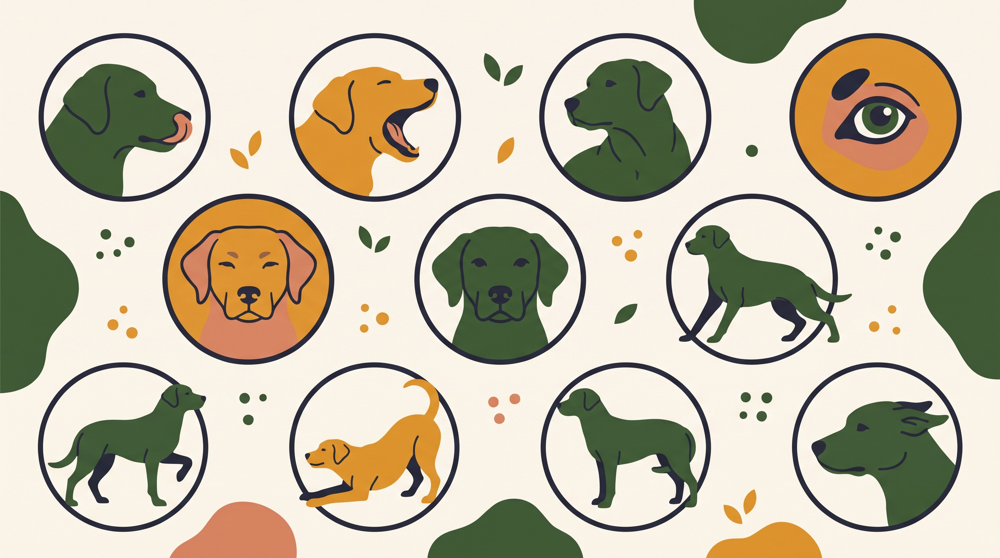

# **01\. Σήματα ανησυχίας: 10 ενδείξεις που αξίζει να παρατηρείτε στον σκύλο**

**Κατηγορία:** 03 - Πώς Εκφράζονται τα Σκυλιά (Γλώσσα Σώματος & Σήματα Ηρεμίας)  
**Προτεινόμενο URL:** /blog/simata-iremias-skylou-calming-signals  
**Χρόνος ανάγνωσης:** 2 λεπτά

**Με μια ματιά (TL;DR)**

> * Κανένα σήμα δεν μεταφράζεται πάντα με τον ίδιο τρόπο.
> * Παρατηρούμε συνδυασμούς, αλλαγές και περιβάλλον.
> * Όταν υπάρχει αμφιβολία, προσφέρουμε περισσότερο χώρο.

## **Τι σημαίνει «σήματα ηρεμίας»**

Ο όρος χρησιμοποιείται για κινήσεις που μπορεί να εμφανίζονται σε κοινωνική ένταση ή αποφυγή σύγκρουσης. Δεν αποτελεί αλάνθαστο λεξικό. Ένα χασμουρητό μπορεί να σχετίζεται με κούραση και το γλείψιμο της μύτης με φαγητό.

## **Δέκα χρήσιμες παρατηρήσεις**

1. **Γλείψιμο μύτης:** Προσέξτε αν εμφανίζεται όταν πλησιάζει χέρι ή πρόσωπο.
2. **Χασμουρητό:** Εξετάστε το περιβάλλον, όχι μόνο αν νυστάζει.
3. **Στροφή κεφαλιού:** Μπορεί να αποφεύγει έντονη επαφή.
4. **Αποστροφή βλέμματος:** Δεν σημαίνει ότι «αγνοεί επίτηδες».
5. **Χαμήλωμα σώματος:** Συνεκτιμήστε ουρά, αυτιά και δυνατότητα διαφυγής.
6. **Αργή κίνηση:** Μπορεί να δείχνει επιφύλαξη, αλλά και σωματική δυσκολία.
7. **Ακινησία:** Το πάγωμα δεν είναι πάντα χαλαρή υπακοή.
8. **Ανύψωση πατούσας:** Μπορεί να συνδέεται με αβεβαιότητα ή άλλους λόγους.
9. **Ξαφνικό μύρισμα εδάφους:** Ενδέχεται να είναι εξερεύνηση ή αλλαγή δραστηριότητας.
10. **Απομάκρυνση:** Είναι επιλογή που χρειάζεται σεβασμό.

## **Πώς απαντάμε**

Σταματήστε το άγγιγμα ή αυξήστε απόσταση από το ερέθισμα. Παρατηρήστε αν το σώμα γίνεται πιο άνετο και αν επιλέγει ξανά επαφή. Μην τον ακολουθείτε για να «συνηθίσει».

Δεν περιμένουμε όλα τα σημάδια πριν παρέμβουμε. Επίμονο πάγωμα, γρύλισμα ή ιστορικό δαγκώματος χρειάζεται εξατομικευμένη βοήθεια. Ξαφνικές αλλαγές στάσης ή κίνησης μπορεί να απαιτούν κτηνιατρικό έλεγχο.

**Διαβάστε επίσης:** [Συναίνεση στα χάδια](/blog/test-synainesis-sta-xadia-skylou).
