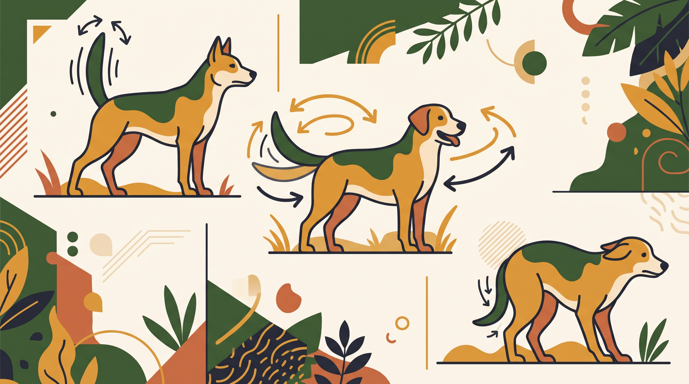

# **02\. Κουνάει την ουρά του: Σημαίνει πάντα ότι είναι χαρούμενος; (Ο μεγαλύτερος μύθος)**

**Κατηγορία:** 03 - Πώς Εκφράζονται τα Σκυλιά (Γλώσσα Σώματος & Σήματα Ηρεμίας)  
**Προτεινόμενο URL:** /blog/ti-simainei-otan-kounaei-tin-oura-o-skylos  
**Χρόνος ανάγνωσης:** 2 λεπτά

**Με μια ματιά (TL;DR)**

> * Κινούμενη ουρά δεν σημαίνει αυτόματα χαρά ή ασφάλεια.
> * Κοιτάμε σώμα, πρόσωπο, κίνηση και πλαίσιο.
> * Δεν πλησιάζουμε άγνωστο σκύλο βασιζόμενοι μόνο στην ουρά.

## **Ένα μόνο κομμάτι της εικόνας**

Ύψος, ακαμψία και ρυθμός μπορεί να δίνουν πληροφορίες για διέγερση. Όμως η φυσική θέση διαφέρει ανά ανατομία. Μια κοντή ή κυρτή ουρά δεν διαβάζεται όπως μια μακριά, χαμηλή ουρά.

Χαλαρές καμπύλες στο σώμα και εθελοντική προσέγγιση διαφέρουν από άκαμπτη στάση με επίμονο βλέμμα, ακόμη κι αν και στις δύο περιπτώσεις η ουρά κινείται. Δεν χρησιμοποιούμε την κατεύθυνση του κουνήματος ως τεστ ασφάλειας.

## **Πριν επιτρέψετε επαφή**

1. **Ρωτήστε τον κηδεμόνα:** Μπορεί να γνωρίζει φόβο, πόνο ή ανάγκη αποστάσεων.
2. **Παρατηρήστε τον χώρο:** Υπάρχει διαδρομή απομάκρυνσης ή ο σκύλος είναι εγκλωβισμένος;
3. **Μείνετε ουδέτεροι:** Μην σκύβετε από πάνω του και μην απλώνετε χέρι στη μουσούδα.
4. **Αφήστε την επιλογή:** Η προσέγγιση δεν είναι αυτόματα πρόσκληση για χάδια. Περιμένετε και κάντε σύντομη παύση αν αρχίσει επαφή.

## **Όταν τα σήματα δεν συμφωνούν**

Αν η ουρά κινείται αλλά ο σκύλος παγώνει, κλείνει απότομα το στόμα ή κοιτάζει επίμονα, αυξήστε απόσταση. Δεν χρειάζεται να αποφασίσετε πρώτα αν είναι φόβος, ενθουσιασμός ή απειλή.

Η παρατήρηση είναι εργαλείο πρόληψης, όχι εγγύηση πρόβλεψης κάθε αντίδρασης. Στις επαφές με παιδιά, η ευθύνη αξιολόγησης και διαχείρισης παραμένει στον ενήλικα. Μην ζητάτε από το παιδί να πλησιάσει για να «δούμε αν είναι φιλικός».

**Διαβάστε επίσης:** [Πρόσωπο, αυτιά και στόμα](/blog/pos-diavazoume-to-prosopo-tou-skylou).
