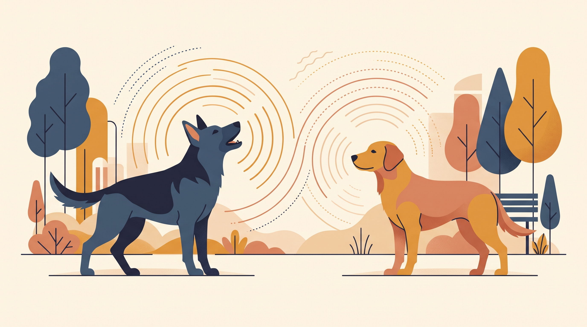

# **Πυλώνας 04: Φωνητική Έκφραση & Επικοινωνία Μεταξύ Σκύλων (Dog-to-Dog)**

**Προτεινόμενο URL:** /blog/enotita/fonitiki-ekfrasi-epikoinonia-metaxy-skylon
**Χρώμα:** #2E4D7A
**Εισαγωγή:** Πέρα από το πώς επικοινωνούν μαζί μας, τα σκυλιά έχουν έναν σύνθετο κώδικα επικοινωνίας μεταξύ τους. Αυτός ο πυλώνας βοηθά τους κηδεμόνες να καταλαβαίνουν τους ήχους του σκύλου τους και τις κοινωνικές αλληλεπιδράσεις με άλλα σκυλιά στη βόλτα και στο πάρκο.  
**Συνδεδεμένη Υπηρεσία:** /ypiresies/astiki-symviosi-ypakoi

## **Πίνακας Περιεχομένων (Άρθρα & Οδηγοί)**

> * **1\. Είναι υγιές παιχνίδι ή αρχή καβγά; 5 σημάδια για να ξεχωρίζετε πότε περνάνε καλά δύο σκυλιά**  
>   *URL:* /blog/paixnidi-skylon-i-kavgas-pos-ksexorizoume  
>   *Περιγραφή:* Υπόκλιση παιχνιδιού (play bow), εναλλαγή ρόλων, παύσεις και πότε πρέπει να παρεμβαίνουμε ήρεμα για να ρίξουμε τους τόνους.  
> * **2\. Το λεξικό των ήχων: Γάβγισμα, κλάμα, ουρλιαχτό και αναστεναγμός**  
>   *URL:* /blog/fonoitiki-epikoinonia-skylou-gavgisma-ixoi  
>   *Περιγραφή:* Πιθανές εξηγήσεις της φωνητικής έκφρασης με βάση το πλαίσιο και το σώμα, όχι μόνο τον τόνο του ήχου.  
> * **3\. Πώς «χαιρετιούνται» ευγενικά τα σκυλιά: Γιατί η προσέγγιση πρόσωπο-με-πρόσωπο στο λουρί προκαλεί καβγάδες**  
>   *URL:* /blog/pos-xairetiountai-ta-skylia-sti-volta  
>   *Περιγραφή:* Εθελοντική προσέγγιση με χώρο απομάκρυνσης και σύντομες παύσεις. Κανένας χρονικός κανόνας δεν εγγυάται ασφαλή γνωριμία.  
> * **4\. Τι είναι το Trigger Stacking (Συσσώρευση Στρες): Γιατί ο σκύλος σας «ξέσπασε» το απόγευμα για κάτι ασήμαντο**  
>   *URL:* /blog/trigger-stacking-syssorefsi-stres-skylos  
>   *Περιγραφή:* Πώς αθροίζονται τα μικρά στρεσογόνα γεγονότα της ημέρας και πώς αναγνωρίζουμε ότι το «ποτήρι» του σκύλου έχει γεμίσει.  
> * **5\. Γιατί σηκώνει τρίχες στην πλάτη (Piloerection); Σημαίνει πάντα επιθετικότητα;**  
>   *URL:* /blog/giati-o-skylos-sikonei-trixes-stin-plati  
>   *Περιγραφή:* Η βιολογική εξήγηση του αντανακλαστικού (όπως η ανατριχίλα στον άνθρωπο) που δείχνει έντονη διέγερση, έκπληξη ή αβεβαιότητα.  
> * **6\. «Νιώθει ενοχές όταν κάνει ζημιά!» Τι δείχνει πραγματικά το «ένοχο βλέμμα»**  
>   *URL:* /blog/niothei-enoxes-o-skylos-enoxo-vlemma  
>   *Περιγραφή:* Γιατί η χαμηλή στάση σώματος δεν αποδεικνύει ότι ο σκύλος κατανοεί ένα προηγούμενο λάθος όπως ένας άνθρωπος.
