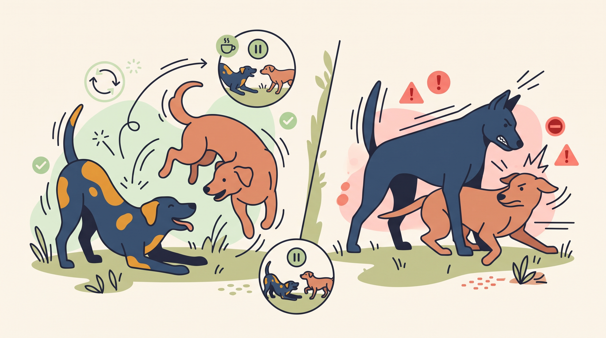

# **01\. Είναι υγιές παιχνίδι ή αρχή καβγά; 5 σημάδια για να ξεχωρίζετε πότε περνάνε καλά δύο σκυλιά**

**Κατηγορία:** 04 - Φωνητική Έκφραση & Επικοινωνία Μεταξύ Σκύλων  
**Προτεινόμενο URL:** /blog/paixnidi-skylon-i-kavgas-pos-ksexorizoume  
**Χρόνος ανάγνωσης:** 2 λεπτά

**Με μια ματιά (TL;DR)**

> * Παρατηρούμε αν συμμετέχουν άνετα και οι δύο σκύλοι.
> * Ο θόρυβος μόνος του δεν ξεχωρίζει παιχνίδι από σύγκρουση.
> * Κάνουμε παύση πριν κάποιος αναγκαστεί να αμυνθεί.

## **Πέντε χρήσιμες ενδείξεις**

1. **Χαλαρή κίνηση:** Καμπύλες και ελαστικές κινήσεις αντί για παρατεταμένη ακαμψία.
2. **Εθελοντική επιστροφή:** Μετά από διάλειμμα, και οι δύο επιλέγουν να συνεχίσουν.
3. **Παύσεις:** Υπάρχουν στιγμές απομάκρυνσης και ανάκτησης αναπνοής.
4. **Προσαρμογή έντασης:** Ο δυνατότερος σκύλος δεν πιέζει συνεχώς τον άλλον.
5. **Εναλλαγές:** Συχνά αλλάζουν ρόλους ή δραστηριότητα, χωρίς να είναι αυτό υποχρεωτικό σε κάθε παιχνίδι.

Καμία ένδειξη δεν αποτελεί εγγύηση. Μια υπόκλιση παιχνιδιού δεν ακυρώνει την αποφυγή ή την κούραση του άλλου σκύλου.

## **Πώς κάνουμε ασφαλή παύση**

Καλέστε τους χωριστά όταν ακόμη ανταποκρίνονται και απομακρυνθείτε με διαφορετικούς συνοδούς. Δώστε χώρο και χρόνο. Μην προσφέρετε φαγητό ανάμεσά τους αν μπορεί να δημιουργηθεί ανταγωνισμός.

Αν ο ένας κρύβεται, προσπαθεί να φύγει ή καταδιώκεται συνεχώς, η συνάντηση τελειώνει. Δεν τον επιστρέφουμε στο παιχνίδι για να «μάθει να υπερασπίζεται τον εαυτό του».

## **Όρια ασφάλειας**

Μεγάλη διαφορά μεγέθους μπορεί να προκαλέσει τραυματισμό ακόμη και χωρίς επιθετική πρόθεση. Επιλέξτε συμβατή παρέα και σύντομη διάρκεια.

Σε καβγά μην βάζετε χέρια ανάμεσα στα στόματα και μην πιάνετε κολάρα. Χρειάζεται σχέδιο πρόληψης με επαγγελματία, ιδιαίτερα μετά από τραυματισμό. Η επόμενη συνάντηση δεν πρέπει να γίνει αυτόματα επειδή «ηρέμησαν».

**Διαβάστε επίσης:** [Επιλεκτικότητα στις παρέες](/blog/skylos-den-thelei-na-paizei-me-alla-skylia).
