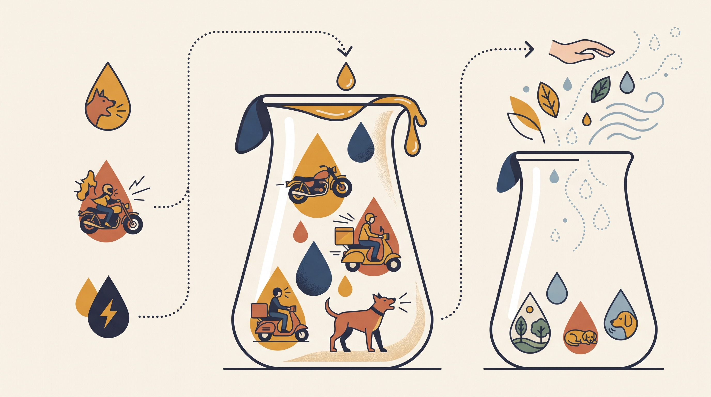

# **04\. Τι είναι το Trigger Stacking (Συσσώρευση Στρες): Γιατί ο σκύλος σας «ξέσπασε» το απόγευμα για κάτι ασήμαντο**

**Κατηγορία:** 04 - Φωνητική Έκφραση & Επικοινωνία Μεταξύ Σκύλων  
**Προτεινόμενο URL:** /blog/trigger-stacking-syssorefsi-stres-skylos  
**Χρόνος ανάγνωσης:** 2 λεπτά

**Με μια ματιά (TL;DR)**

> * Πολλά απαιτητικά γεγονότα μπορεί να μειώσουν προσωρινά την ανοχή.
> * Το τελευταίο ερέθισμα δεν εξηγεί πάντα μόνο του την αντίδραση.
> * Η αποφόρτιση δεν έχει ίδιο χρονοδιάγραμμα για όλους.

## **Τι περιγράφει το trigger stacking**

Μεταφορά, κτηνίατρος, θόρυβοι και δύσκολες συναντήσεις μπορεί να συμβούν στην ίδια ημέρα. Ένα συνηθισμένο ερέθισμα αργότερα ίσως προκαλέσει μεγαλύτερη αντίδραση από άλλες φορές.

Ο όρος είναι χρήσιμη περιγραφή, όχι μέτρηση ενός «ποτηριού στρες». Δεν γνωρίζουμε από τη συμπεριφορά ακριβή επίπεδα κορτιζόλης ούτε έναν καθολικό αριθμό ωρών μέχρι να επανέλθει.

## **Πώς μειώνουμε το φορτίο**

1. **Δείτε ολόκληρη την ημέρα:** Καταγράψτε ύπνο, δραστηριότητες και δύσκολα γεγονότα.
2. **Μην στοιβάζετε απαιτήσεις:** Μετά τον κτηνίατρο ίσως ταιριάζει ξεκούραση, όχι πολυσύχναστη καφετέρια.
3. **Δώστε εύκολες επιλογές:** Γνώριμη σύντομη διαδρομή, ήρεμο μύρισμα και άνετος χώρος ύπνου.
4. **Αξιολογήστε την επαναφορά:** Παρατηρήστε αν τρώει φυσιολογικά, ξεκουράζεται και επανέρχεται στη συνηθισμένη συμπεριφορά του.

## **Χωρίς ενοχές και χωρίς υπερβολική απομόνωση**

Μια δύσκολη ημέρα δεν σημαίνει αποτυχία εκπαίδευσης. Η παύση από απαιτητικές ασκήσεις μπορεί να είναι η κατάλληλη επιλογή. Δεν χρειάζεται όμως μόνιμη αποφυγή κάθε εμπειρίας.

Αν η ανοχή πέφτει συχνά, εξετάστε και σωματική δυσφορία, ύπνο και συνολικό περιβάλλον. Νέα έντονη αντίδραση ή επίμονη αδυναμία ανάπαυσης χρειάζεται κτηνιατρική και συμπεριφορική αξιολόγηση. Χτίζουμε ανεκτές εμπειρίες σταδιακά, όχι συνεχείς «δοκιμασίες αντοχής».

**Διαβάστε επίσης:** [Τίναγμα και μεταβάσεις συμπεριφοράς](/blog/tinagma-somatos-skylou-apovoli-stres).
