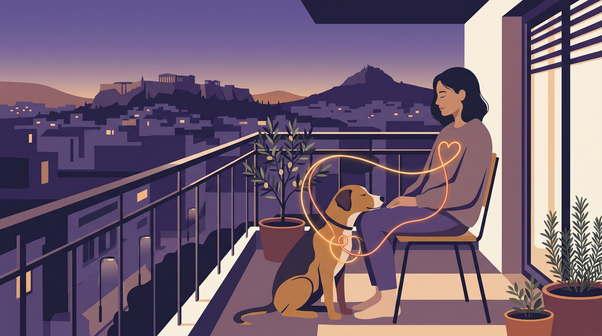

# **Πυλώνας 05: Η Ψυχολογία του Κηδεμόνα στην Πόλη**

**Εισαγωγή:** Στην άλλη άκρη του λουριού υπάρχει πάντα ένας άνθρωπος με τα δικά του συναισθήματα, άγχη και όρια. Αυτός ο πυλώνας στηρίζει ψυχολογικά τους κηδεμόνες που μεγαλώνουν απαιτητικούς ή αντιδραστικούς σκύλους στο πυκνοκατοικημένο κέντρο της Αθήνας.  
**Συνδεδεμένη Σελίδα:** /o-alexandros & /ypiresies/antimetopisi-provlimaton-symperiforas

## **Πίνακας Περιεχομένων (Άρθρα & Οδηγοί)**

> * **1\. Η Ντροπή στη Βόλτα: Πώς να διαχειριστείτε τα βλέμματα και τα σχόλια της γειτονιάς όταν ο σκύλος σας αντιδρά**  
>   *URL:* /blog/ntropi-sti-volta-antidrastikos-skylos  
>   *Περιγραφή:* Γιατί ένας σκύλος που γαβγίζει δεν σας κάνει «κακό κηδεμόνα» και πώς να εστιάζετε στις ανάγκες του σκύλου σας αγνοώντας τους αυτόκλητους κριτές.  
> * **2\. Άγχος του κηδεμόνα και λουρί: Πώς διευκολύνουμε τη βόλτα χωρίς ενοχές**  
>   *URL:* /blog/pos-to-agxos-mas-pernaei-ston-skylo-louri  
>   *Περιγραφή:* Η στάση και οι κινήσεις μας επηρεάζουν την αλληλεπίδραση, αλλά δεν είναι η μοναδική αιτία των αντιδράσεων του σκύλου.  
> * **3\. Κόπωση Συμπόνιας (Caregiver Burnout): Όταν η συμβίωση με έναν δύσκολο σκύλο σας εξαντλεί ψυχικά**  
>   *URL:* /blog/koposi-kidemona-dyskolo-skylo-burnout  
>   *Περιγραφή:* Πώς θέτουμε ρεαλιστικές προσδοκίες, γιατί επιτρέπεται να κάνουμε διαλείμματα εκπαίδευσης και πότε ζητάμε επαγγελματική καθοδήγηση.
