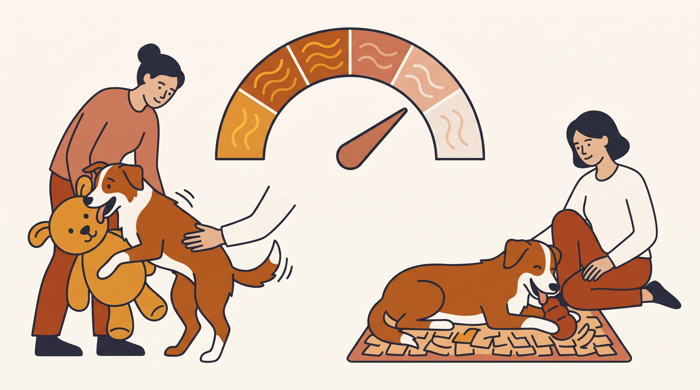

# **05\. Γιατί ο σκύλος μου «καβαλάει» (Humping) μαξιλάρια, άλλα σκυλιά ή τα πόδια των επισκεπτών;**

**Κατηγορία:** 10 - Παράξενες Συμπεριφορές & Καθημερινά Αινίγματα  
**Προτεινόμενο URL:** /blog/giati-o-skylos-kavalaei-podia-skylia  
**Χρόνος ανάγνωσης:** 2 λεπτά

**Με μια ματιά (TL;DR)**

> * Το καβάλημα μπορεί να σχετίζεται με σεξουαλική συμπεριφορά, παιχνίδι ή διέγερση.
> * Δεν αποτελεί αυτόματη απόδειξη κυριαρχίας.
> * Διακόπτουμε ήρεμα όταν ενοχλεί ή υπάρχει κίνδυνος σύγκρουσης.

## **Το πλαίσιο αλλάζει την εξήγηση**

Συμβαίνει μόνο όταν έρχονται επισκέπτες, μετά από έντονο παιχνίδι ή επίμονα μέσα στην ημέρα; Αφορά μαξιλάρι, άνθρωπο ή άλλο ζώο; Οι απαντήσεις βοηθούν να σχεδιάσουμε διαχείριση χωρίς να αποδίδουμε ένα μοναδικό κίνητρο.

Ο άλλος σκύλος δεν χρειάζεται να το ανεχτεί. Αν απομακρύνεται, παγώνει ή προσπαθεί να κρυφτεί, παρεμβαίνουμε πριν κλιμακωθεί η κατάσταση.

## **Πρακτικό πλάνο**

1. **Προλάβετε τις συνηθισμένες στιγμές:** Κάντε νωρίτερα παύση στο έντονο παιχνίδι ή οργανώστε ήρεμη υποδοχή επισκεπτών.
2. **Καλέστε σε γνώριμη εναλλακτική:** Μετακίνηση σε χαλάκι ή σύντομη ήρεμη αναζήτηση, όταν μπορεί ακόμη να ανταποκριθεί.
3. **Δημιουργήστε απόσταση:** Χρησιμοποιήστε ασφαλή χωρισμό αντί για τράβηγμα και πάλη.
4. **Ελέγξτε τις βασικές ανάγκες:** Ανάπαυση, κατάλληλη δραστηριότητα και λιγότερη συσσώρευση έντασης.

## **Πότε χρειάζεται έλεγχος**

Ξαφνική επιμονή, γλείψιμο γεννητικών οργάνων, πόνος ή δυσκολία ούρησης χρειάζονται κτηνιατρική επικοινωνία. Παρατεταμένη έκθεση ή πρήξιμο του πέους που δεν υποχωρεί απαιτεί άμεση βοήθεια.

Η στείρωση δεν εγγυάται ότι θα σταματήσει κάθε καβάλημα. Η απόφαση συζητείται με κτηνίατρο με βάση υγεία και ατομικό ιστορικό. Δεν μαλώνουμε ούτε γελάμε συνεχίζοντας μια αλληλεπίδραση που πιέζει άλλο ζώο ή άνθρωπο.

**Διαβάστε επίσης:** [Στείρωση και συμπεριφορά](/blog/steirosi-skylou-allagi-symperiforas).
