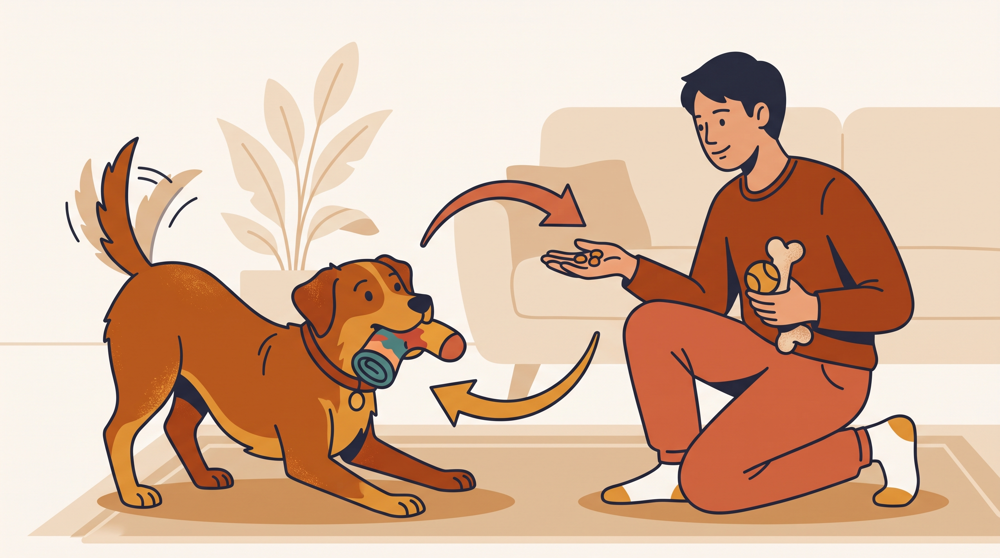

# **06\. Ο σκύλος μου κλέβει κάλτσες, παπούτσια και χαρτομάντιλα και τρέχει να τον κυνηγήσω**

**Κατηγορία:** 10 - Παράξενες Συμπεριφορές & Καθημερινά Αινίγματα  
**Προτεινόμενο URL:** /blog/skylos-klevei-kaltses-papoutsia  
**Χρόνος ανάγνωσης:** 2 λεπτά

**Με μια ματιά (TL;DR)**

> * Το κυνηγητό μπορεί να κάνει την «κλοπή» πιο ενδιαφέρουσα.
> * Η πρόληψη πρόσβασης προστατεύει από κατάποση.
> * Η ανταλλαγή διδάσκεται πρώτα με ασφαλή αντικείμενα.

## **Γιατί οι κάλτσες αποκτούν αξία**

Μυρίζουν οικεία, είναι εύκολες στη μεταφορά και συχνά προκαλούν άμεση ανθρώπινη αντίδραση. Αν κάθε εύρημα οδηγεί σε διασκεδαστικό κυνήγι, η συμπεριφορά μπορεί να επαναλαμβάνεται.

Αυτό δεν σημαίνει ότι κάθε σκύλος ζητά μόνο παιχνίδι. Αν παγώνει, απομακρύνεται έντονα ή γρυλίζει, μπορεί να φοβάται ότι θα του πάρουν τον πόρο.

## **Χτίζουμε ασφαλή ανταλλαγή**

1. **Μαζέψτε τα επικίνδυνα αντικείμενα:** Κλειστό καλάθι ρούχων, παπούτσια εκτός πρόσβασης και ασφαλισμένοι κάδοι.
2. **Εξασκηθείτε με παιχνίδι χαμηλής αξίας:** Προσφέρετε κάτι καλύτερο χωρίς να σκύβετε απειλητικά. Επιβραβεύστε όταν αφήσει το παιχνίδι.
3. **Επιστρέψτε το ασφαλές παιχνίδι συχνά:** Έτσι η προσέγγισή σας δεν σημαίνει πάντα οριστική απώλεια.
4. **Δώστε επιτρεπόμενη δραστηριότητα:** Κατάλληλο παιχνίδι μεταφοράς ή σύντομη διελκυστίνδα, χωρίς ανάγκη να κλέψει πρώτα κάτι.

## **Όταν το αντικείμενο είναι επικίνδυνο**

Μην τραβάτε ύφασμα ή κλωστή που προεξέχει από στόμα ή πρωκτό και μην προκαλείτε εμετό. Αν καταπιεί κάλτσα, μπαταρία ή άλλο επικίνδυνο αντικείμενο, καλέστε αμέσως κτηνίατρο, ακόμη κι αν φαίνεται καλά.

Σε γρύλισμα μην επιχειρείτε επανειλημμένες ανταλλαγές από κοντά. Προέχει η απόσταση και ένα εξατομικευμένο πλάνο. Η πρόληψη δεν είναι αποτυχία εκπαίδευσης, αλλά βασικό μέρος της ασφάλειας.

**Διαβάστε επίσης:** [Φύλαξη πόρων](/blog/skylos-grylizei-sto-fagito-kanape).
