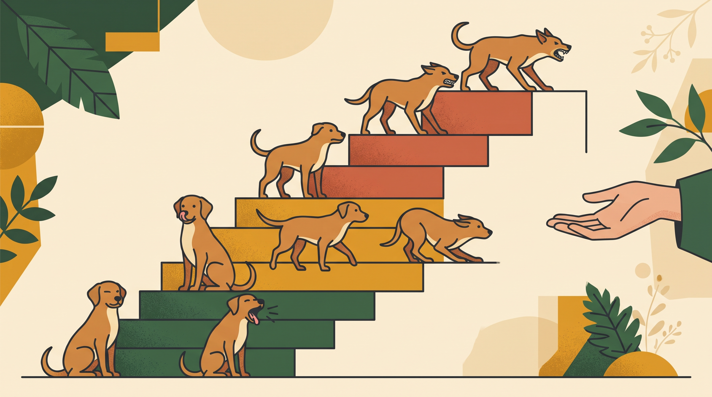

# **03\. Η κλίμακα της επιθετικότητας: Πώς αναγνωρίζουμε την κλιμάκωση της δυσφορίας**

**Κατηγορία:** 12 - Πώς Εκφράζονται τα Σκυλιά (Γλώσσα Σώματος & Σήματα Ηρεμίας)  
**Προτεινόμενο URL:** /blog/klimaka-epithetikotitas-skylou-simadia  
**Χρόνος ανάγνωσης:** 2 λεπτά

**Με μια ματιά (TL;DR)**

> * Η δυσφορία μπορεί να κλιμακώνεται από αποφυγή σε αμυντική αντίδραση.
> * Δεν εμφανίζουν όλοι οι σκύλοι τα ίδια σήματα ή την ίδια σειρά.
> * Δάγκωμα μπορεί να συμβεί χωρίς προειδοποίηση που να αντιληφθούμε.

## **Μοντέλο παρατήρησης, όχι υποχρεωτικά στάδια**

Η «κλίμακα» βοηθά να δώσουμε σημασία σε ήπιες ενδείξεις πριν η κατάσταση γίνει επικίνδυνη. Στροφή κεφαλιού, απομάκρυνση, πάγωμα, γρύλισμα και δάγκωμα δεν εμφανίζονται όμως απαραίτητα διαδοχικά.

Πόνος, αιφνιδιασμός, προηγούμενη μάθηση ή ταχύτητα του συμβάντος μπορούν να αλλάξουν την εικόνα. Δεν κατηγορούμε τον άνθρωπο ότι «σίγουρα αγνόησε τα σημάδια», ούτε θεωρούμε ασφαλή έναν σιωπηλό σκύλο.

## **Παρεμβαίνουμε νωρίς**

1. **Σταματήστε την πίεση:** Διακόψτε άγγιγμα, προσέγγιση ή χειρισμό που φαίνεται να δυσκολεύει.
2. **Δημιουργήστε χώρο:** Αφήστε έξοδο και απομακρύνετε παιδιά ή άλλα ζώα χωρίς σύγκρουση.
3. **Μην τιμωρείτε την προειδοποίηση:** Η καταστολή γρυλίσματος δεν αφαιρεί απαραίτητα την αιτία.
4. **Αλλάξτε το μελλοντικό πλαίσιο:** Χωριστοί χώροι, διαφορετική ρουτίνα και αξιολόγηση αντί για επανάληψη της ίδιας δοκιμής.

## **Μετά από επικίνδυνο περιστατικό**

Σε δάγκωμα εξασφαλίστε χωρισμό και κατάλληλη ιατρική φροντίδα. Καταγράψτε όσα θυμάστε χωρίς να αναπαραστήσετε τη σκηνή.

Ζητήστε κτηνιατρικό έλεγχο και επαγγελματική αξιολόγηση κινδύνου. Το ότι ο σκύλος επέστρεψε γρήγορα σε ήρεμη συμπεριφορά δεν καταργεί την ανάγκη πρόληψης. Η διαχείριση παραμένει απαραίτητη όσο χτίζεται ένα εξατομικευμένο πλάνο, χωρίς υποσχέσεις ότι δεν θα ξανασυμβεί.

**Διαβάστε επίσης:** [Γιατί δεν μαλώνουμε το γρύλισμα](/blog/giati-den-malonoume-skylo-pou-grylizei).
