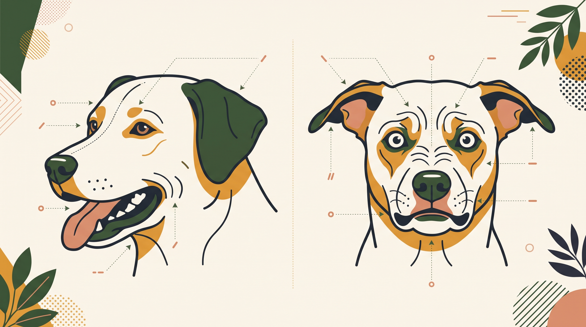

# **04\. Whale Eye (Ασπράδι ματιού), Αυτιά & Στόμα: Πώς να διαβάζετε το πρόσωπο του σκύλου σας**

**Κατηγορία:** 12 - Πώς Εκφράζονται τα Σκυλιά (Γλώσσα Σώματος & Σήματα Ηρεμίας)  
**Προτεινόμενο URL:** /blog/pos-diavazoume-to-prosopo-tou-skylou  
**Χρόνος ανάγνωσης:** 2 λεπτά

**Με μια ματιά (TL;DR)**

> * Μάτια, αυτιά και στόμα δίνουν ενδείξεις, όχι βέβαιες διαγνώσεις.
> * Συγκρίνουμε με τη συνηθισμένη έκφραση του συγκεκριμένου σκύλου.
> * Ξαφνική αλλαγή μπορεί να σχετίζεται και με σωματικό πρόβλημα.

## **Τι είναι το whale eye**

Όταν στρέφει το κεφάλι αλλά κρατά το βλέμμα σε κάτι, μπορεί να φαίνεται περισσότερο ασπράδι του ματιού. Σε ορισμένα πλαίσια αυτό συνοδεύει ένταση. Ανατομία και θέση βλέμματος επηρεάζουν επίσης την εικόνα.

Παρόμοια, αυτιά προς τα πίσω δεν σημαίνουν πάντα φόβο και ανοιχτό στόμα δεν σημαίνει πάντα «χαμόγελο». Μπορεί να υπάρχει ζέστη, άσκηση ή δυσφορία.

## **Παρατήρηση στην πράξη**

1. **Μάθετε τη συνηθισμένη έκφραση:** Παρατηρήστε τον σε ήρεμες στιγμές χωρίς να τον ενοχλείτε.
2. **Δείτε τι άλλαξε:** Έκλεισε απότομα το στόμα όταν πλησιάσατε το παιχνίδι; Σκλήρυνε το βλέμμα;
3. **Κοιτάξτε ολόκληρο το σώμα:** Πάγωμα και αποφυγή έχουν σημασία μαζί με το πρόσωπο.
4. **Μειώστε την πίεση:** Σταματήστε το άγγιγμα, απομακρυνθείτε λίγο και παρατηρήστε αν χαλαρώνει.

## **Μην κάνετε δοκιμές από κοντά**

Δεν πλησιάζουμε πρόσωπο ή κάμερα στη μουσούδα για καλύτερη εικόνα. Σε φύλαξη τροφής ή αντικειμένου, προέχει η απόσταση.

Κλείσιμο ενός ματιού, κοκκινίλα, έκκριση, ασυμμετρία προσώπου ή έντονη ενόχληση χρειάζονται κτηνιατρική επικοινωνία. Μην τα αποδίδετε απλώς σε συναίσθημα. Ειδικά σε ξαφνικό οφθαλμολογικό σύμπτωμα, η έγκαιρη εξέταση έχει σημασία.

Χρησιμοποιούμε την παρατήρηση για να προσφέρουμε άνεση, όχι για να διαβάσουμε με βεβαιότητα τη σκέψη του σκύλου.

**Διαβάστε επίσης:** [Πόνος και συμπεριφορά](/blog/ponos-kai-epithetikotita-skylou).
