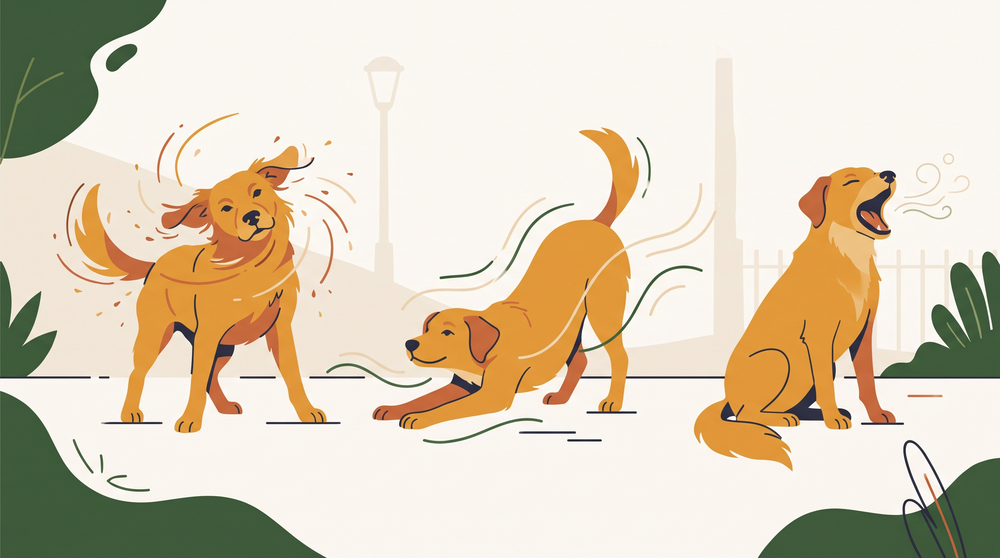

# **07\. Τίναγμα σώματος, τέντωμα και χασμουρητό: Τι μπορεί να σημαίνουν**

**Κατηγορία:** 12 - Πώς Εκφράζονται τα Σκυλιά (Γλώσσα Σώματος & Σήματα Ηρεμίας)  
**Προτεινόμενο URL:** /blog/tinagma-somatos-skylou-apovoli-stres  
**Χρόνος ανάγνωσης:** 2 λεπτά

**Με μια ματιά (TL;DR)**

> * Αυτές οι κινήσεις μπορεί να έχουν πολλούς φυσιολογικούς λόγους.
> * Μετά από ένταση είναι χρήσιμη η παρατήρηση ολόκληρης της συμπεριφοράς.
> * Δεν αποτελούν απόδειξη ότι το στρες «έφυγε» ή ότι χρειάζεται άμεση νέα έκθεση.

## **Δεν υπάρχει κουμπί επανεκκίνησης**

Τίναγμα μετά από βρέξιμο, τέντωμα μετά τον ύπνο και χασμουρητό από νύστα είναι συνηθισμένα. Οι ίδιες κινήσεις μπορεί να εμφανίζονται και σε μεταβάσεις μετά από αλληλεπίδραση.

Δεν γνωρίζουμε από μία κίνηση τι συμβαίνει στις ορμόνες ή στο νευρικό σύστημα. Η φράση «κάνει reset» είναι μεταφορά, όχι κυριολεκτική διάγνωση.

## **Τι παρατηρούμε στη βόλτα**

1. **Τι προηγήθηκε:** Έντονος χαιρετισμός, θόρυβος, άγγιγμα ή απλώς στάση μετά τον ύπνο;
2. **Πώς κινείται μετά:** Επιστρέφει σε άνετη εξερεύνηση ή παραμένει άκαμπτος και σε επιφυλακή;
3. **Αν χρειάζεται διάλειμμα:** Προσφέρετε ήσυχη διαδρομή και απόσταση, αντί για αμέσως νέα γνωριμία.
4. **Αν επαναλαμβάνεται ασυνήθιστα:** Καταγράψτε συχνότητα και συνοδά συμπτώματα χωρίς να προκαλείτε την κίνηση.

## **Πότε κοιτάμε την υγεία**

Επίμονο τίναγμα κεφαλιού μπορεί να σχετίζεται με αυτί και έντονο ξύσιμο με δέρμα. Επαναλαμβανόμενο τέντωμα μαζί με δυσφορία, εμετό ή πόνο χρειάζεται κτηνιατρική επικοινωνία.

Δεν μαλώνουμε τις κινήσεις και δεν θεωρούμε ότι ένα τίναγμα σημαίνει πως είναι έτοιμος να ανεχτεί ό,τι προηγήθηκε. Η καλύτερη απάντηση είναι συχνά μια ήρεμη παύση, παρατήρηση και προσαρμογή της επόμενης δραστηριότητας.

**Διαβάστε επίσης:** [Συσσώρευση στρες μέσα στην ημέρα](/blog/trigger-stacking-syssorefsi-stres-skylos).
