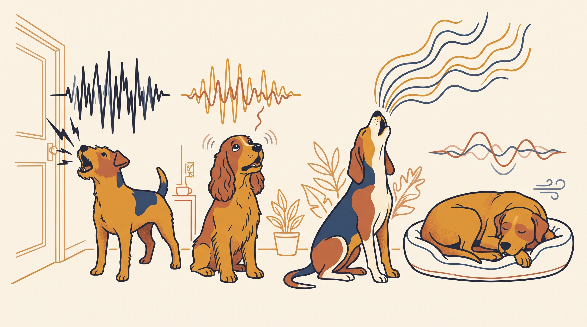

# **02\. Το λεξικό των ήχων: Γάβγισμα, κλάμα, ουρλιαχτό και αναστεναγμός**

**Κατηγορία:** 13 - Φωνητική Έκφραση & Επικοινωνία Μεταξύ Σκύλων  
**Προτεινόμενο URL:** /blog/fonoitiki-epikoinonia-skylou-gavgisma-ixoi  
**Χρόνος ανάγνωσης:** 2 λεπτά

**Με μια ματιά (TL;DR)**

> * Δεν υπάρχει μία μετάφραση για κάθε ήχο.
> * Ρυθμός, σώμα και γεγονότα γύρω του δίνουν το πλαίσιο.
> * Ξαφνική αλλαγή φωνής ή επίμονο κλάμα μπορεί να χρειάζεται κτηνίατρο.

## **Τέσσερις συνηθισμένοι ήχοι**

Το **γάβγισμα** μπορεί να αφορά ειδοποίηση, παιχνίδι, φόβο ή αναζήτηση πρόσβασης. Το **κλάμα** μπορεί να συνοδεύει προσμονή, δυσφορία ή πόνο. Το **ουρλιαχτό** μπορεί να εμφανίζεται ως ανταπόκριση σε ήχους ή στην απουσία ανθρώπου. Ο **αναστεναγμός** μπορεί να είναι απλή μετάβαση στην ανάπαυση, αλλά δεν αποδεικνύει από μόνος του ικανοποίηση.

Η ένταση και ο τόνος δεν αρκούν για ασφαλή διάγνωση. Ένας μικρός σκύλος και ένας μεγαλόσωμος παράγουν διαφορετικούς ήχους ακόμη και σε παρόμοια κατάσταση.

## **Πώς βρίσκουμε τι χρειάζεται**

1. **Καταγράψτε τι προηγείται:** Κουδούνι, προετοιμασία βόλτας, άγγιγμα ή αποχώρηση;
2. **Δείτε το σώμα:** Είναι χαλαρό, άκαμπτο, λαχανιασμένο ή σε διαρκή κίνηση;
3. **Ελέγξτε βασικές ανάγκες:** Τουαλέτα, νερό, ανάπαυση και σωματική άνεση.
4. **Αλλάξτε μία συνθήκη:** Περισσότερη απόσταση ή λιγότερος θόρυβος μπορεί να βοηθήσει να καταλάβετε το πλαίσιο.

## **Δεν αντιμετωπίζουμε όλους τους ήχους με σιωπή**

Μην χρησιμοποιείτε κολάρα αντιγαβγίσματος ή εκφοβισμό. Αν οι φωνές εμφανίζονται στην απουσία σας, μια κάμερα βοηθά στην αξιολόγηση χωρίς πρόκληση μεγάλης δοκιμαστικής απουσίας.

Βραχνάδα, δυσκολία αναπνοής, πόνος ή ασυνήθιστα επίμονο κλάμα χρειάζονται κτηνιατρική επικοινωνία. Στόχος δεν είναι ένας άφωνος σκύλος, αλλά να καλύπτεται η ανάγκη πίσω από την έκφραση.

**Διαβάστε επίσης:** [Άγχος αποχωρισμού](/blog/agxos-apoxorismou-skylos-polykatoikia).
