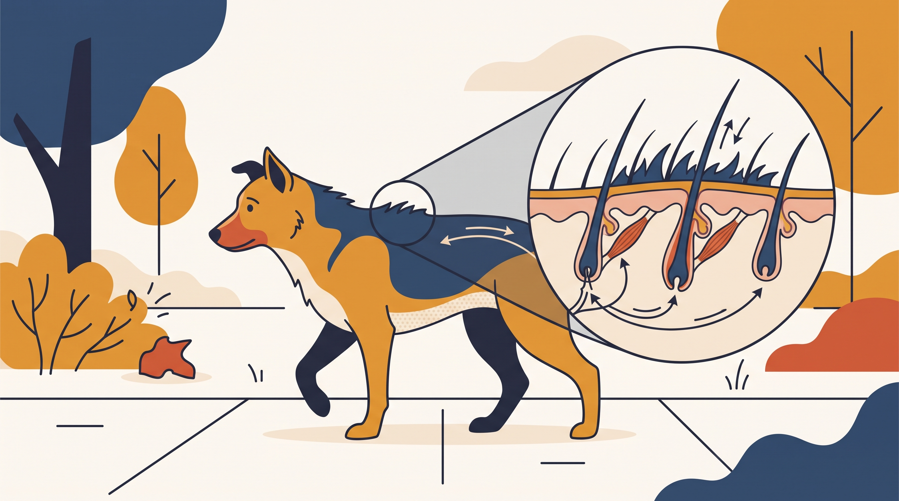

# **05\. Γιατί σηκώνει τρίχες στην πλάτη (Piloerection); Σημαίνει πάντα επιθετικότητα;**

**Κατηγορία:** 13 - Φωνητική Έκφραση & Επικοινωνία Μεταξύ Σκύλων  
**Προτεινόμενο URL:** /blog/giati-o-skylos-sikonei-trixes-stin-plati  
**Χρόνος ανάγνωσης:** 2 λεπτά

**Με μια ματιά (TL;DR)**

> * Η ανόρθωση τριχών είναι ακούσια αντίδραση.
> * Μπορεί να συνοδεύει διέγερση, έκπληξη ή δυσφορία.
> * Δεν αποδεικνύει από μόνη της επιθετική πρόθεση.

## **Τι βλέπουμε**

Οι τρίχες μπορεί να σηκωθούν στον αυχένα, κατά μήκος της πλάτης ή κοντά στην ουρά. Η ορατότητα διαφέρει ανά τρίχωμα. Το ίδιο φαινόμενο μπορεί να εμφανιστεί σε διαφορετικές κοινωνικές καταστάσεις.

Δεν χρειάζεται να αγγίξετε την πλάτη για να «κατεβάσετε» τις τρίχες. Το σημαντικό είναι τι κάνει ο σκύλος συνολικά: πλησιάζει άκαμπτα, απομακρύνεται, παίζει χαλαρά ή έχει παγώσει;

## **Ασφαλής ανταπόκριση**

1. **Παρατηρήστε το ερέθισμα:** Άγνωστος σκύλος, ξαφνικός θόρυβος ή έντονο παιχνίδι;
2. **Δώστε χώρο:** Μειώστε πίεση χωρίς τινάγματα λουριού ή φωνές.
3. **Κάντε παύση στις επαφές:** Αν υπάρχει αμφιβολία, απομακρυνθείτε πριν αυξηθεί η ένταση.
4. **Δείτε τι ακολουθεί:** Η επιστροφή σε άνετη κίνηση έχει μεγαλύτερη σημασία από το πόσο γρήγορα πέφτουν οι τρίχες.

## **Τι δεν συμπεραίνουμε**

Δεν χαρακτηρίζουμε έναν σκύλο επικίνδυνο μόνο από αυτό το σημάδι. Αντίστοιχα, δεν αγνοούμε ακαμψία και επίμονο βλέμμα επειδή «οι τρίχες σηκώνονται και στο παιχνίδι».

Σε επαναλαμβανόμενες δύσκολες συναντήσεις ζητήστε εξατομικευμένη αξιολόγηση. Αν η αλλαγή στο τρίχωμα συνοδεύεται από ερεθισμό δέρματος, πόνο ή ασυνήθιστες κινήσεις, χρειάζεται και κτηνιατρικός έλεγχος. Η παρατήρηση λειτουργεί καλύτερα όταν οδηγεί σε ασφαλέστερη επιλογή, όχι σε ταμπέλα.

**Διαβάστε επίσης:** [Κούνημα ουράς και πλαίσιο](/blog/ti-simainei-otan-kounaei-tin-oura-o-skylos).
