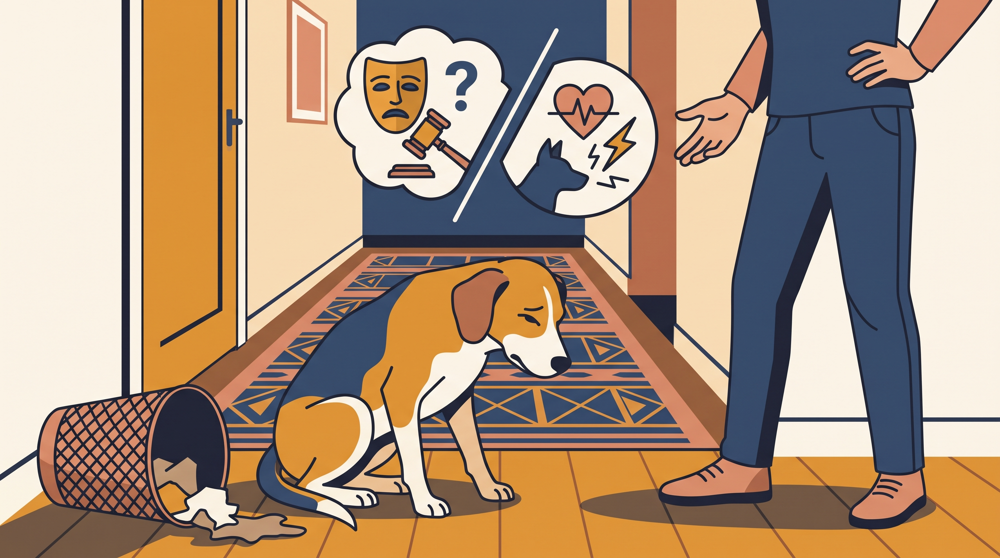

# **06\. «Νιώθει ενοχές όταν κάνει ζημιά!» Τι δείχνει πραγματικά το «ένοχο βλέμμα»**

**Κατηγορία:** 13 - Φωνητική Έκφραση & Επικοινωνία Μεταξύ Σκύλων  
**Προτεινόμενο URL:** /blog/niothei-enoxes-o-skylos-enoxo-vlemma  
**Χρόνος ανάγνωσης:** 2 λεπτά

**Με μια ματιά (TL;DR)**

> * Χαμηλό κεφάλι και αποφυγή δεν αποδεικνύουν κατανόηση ενός παλιού «λάθους».
> * Η αντίδραση μπορεί να σχετίζεται με τη στάση μας ή προηγούμενες εμπειρίες.
> * Η καθυστερημένη τιμωρία δεν διδάσκει τη συμπεριφορά που θέλουμε.

## **Τι πραγματικά γνωρίζουμε**

Βρίσκετε σκισμένο μαξιλάρι και ο σκύλος χαμηλώνει το σώμα. Είναι εύκολο να σκεφτείτε ότι «ξέρει τι έκανε». Η έκφραση όμως δεν αρκεί για τέτοιο συμπέρασμα. Μπορεί να ανταποκρίνεται στον τόνο της φωνής, την ένταση ή στη συνήθη εξέλιξη παρόμοιων σκηνών.

Δεν χρειάζεται να αποφασίσουμε αν οι σκύλοι μπορούν να έχουν κάποιο ανάλογο ανθρώπινης ενοχής για να επιλέξουμε ασφαλή διαχείριση.

## **Μετά τη ζημιά**

1. **Ελέγξτε τον κίνδυνο:** Αν λείπουν κομμάτια υφάσματος ή άλλου υλικού, επικοινωνήστε με κτηνίατρο για πιθανή κατάποση.
2. **Καθαρίστε χωρίς αντιπαράθεση:** Μην τον φέρνετε μπροστά στη ζημιά και μην φωνάζετε.
3. **Βρείτε το πλαίσιο:** Έμεινε μόνος, είχε πρόσβαση σε ακατάλληλα αντικείμενα ή έψαχνε απασχόληση;
4. **Αλλάξτε την πρόληψη:** Ασφαλής χώρος και κατάλληλες δραστηριότητες, όχι άγνωστος αυστηρός περιορισμός ως τιμωρία.

## **Αν συμβαίνει στην απουσία σας**

Παρατηρήστε με κάμερα, χωρίς να παρατείνετε σκόπιμα την απουσία για δοκιμή. Καταστροφή κοντά στην έξοδο, βηματισμός και φωνές χρειάζονται διερεύνηση πιθανής δυσφορίας αποχωρισμού.

Επιβραβεύστε τις επιθυμητές επιλογές όταν συμβαίνουν. Η μάθηση χρειάζεται καθαρή σύνδεση με την πράξη, όχι φόβο στην επιστροφή του κηδεμόνα.

**Διαβάστε επίσης:** [Άγχος αποχωρισμού](/blog/agxos-apoxorismou-skylos-polykatoikia).
