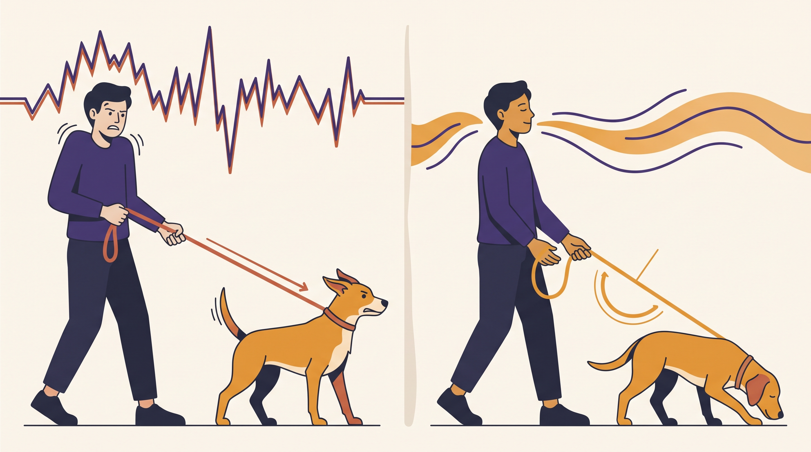

# **02\. Άγχος του κηδεμόνα και λουρί: Πώς διευκολύνουμε τη βόλτα χωρίς ενοχές**

**Κατηγορία:** 18 - Η Ψυχολογία του Κηδεμόνα στην Πόλη  
**Προτεινόμενο URL:** /blog/pos-to-agxos-mas-pernaei-ston-skylo-louri  
**Χρόνος ανάγνωσης:** 2 λεπτά

**Με μια ματιά (TL;DR)**

> * Οι κινήσεις μας επηρεάζουν την αλληλεπίδραση, αλλά δεν εξηγούν όλες τις αντιδράσεις.
> * Το λουρί δεν μεταφέρει συναισθήματα σαν «τηλεγραφικό σύρμα».
> * Στόχος είναι ασφαλής χειρισμός, όχι η υποχρέωση να είμαστε πάντα ήρεμοι.

## **Τι μπορεί να αλλάξει πρακτικά**

Αν σφίγγουμε απότομα το λουρί, σταματάμε κάθε κίνηση ή πλησιάζουμε άθελά μας ένα ερέθισμα, περιορίζουμε τις επιλογές του σκύλου. Η αλλαγή αυτών των κινήσεων μπορεί να βοηθήσει.

Αυτό δεν σημαίνει ότι ο φόβος ή η αντιδραστικότητα είναι «δικό σας άγχος». Ο σκύλος έχει δικό του ιστορικό, αισθητηριακές εμπειρίες και κατάσταση υγείας. Η ενοχοποίηση δεν είναι πλάνο εκπαίδευσης.

## **Εξάσκηση πριν τη δύσκολη στιγμή**

1. **Ελέγξτε τον εξοπλισμό:** Άνετο κράτημα και κατάλληλο μήκος, χωρίς τύλιγμα γύρω από χέρι ή σώμα.
2. **Μάθετε μια απλή αναστροφή:** Σε ήσυχο χώρο, με επιβράβευση της κοινής αλλαγής κατεύθυνσης.
3. **Επιλέξτε διαδρομές με χώρο:** Μην βασίζετε την ασφάλεια μόνο στον αυτοέλεγχο μέσα σε στενό πέρασμα.
4. **Χρησιμοποιήστε μικρή παύση:** Μια ήρεμη αναπνοή μπορεί να σας βοηθήσει να αποφασίσετε, χωρίς να καθυστερεί αναγκαία απομάκρυνση.

## **Ρεαλιστικός στόχος**

Δεν χρειάζεται να χαλαρώσετε τόσο το λουρί ώστε να κινδυνεύει να φτάσει στον δρόμο. Ασφαλές μήκος και αποφυγή περιττής τάσης μπορούν να συνυπάρχουν.

Αν η δύναμη ή οι αντιδράσεις ξεπερνούν τη δυνατότητα χειρισμού, ζητήστε επαγγελματική βοήθεια και εναλλακτική φροντίδα. Η ασφαλής οργάνωση είναι σημαντικότερη από τη συμβουλή «απλώς μην αγχώνεσαι».

**Διαβάστε επίσης:** [Βόλτα χωρίς τράβηγμα](/blog/volta-xoris-travigma-sto-louri-athina).
