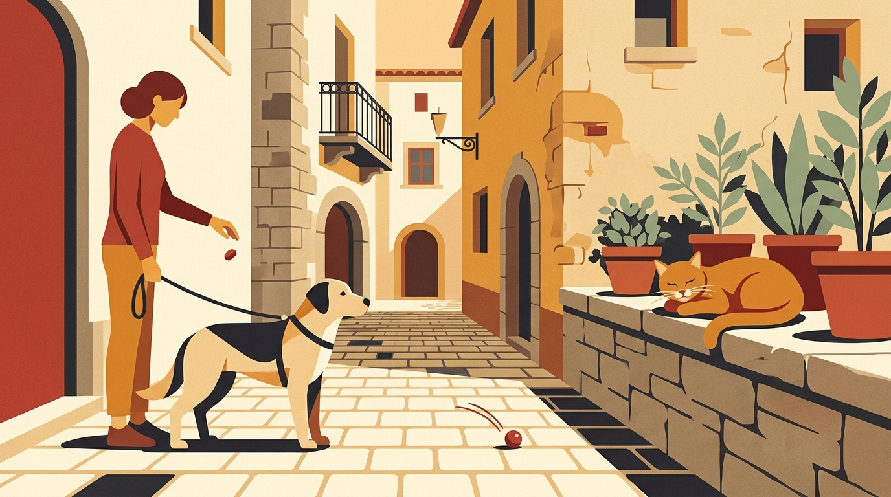

# **03\. Γάτες της γειτονιάς vs Σκύλος: Πώς να διαχειριστείτε το ένστικτο θήρευσης στα στενά της πόλης**

**Κατηγορία:** 03 \- Αντιδραστικότητα, Φοβίες & Ερεθίσματα της Πόλης  
**Προτεινόμενο URL:** /blog/skylos-kynigaei-gates-sti-volta  
**Χρόνος ανάγνωσης:** 3 λεπτά

## \---

**Με μια ματιά (TL;DR)**

> * Στην Αθήνα, οι αδέσποτες γάτες βρίσκονται σε κάθε γωνία, κάτω από κάθε αυτοκίνητο και πάνω σε κάθε κάδο.  
> * Το κυνήγι της γάτας δεν είναι «κακία», αλλά η ενεργοποίηση της **αλυσίδας θήρευσης** (Εντοπισμός → Παρατήρηση → Καταδίωξη).  
> * Αντί να μαλώνουμε τον σκύλο επειδή είδε μια γάτα, του επιτρέπουμε να την παρατηρήσει ήρεμα από απόσταση και επιβραβεύουμε την αποδέσμευση της προσοχής του.

## **Γιατί συμβαίνει αυτό; (Η λογική πίσω από τη συμπεριφορά)**

Κάθε σκύλος, ανεξαρτήτως φυλής ή μεγέθους, κουβαλάει σε μικρότερο ή μεγαλύτερο βαθμό το ένστικτο του κυνηγού. Η αλυσίδα της θήρευσης ξεκινάει με τον **εντοπισμό (orient)** και το **βλέμμα/παρατήρηση (eye/stalk)**, και στη συνέχεια περνάει στην **εκτίναξη/καταδίωξη (chase)**.  
Το μυστικό της σύγχρονης εκπαίδευσης (Predation Substitute Training) είναι απλό: αν προσπαθήσουμε να σταματήσουμε τον σκύλο *αφού* έχει ήδη αρχίσει να τρέχει και να γαβγίζει, ο εγκέφαλός του είναι πλημμυρισμένος από αδρεναλίνη και ντοπαμίνη και δεν μας ακούει. Αν όμως παρέμβουμε στο πρώτο στάδιο —όταν απλώς **κοιτάζει** τη γάτα ακίνητος— μπορούμε να τον βοηθήσουμε να πάρει μια ήρεμη απόφαση.

## **Πώς να το εφαρμόσετε στην πράξη (Βήμα-Βήμα)**

> 1. **Επιβραβεύστε την ήρεμη παρατήρηση:** Όταν ο σκύλος σας εντοπίσει μια γάτα σε ασφαλή απόσταση (π.χ. πάνω σε ένα καπό αυτοκινήτου στα 6–8 μέτρα) και «παγώσει» κοιτάζοντάς την, μην τον τραβήξετε\! Αφήστε τον να την κοιτάξει για 2 δευτερόλεπτα.  
> 2. **Διακόψτε ήρεμα πριν την έκρηξη:** Πείτε μια σταθερή λέξη επιβράβευσης (π.χ. «Ναι\!») και κυλήστε μια νόστιμη λιχουδιά στο έδαφος, προς την αντίθετη κατεύθυνση από τη γάτα.  
> 3. **Ικανοποιήστε το ένστικτο με ασφάλεια:** Το να κυνηγήσει ο σκύλος μια λιχουδιά που κυλάει στο πεζοδρόμιο (ή να ψάξει 3–4 λιχουδιές στο γρασίδι) ολοκληρώνει την αλυσίδα της θήρευσης με ασφαλή τρόπο, ρίχνοντας την ένταση.

## **Τι να κάνετε & Τι να αποφύγετε**

> * **Ναι:** Κοντύνετε ήρεμα το λουρί όταν περνάτε δίπλα από σημεία ταΐσματος γατών (αποικίες) ή πυκνούς θάμνους στις γωνίες των πολυκατοικιών.  
> * **Ναι:** Σεβαστείτε και την ασφάλεια των γατών (αλλά και των ματιών του σκύλου σας, καθώς μια εγκλωβισμένη γάτα θα αμυνθεί με τα νύχια της).  
> * **Όχι:** Μην λέτε στον σκύλο «Κοίτα τη γατούλα\!» με ενθουσιώδη φωνή αν έχει έντονο κυνηγετικό ένστικτο — έτσι του ανεβάζετε τη διέγερση στα ύψη.  
> * **Όχι:** Μην προσπαθείτε να «κρύψετε» τις γάτες τραβώντας το κεφάλι του σκύλου σας· η ήρεμη παρατήρηση από απόσταση είναι εκείνη που τον μαθαίνει να μην εντυπωσιάζεται πλέον από αυτές.

## **Μικρή Συμβουλή (Pro Tip)**

Οι γάτες που κάθονται ακίνητες είναι πολύ πιο «εύκολες» για την εκπαίδευση του σκύλου σας από τις γάτες που τρέχουν. Αξιοποιήστε τις ήρεμες, «περπατημένες» γάτες της γειτονιάς που κάθονται πάνω σε μάντρες ή αυτοκίνητα ως τους καλύτερους βοηθούς προπόνησης\!