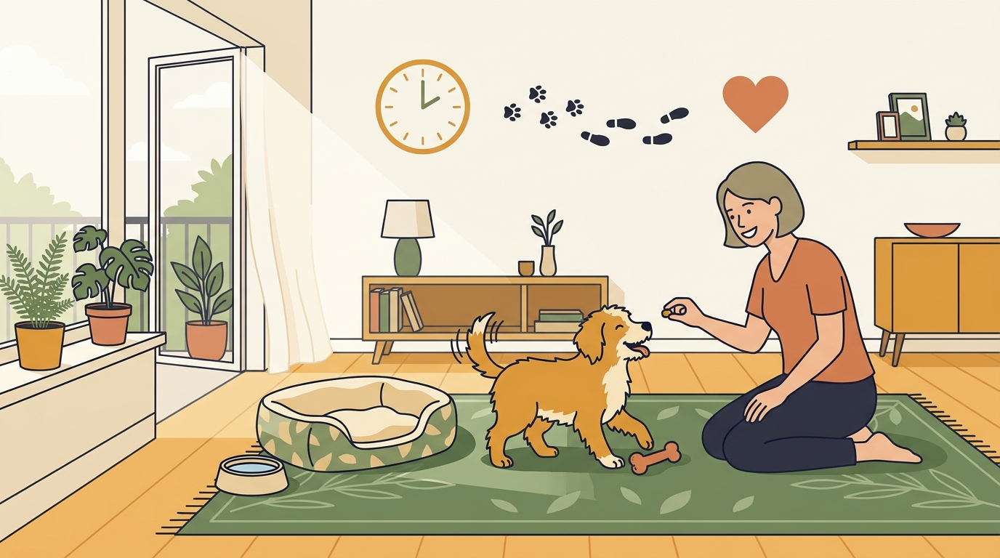

# **Πυλώνας 01: Κουτάβι στο Διαμέρισμα (Puppy Hub)**

**Προτεινόμενο URL:** /blog/enotita/koutavi-sto-diamerisma-puppy-hub
**Χρώμα:** #5A7A54
**Εισαγωγή:** Οι πρώτοι μήνες προσφέρουν σημαντικές ευκαιρίες μάθησης, χωρίς να προδικάζουν ολόκληρη τη ζωή του σκύλου. Εδώ θα βρείτε πρακτική βοήθεια για τουαλέτα, κοινωνικοποίηση, ύπνο και καθημερινή ρουτίνα στο διαμέρισμα.  
**Συνδεδεμένη Υπηρεσία:** /ypiresies/ekpaidefsi-koutaviou

## **Πίνακας Περιεχομένων (Άρθρα & Οδηγοί)**

> * **1\. Εκπαίδευση τουαλέτας κουταβιού σε διαμέρισμα: Πάνα, μπαλκόνι ή κατευθείαν έξω;**  
>   *URL:* /blog/ekpaidefsi-toualetas-koutaviou-diamerisma  
>   *Περιγραφή:* Τα πλεονεκτήματα και οι παγίδες της πάνας, το ωράριο βιολογικών αναγκών ανά ηλικία και γιατί δεν μαλώνουμε ποτέ το κουτάβι για «ατυχήματα».  
> * **2\. Το κουτάβι μου με δαγκώνει συνέχεια στα χέρια και στα πατζάκια: Πώς σταματάμε τα δαγκώματα**  
>   *URL:* /blog/koutavi-dagkonei-xeria-patzakia  
>   *Περιγραφή:* Εξήγηση της στοματικής εξερεύνησης, της ανακούφισης των ούλων και της ανακατεύθυνσης σε κατάλληλα παιχνίδια μάσησης.  
> * **3\. Κοινωνικοποίηση κουταβιού στην πόλη: Πώς να το εξοικειώσετε με θορύβους πριν ολοκληρώσει τα εμβόλια**  
>   *URL:* /blog/koinonikopoiisi-koutaviou-stin-poli  
>   *Περιγραφή:* Ελεγχόμενες, θετικές εμπειρίες πριν ολοκληρωθούν τα εμβόλια, με εξατομικευμένο κτηνιατρικό πλάνο για τη μείωση του κινδύνου λοιμώξεων.  
> * **4\. Το πρώτο βράδυ του κουταβιού στο σπίτι: Πώς να αντιμετωπίσετε το κλάμα χωρίς να το «κακομάθετε»**  
>   *URL:* /blog/proto-vrady-koutaviou-sto-spiti-klama  
>   *Περιγραφή:* Γιατί η μέθοδος «άστο να κλάψει μέχρι να σταματήσει» προκαλεί ανασφάλεια, και πώς βοηθάμε το κουτάβι να κοιμηθεί ήρεμα.  
> * **5\. Πόσο ύπνο χρειάζεται το κουτάβι και πότε η υπερένταση μοιάζει με «ανυπακοή»**  
>   *URL:* /blog/ypnos-koutaviou-yperentasi-zoomies  
>   *Περιγραφή:* Οι ανάγκες ύπνου διαφέρουν. Αναγνωρίζουμε την κόπωση και οργανώνουμε διαλείμματα χωρίς να θεωρούμε κάθε zoomie ένδειξη αϋπνίας.  
> * **6\. Εφηβεία σκύλου: Γιατί ξαφνικά δυσκολεύεται με όσα είχε μάθει**  
>   *URL:* /blog/efiveia-skylou-allagi-symperiforas  
>   *Περιγραφή:* Πώς προσαρμόζουμε τις προσδοκίες και την εξάσκηση στην εφηβεία, της οποίας η διάρκεια διαφέρει ανά σκύλο.
